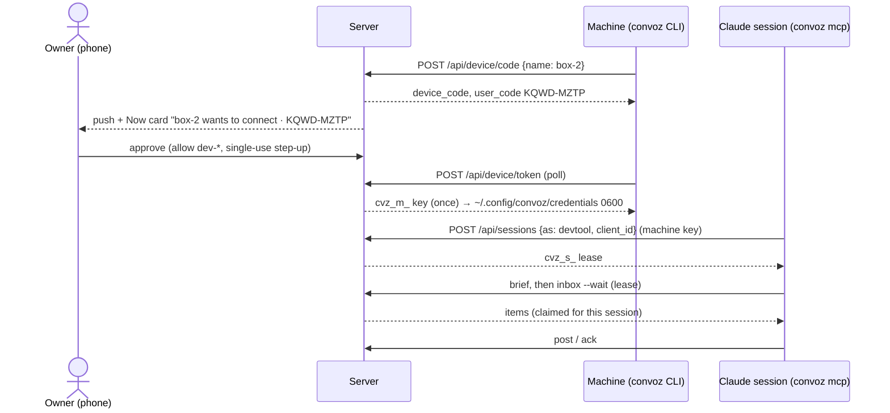

# Convoz — design draft 9

Status: draft 9, the consolidation pass. It starts from draft 8 and folds in: the devil's-advocate review of draft 8 (must-fixes M1–M8, its cut list and its should-fixes), the messages and apps spec (edits E-1…E-28 and the new invariant I-50), the owner's testing decision (Gherkin end-to-end scenarios are the specs), and picks for the 10 contradictions the spec writer found (C-1…C-10). Owner decisions override earlier drafts.
Date: 2026-10-16. Prototype: https://claude.ai/artifact/LnrYoD8h78ZA5VW13Wh9zr

Companion files, laid out as the repo will be:
- `docs/messages-apps-spec.md`: the message catalogue (10 variants, 4 modifiers, 12 system subtypes) and Tier-1/Tier-2 apps. Its §8 edits are applied here.
- `docs/testing.md`: the test strategy (Gherkin, end to end, four drivers, the parity checker).
- `specs/features/*.feature` (user-facing), `specs/contracts/*.feature` (protocol, security, invariants), `specs/stories.md`, `specs/coverage.md` (generated), `specs/scripts/check_specs.py`.
- `schemas/`: JSON Schema 2020-12 for `app.v1`, its 10 components, the Tier-2 manifest and bridge, `app-result.v1` and `system.v1`, with valid and invalid examples.

Conventions:
- **DEFAULT (owner to confirm)** marks a call made without the owner. Each one is in §17.
- `I-n` = invariant (§8). `T-n` = threat (§6). `S-n` = build slice (§16). `DA-n` / `SEC-n` = review finding on draft 7. `M-n` = must-fix from the DA review of draft 8. `E-n` = edit from the messages and apps spec. `C-n` = contradiction pick (§17).
- Times are INTEGER ms UTC. Booleans are INTEGER 0/1. All tables are `STRICT`.
- Test tokens in this doc and in all tests are fake. They contain `TESTONLY`, e.g. `cvz_m_TESTONLY0000000000000000`.

## Changelog from draft 8

| # | Change | Why |
|---|---|---|
| 1 | Inbox: a poll first re-returns the items this session already holds, with the same claim tokens and no delivery counted. | M1 |
| 2 | Items already delivered 5 times become `expired` (`deliveries`) before each claim, so one bad item never aborts a batch. | M2 |
| 3 | A claim returns a per-item `claim_token`; the ack must carry it; an old token gets 409 `claim_lost`. The exact claim, merge, extend and ack SQL is in §3.8. | M3; DA should-fix (ack SQL) |
| 4 | An expired or released claim of a conversation item merges into the ready item of that conversation, so there is never more than one ready item per conversation. | M4 |
| 5 | Any request of the claiming session (at most one write per 30 s) and every lease renewal extend its live claims. While a session holds a live claim in a conversation, no other session of the identity gets that conversation's items. | M8 |
| 6 | Re-minting with the same open `client_id` ends the old lease (`replaced`), moves its live claims to the new lease and returns a new working lease; expired-but-open rows are ended first. | M5 |
| 7 | Device flow: the approved key can be fetched again with the same device code until the request expires (10 min after approval) or the key is first used (`delivered`). | M6 |
| 8 | Brief: fixed per-section budgets with identity, handoff and asks first; the conversation section lists the top 10 plus "and K more" and pages; the brief has **no side effects**, so cut conversations come back until the agent reads them; default 12 KB; handoffs ≤4096 bytes. `agents.seen_through_message_id` and `sessions.brief_floor_message_id` are gone. | M7 |
| 9 | Cut: `inbox --follow` and `GET /api/inbox/stream` (SSE for agents); the `parked` state and `ack --parked`; the `ask_snoozed` item; `agents.inbox_floor_id`; "replace the key of an existing machine" in the device flow. | DA cut list |
| 10 | Session preference: an item goes first (for 30 s) to the session that holds the conversation's pickup, else to the one that posted there last; `convoz inbox --conv <id>`. **DEFAULT (owner to confirm).** | DA should-fix |
| 11 | Claude Code session id answered: `CLAUDE_CODE_SESSION_ID` is the `client_id` for `convoz mcp` and plain CLI calls of one Claude session; its subagents share that lease and its claims. | DA should-fix (S1 spike) |
| 12 | Device-flow flooding while the source is unknown: narrowed to a clear CLI message, "Deny all" in Now and the tailnet ACL owner step. | DA should-fix, narrowed (§18.3) |
| 13 | One conversation item per agent and conversation coalesces mentions, thread replies and activity; its reason is the highest seen (mention > thread > activity). `ask_resolved`, `membership` and `app_result` stay separate items. One item per (identity, message), precedence `app_result` > `ask_resolved` > `mention` > `thread` > `activity`. | C-10; E-19 (`ask_resolved` moved above `mention`, §3.8) |
| 14 | All 28 messages/apps edits: `app_result_json` and the via_app trigger; `uploads.kind = 'app'` and `waveform`; `answer_via` `inline`; `app_result` items and voice `not_before`; `is:app`; MCP `app_validate`/`app_build`; 4 routes; caps; `convoz app init/build/validate`; I-46 rewritten (port only; a frame that navigates is torn down); I-50 (app contract); S7 scope; contracts layout; runtime inlining; delete and purge cover the new columns; matrix rows; edit rules; push body; one plain-text projection; compact app stubs; Tier-2 frames never auto-load; SW cache for frames; the frame-leak risk; the prompt's App line; I-31; open questions Q16–Q25. | E-1…E-28 |
| 15 | Testing: Gherkin end-to-end scenarios are the only required specs. Every invariant and AC is proven by bound scenarios (`specs/coverage.md`); Go test names are optional regression aids. User-facing scenarios (`specs/features/`) are split from contract scenarios (`specs/contracts/`). §4.4 replaced; `docs/testing.md`. Changes to `.feature` files are flagged in the PR summary; no hard lock and no spec review gate. | Owner |
| 16 | The removal notice (`membership` item) is delivered even though the removed agent can no longer see the conversation; after it, nothing more. | C-1 |
| 17 | Push on `machine.requested` and on `machine.key_revealed` (the event catalogue now says so). | C-2 |
| 18 | No "answer from the CLI" in v1: `answer_via` is `inline` or `now`. | C-3 |
| 19 | The same human re-sending the same answer gets 200 no-op; any other answer to a resolved ask gets 409 with the winning choice. | C-4 |
| 20 | Snooze only on open asks (else 409 `not_open`). | C-5 |
| 21 | Ask history (`ask_transitions`) keeps who dismissed, reopened, answered or closed an ask. | C-6 |
| 22 | AC-23 (delete my data) moves to later with members (S-15); v1 proves the owner's purge. | C-7 |
| 23 | Where the M amendments and the draft-8 text disagree, the amendments win: I-37, AC-8, AC-18 and §13.2 are updated. | C-8 |
| 24 | Rail "Older" = not starred and no activity for 14 days. Snooze "Tonight" = 20:00 local the same day; it is not offered from 20:00. | C-9 |
| 25 | Draft 7 → 8 changelog removed; see draft 8. | Length |

## 0. Envelope

- 1 owner now; model ready for N humans (D4).
- Agents: up to ~100 identities, up to ~10 machines, up to ~200 live sessions. "Countless agents on a single machine" is the normal case.
- ≤50k messages/day, ≤500 asks/day, ≤10 GB blobs, design point 1M messages.
- One box, one Go process, one SQLite file. Reached only over the tailnet.
- One Go binary **`convoz`** (alias `cvz`, via `argv[0]`): `convoz serve` runs the server; all other subcommands are the agent CLI; `convoz mcp` is an MCP server for Claude Code. It shares the API types with the server.
- Agents often run on poor networks (mobile tethering, DERP relays). Every agent and client path must work with high RTT, loss and drops (§12.3).

## 1. Defaults D1–D7

| # | Decision | Pick | Why |
|---|---|---|---|
| D1 | Server | **DEFAULT (owner to confirm):** Go 1.25+, one static binary (`convoz`), stdlib `net/http`. SQLite in WAL mode with FTS5. Driver: **`github.com/ncruces/go-sqlite3`** (cgo-free, SQLite compiled to Wasm, run by wazero). Fallback: `mattn/go-sqlite3` linked to SQLCipher (cgo). | It is the only cgo-free driver with page-level encryption (the `vfs/adiantum` encrypting VFS). That gives encryption of the DB, WAL and temp files, FTS included, and keeps a static binary. S0 runs a spike with a gate: if FTS5 is missing, if the encrypted p95 misses §12 by more than 30%, or if a backup snapshot cannot be proven encrypted (§14), we switch to SQLCipher. Both sit behind `database/sql`, so the switch is one package. |
| D2 | Frontend | **DEFAULT (owner to confirm):** React + Vite + Tailwind v4, an installable PWA (§9). Zustand store, IndexedDB cache, `@tanstack/react-virtual`. Exact versions pinned in S0. | Owner's stated stack. Tier-1 app kits are React components. |
| D3 | Encryption | **DEFAULT (owner to confirm):** TLS/WireGuard in transit. At rest: page-level DB encryption (Adiantum VFS), blobs in Tink streaming AEAD, backups in `age` plus a signature. A KEK from systemd `LoadCredential` wraps the DEKs (§6). E2E is out of scope. | Covers backup leaks, file copies and stolen disks when the KEK is off the disk. Keeps server-side search, push previews and Now. |
| D4 | People model | **DEFAULT (owner to confirm):** multi-human model now (roles owner/member/guest), single-human UI. Invites later (S-15, own migration). | Avoids a later migration of every "owner-only" rule. |
| D5 | Principals | **DEFAULT (owner to confirm):** one `identities` table (`kind` human \| agent). `humans` and `agents` hang off it 1:1. Every reference uses `identity_id`. UI directory label: **"Crew"**. | Owner: "it's really identities". |
| D6 | Agent credentials | **DEFAULT (owner to confirm):** one **machine key** (`cvz_m_`) per machine, obtained by `convoz login` (a device flow, like GitHub's) and approved by the owner with a passkey. The machine lists which identities it may use. Each Claude session mints a short **session lease** (`cvz_s_`) as one identity. The key has no expiry; the owner can reveal, regenerate or revoke it in the app (§3). | Owner decisions 1, 3, 4. One secret per machine, not per agent, because one machine runs countless agents. |
| D7 | Code architecture | **DEFAULT (owner to confirm):** monorepo `drewdrewthis/convoz`, pnpm workspaces + Turborepo + `go.work`. Our own `packages/ui`. One contract package as the source of truth. Feature modules (web) and domain modules (Go) with CI boundary rules (§4). | Owner: "a UI library that we create … mono repo + features + modules". |

## 2. Principals and auth

### 2.1 Principals

| Principal | Table | How it is obtained | Credential (prefix) | Stored as |
|---|---|---|---|---|
| Human | `identities` + `humans` | WebAuthn passkey | device session cookie `__Host-convoz_sid` (`cvz_d_`) | SHA-256 |
| Human recovery | `recovery_codes` | shown once at onboarding | 10 one-time codes (`cvz_r_`, 80-bit) | SHA-256 |
| Owner break-glass | `bootstrap_links` | `convoz admin bootstrap-link` on the server box, over the admin Unix socket | one-time link token `cvz_b_`, 10 min | SHA-256 |
| Step-up | `step_ups` | a fresh passkey assertion | step-up id, single use, one action, ≤5 min | row |
| Device-flow request | `machine_requests` | `convoz login` | device code `cvz_c_` (held by the CLI only, 10 min) + user code `XXXX-XXXX` (not a secret) | SHA-256 |
| Machine | `machines` | owner approves a device-flow request | machine key `cvz_m_`, no expiry | SHA-256 lookup hash + AES-256-GCM copy (for Reveal, I-25) |
| Agent session | `sessions` | `convoz session start --as h`, or `convoz mcp` at start | session lease `cvz_s_`, ≤12 h, renewed while the key is active | SHA-256 |

- Bearer tokens are 256-bit random (recovery codes 80-bit), base62, with the prefix (for secret scanners). Rows store `hint` = prefix + 4 chars for the UI. They are opaque, not JWT, so revocation is one row update.
- The machine key is used **only** to mint session leases (`POST /api/sessions`). Every other agent request uses a lease. This keeps the long-lived secret off most requests and keeps the lease, cursor and claim machinery per session.
- Human CLI credentials are out of v1 (later: the same device flow, "log in as yourself").
- **Passkeys** (`go-webauthn/webauthn`): RP ID = the tailnet host; `userVerification=required`; resident keys preferred. First passkey: a break-glass link (§3.6).
- **Device session:** 30 d sliding, 90 d absolute. `last_seen_at` flushed ≤1/min. Cookie `Secure; HttpOnly; SameSite=Strict; Path=/`.
- **CSRF:** every cookie-auth non-GET needs the exact `Origin` (a missing `Origin` is rejected), `Content-Type: application/json` and `X-Convoz: 1`. No CORS.
- **Step-up** (SEC-1, I-26): a passkey assertion for **one named action and target**, used once, within 5 min. The client calls `POST /api/auth/step-up {action, target_id}` → options → verify → `step_up_id`; the action request sends `X-Convoz-Step-Up: <id>`; the action's tx consumes it. Required for: approve a machine request, reveal / regenerate / revoke a machine key, change a machine's allow-list, create an agent identity, disable an identity, sign out all, purge, export, delete my data, add or remove a passkey, regenerate recovery codes, invite. The **destructive** subset, refused to a passkey that is still in its 24 h hold (`passkey_too_new`), is `passkey.remove`, `recovery.regenerate`, `machine.reveal`, `machine.regenerate`, `machine.revoke`, `machine.approve` and `machine.allow`. A lease or machine key can never step up.
- **Honest limit (kept):** agents on one Unix user can read the machine credentials file. The key gives attribution per machine and stops mistakes. It does not isolate a compromised agent (T-6).

### 2.2 Scopes

| Credential | Scopes (bitmask) | Default |
|---|---|---|
| Machine (and the leases it mints) | `read`=1 `post`=2 `ask`=4 `status`=8 `upload`=16 `pickup`=32 `create_identity`=64 | all except `pickup` and `create_identity` |

A lease's scopes = its machine's scopes at mint time; a scope removed from the machine applies on the next request (the auth cache is invalidated). Routes declare the scope they need (I-6).

### 2.3 Permission matrix

Legend: ✓ allowed, ✗ denied, P = only as a participant of that conversation, S = needs a single-use step-up. "Dep." = what decides the cell: **K** kind, **R** human role, **K+R** both.

| Action | Owner | Member | Guest | Agent (lease) | Dep. |
|---|---|---|---|---|---|
| See a conversation and its messages (`canSee`) | ✓ all | P | P | P, from `joined_message_id` | K+R |
| List all conversations (admin view) | ✓ | ✗ | ✗ | ✗ | R |
| Create a conversation | ✓ | ✓ | ✗ | ✓ (≤20/day); listed participants go **pending** | K+R |
| Post a text message or thread reply | ✓ | P | P | P + `post` | K+R |
| Post an app (Tier 1 or 2) | ✗ | ✗ | ✗ | P + `post` | K |
| Send an app result (`via_app`) | ✓ | P | P | ✗ | K+R |
| Post an ask | ✗ | ✗ | ✗ | P + `ask` | K |
| Answer / dismiss / undismiss an ask | ✓ | P | ✗ | ✗ | K+R |
| Withdraw an ask | ✗ | ✗ | ✗ | asker only | K |
| Snooze an open ask (per user) | ✓ | P | P | ✗ | K |
| Add an agent at once (@mention, + Add) | ✓ | P | ✗ | ✗ (request only) | K+R |
| Request an agent add (pending) | — | — | — | P | K |
| Approve or decline a pending add | ✓ | P | ✗ | ✗ | K+R |
| Remove an agent participant | ✓ | P | ✗ | self (leave) | K+R |
| Add or remove a human participant | ✓ | ✗ | ✗ | ✗ | R |
| Edit own message (body and format only; not asks, answers, via_app or system; apps and files immutable; mentions unchanged, so no new participants, items or pushes) | ✓ | ✓ | ✓ | same, ≤24 h | K |
| Delete own message (tombstone) | ✓ | ✓ | ✓ | ✓ | — |
| Delete someone else's message | ✓ | ✗ | ✗ | ✗ | R |
| Delete a conversation (soft) / purge (hard scrub) | ✓ / ✓ S | ✗ | ✗ | ✗ | R |
| Pin, star, rail order, mute, read state | ✓ | ✓ | ✓ | read state only | K |
| Set status | ✗ | ✗ | ✗ | own + `status` | K |
| Upload a file | ✓ | P | P | P + `upload` | K+R |
| Search | ✓ | ✓ (canSee) | ✓ (canSee) | ✓ (canSee) | K |
| Inbox, brief, write a handoff | ✗ | ✗ | ✗ | own identity | K |
| Read an agent's handoffs | ✓ (Crew) | ✗ | ✗ | own identity | K+R |
| Open a conversation for pickup | ✓ | P | ✗ | ✗ | K+R |
| Pick up an open conversation | ✗ | ✗ | ✗ | `pickup` | K |
| Resume a loop-paused conversation | ✓ | P | ✗ | ✗ | K+R |
| Approve a machine request; reveal / regenerate / revoke a machine key; edit its allow-list | ✓ S | ✗ | ✗ | ✗ | R |
| Create an agent identity | ✓ S | ✗ | ✗ | via a machine with `create_identity` | K+R |
| Disable an identity | ✓ S | ✗ | ✗ | ✗ | R |
| Edit own profile (display name, description, avatar, capabilities) | ✓ | ✓ | ✓ | ✓ (never the handle) | — |
| Invite a human (later) | ✓ S | ✗ | ✗ | ✗ | R |
| Own devices, passkeys, recovery codes, settings | ✓ | ✓ | ✓ | ✗ | K |
| Workspace settings, audit, admin health | ✓ | ✗ | ✗ | ✗ | R |
| Export | ✓ S (workspace) | ✓ S (own) | ✓ S (own) | ✗ | R |
| Delete my data | workspace destroy (CLI) | ✓ S | ✓ S | ✗ | R |

Member and guest cells are **DEFAULT (owner to confirm)**. They are dormant until invites ship.

## 3. Agent identity and credentials

### 3.0 Owner decisions since draft 7

Owner said: "the "add agent" should just create a key on the fly, right? then the agent can use it forever. Via the app, I can retrieve the key and give it back to the agent if it's lost. super simple. I don't think it needs to be fancier than that, does it? tailnet is the protection, probably? simplest way forward for now?"

Owner said: "convoz should be the binary, no?"

Owner said (on a proposed device-flow login): "that's like github's. That seems interesting and fine."

Owner said: "we'll have countless agents on a single machine. A new claude session can connect as any identity, really, with the expectation that it would know its identity, be able to look up past conversations, be able to recontextualize itself"

Owner said: "connected agents will need a cli. Think of the best way to connect -- long polling? each crew member/identity automatically gets an "inbox"?"

Owner said: "I want this to work with poor connections" (with: databases, the architecture proposal, and "super fast and lightweight everywhere").

**Resulting model — DEFAULT (owner to confirm).** It keeps what the owner asked for: a simple key that works forever, can be retrieved in the app, with the tailnet as the wall. It moves the key from the agent to the **machine**, because one machine runs countless identities and any new Claude session may connect as any of them. One key per agent would mean countless secrets on one machine with no gain: they all sit in the same Unix user's files (T-6).

| Layer | What it is | Credential | Lifetime | Count |
|---|---|---|---|---|
| **Machine** | a host that runs agents (box-2, a laptop) | machine key `cvz_m_` in `~/.config/convoz/credentials` or the OS keychain | no expiry; regenerate or revoke at any time | ≤10 |
| **Identity** | who speaks: `@devtool`, with a profile, an inbox, history, handoffs | none (it is a name the machine is allowed to use) | forever (disabled, never deleted) | ≤100 |
| **Session** | one Claude session (or one script) acting as one identity on one machine | lease `cvz_s_` | ≤12 h, renewed while in use | ≤20 live per identity, ≤200 per machine |

Messages show the **identity**. The message details sheet shows the **session label and machine**. Audit always records machine and session.

### 3.1 Identity is assigned, not declared

- An identity is created by the owner (Crew → Add agent → handle + display name, step-up), or by a machine that has the `create_identity` scope (`convoz session start --as newname --create --name "New Name"`, ≤5/day per machine, shown in Crew as "created by box-2").
- "Add agent" no longer makes a key. It makes the identity and, if no machine allows it yet, offers "Allow on machine…" (adds it to a machine's list) or shows the one command for a new machine: `convoz login`.
- The credential proves which **machine** is calling; the lease says which identity the session acts as. Nothing in a request body can claim an identity; the server derives it from the lease (I-40).
- The agent may self-declare **profile metadata only**, for its own identity: display name, description, SVG avatar, capabilities (≤20 short strings). Strict schema; unknown keys → 400. ≤1 change/h. Display names are checked for confusables against every other handle and display name (I-3). The handle is immutable and is always shown next to an agent's display name.

### 3.2 Credential options

| | Draft 7: Ed25519 key per host + challenge | Owner's first idea: one reversible key per agent | **Machine key via device flow → session leases (pick)** |
|---|---|---|---|
| Steps to add an agent on a machine that is logged in | mint a code, paste a prompt, enroll | create, copy the key into the agent | **none** if the allow-list covers it (glob or "any"), else one tap |
| Countless agents on one machine | one key pair each | one key each | one key total |
| Secret enters a prompt or transcript | no (code only) | yes, unless careful | **no**: the CLI receives it directly (I-42) |
| Lost credential | re-enroll | reveal in the app | reveal in the app, or regenerate it (the new key is shown once) |
| DB leak gives a usable credential | no | yes if stored reversibly | lookup hash: no; the encrypted copy needs the KEK |
| Compromised server process (T-7) | sees only leases | sees keys | sees keys at reveal and at mint (accepted: T-7 already means full control) |
| Revoke granularity | per host | per agent | per machine (and per identity: disable) |
| Cost | challenge, signatures, rotation | lowest | device flow (~1 table, 2 routes) + allow-lists |

- Pick: machine key + leases. Ed25519 per-host keys stay a "later" upgrade (§3.9). The lease layer means the upgrade changes only `POST /api/sessions`.

### 3.3 Flows

**Login (device flow, once per machine):**
1. `convoz login [--server https://convoz.<tailnet>.ts.net] [--name box-2]` → `POST /api/device/code {name, host_info}`. The server returns `device_code` (`cvz_c_`, 256-bit, kept by the CLI), `user_code` (`XXXX-XXXX`, 8 letters from a 20-letter alphabet without look-alikes), `interval` 5 s, `expires_in` 600.
2. The CLI prints: `Approve "box-2" in Convoz. Code: KQWD-MZTP` and starts polling.
3. In the same tx the server writes `machine_requests` (pending) and the event `machine.requested.v1`. The owner gets a push "box-2 wants to connect · code KQWD-MZTP" and a card in **Now** and in **Crew → Machines**. The card shows the name, the self-reported host info (labelled "reported by the machine"), the source (tailnet node if the S1 spike passes, else "unknown"), and the age of the request.
4. The owner checks that the code matches the terminal, chooses the allowed identities (a list, glob patterns such as `dev-*`, or "any agent"; DEFAULT: the list, empty), optionally ticks "may create new identities", and approves with a single-use step-up. If more than one request is pending, the approve sheet asks the owner to **type** the code. **DEFAULT (owner to confirm).** A request cannot take an active machine's name: the sheet says "box-2 already exists: use Reveal or Regenerate on it, or revoke it first". There is no key replace inside the device flow (DA cut). Now also offers **Deny all** for the pending requests (§18.3).
5. The approve tx creates the `machines` row, generates the key, stores its SHA-256 and its AES-GCM copy, sets the request `approved` with `expires_at = approved_at + 10 min`, and writes audit + `machine.approved.v1`.
6. **Key pickup survives a lost response (M6).** While the request is `approved` and not expired, every poll `POST /api/device/token {device_code}` returns the key (decrypted from its AES-GCM copy), so a response lost on a bad link is fixed by the next poll with the same device code. The first request made with the key (`POST /api/sessions`) sets the request `delivered`. After `delivered`, and after expiry, the device code gets `expired_token`. Earlier polls get `authorization_pending`; too-fast polls get `slow_down` (+5 s); the first poll after a denial gets `access_denied`. Unknown, delivered, denied-then-retried and expired codes all get the same `expired_token` body.
7. The CLI writes `~/.config/convoz/credentials` (file 0600, directory 0700; the CLI refuses to read looser modes) or the OS keychain where one is available (`--store keychain|file`, default auto). It never prints the key.

**Session start (each Claude session):**
1. `convoz mcp` (started by Claude Code) or `convoz session start --as devtool` (or `CONVOZ_AS=devtool`) → `POST /api/sessions {as, client_id, label}` with the machine key.
2. In one tx: the key is active; the identity is an active agent, not disabled; the machine's allow-list covers it (a DB trigger, I-37); live caps hold. The server returns a lease `cvz_s_` and writes `session.started.v1`. If this request is the first one made with the key, the device-flow request becomes `delivered` (M6).
   **Re-mint with the same `client_id` (M5).** The server stores only token hashes, so it can never hand back an old lease. In the same tx it ends that client's open rows that are past `expires_at` (`expired`), ends a still-live open row (`replaced`), inserts the new session, and releases the replaced session's inbox claims (they run out at once and the next claim merges them back; the screen gets `working` false). The response is a new working lease; the old lease gets 401. A retry after a lost mint response therefore always ends with exactly one working lease.
3. `convoz mcp` keeps the lease in memory, renews it, and ends it on exit. `convoz session start` stores the lease in `~/.config/convoz/sessions/<sid>` (0600) and prints only `CONVOZ_SID=<sid>`, a local file name, not a secret. Later CLI calls take `--sid` or `CONVOZ_SID`.
   **S1 spike, answered by the DA review:** Claude Code puts `CLAUDE_CODE_SESSION_ID` in the environment of Bash and MCP subprocesses. `convoz mcp` and the CLI use it as `client_id`, so plain `convoz post` calls and the MCP tools of one Claude session share one lease. Subagents see the same id (with `CLAUDE_CODE_CHILD_SESSION=1`), so they share that lease and its claims: one Claude session is one worker. Without the variable, `convoz session start` and `CONVOZ_SID` work as above.
4. Lease TTL 12 h, renewed on use while the machine key is active. A renewal also extends the session's live claims (M8). "Live" = `last_seen_at` within 15 min.

**Reveal (lost credential, owner only, SEC-1):**
1. Crew → Machines → box-2 → "Reveal key". The app asks for a single-use step-up for `machine.reveal` on that machine.
2. `POST /api/machines/:id/reveal` with `X-Convoz-Step-Up`. One tx: consume the step-up, decrypt the AES-GCM copy (keyring purpose `machine_key`, AAD = `convoz-machine-key-v1‖machine_id‖key_version`), write an audit row and `machine.key_revealed.v1`. If the audit or event write fails, nothing is returned (fail closed).
3. The response has `Cache-Control: no-store`; the service worker never handles this route. The key is shown once with a "copy" button and the hint: "Paste into `convoz login --stdin` on the machine, never into an agent prompt."

**Regenerate / revoke (SEC-4):** one tx sets a new key (regenerate; shown once, like Reveal) or `revoked_at` (revoke), ends every lease of that machine, releases its inbox claims (the release routine of §3.8) and pickups, and writes audit + event. The auth cache is invalidated before the response returns. After commit, the hub closes that machine's SSE streams and long polls. The next request with the old key or its leases → 401.

**Disable an identity:** one tx: `disabled_at`, end every lease of that identity on every machine, close its open and dismissed asks (`agent_revoked`), release claims and pickups. Machines are not touched.

### 3.4 The tailnet wall (SEC-3)

The tailnet is the perimeter, so it must be real:
- The server listens only on a Unix socket for `tailscale serve` (DEFAULT, if the S1 spike shows `serve` can proxy to `unix:`), else on `127.0.0.1` only. It never binds a tailnet or public address.
- `Host` must be the configured name (`--host`, `convoz.<tailnet>.ts.net`; over loopback TCP also with the bound port); anything else → 421, before auth. On the unix socket `Host` stays `localhost` and `X-Forwarded-Host` must be the configured name; only there is a port stripped from it, and only the configured serve port (`--host NAME:PORT`, none for 443), any other port → 421.
- Tailscale identity headers and `X-Forwarded-For` are **never an auth input**. They are trusted only on the unix socket (mode 0600, so only `tailscaled` reaches it), where they give the rate-limit source and the display of "source"; on loopback TCP they are stripped from every request. A request that carries `Tailscale-Funnel-Request` is refused with 403 whatever the start check said.
- `Authorization`, cookies and request bodies of auth routes are never logged. A credential in a query string → 400 (and the URL is not logged).
- At boot, the server reads `tailscale serve status --json` (read-only): the top-level `AllowFunnel` map, every `Foreground` session and every `Services` entry. If funnel is on for a host:port that leads to its listen address (a web proxy or a TCP forward), it refuses to start (exit 13). Funnel on for another port does not stop it. A missing binary or an unreadable status also stops it unless `--tailscale off`.
- Owner step (not done by this design): a tailnet ACL that limits which nodes reach the server.
- Admin actions that must not be HTTP (break-glass) use a second Unix socket, `/run/convoz/admin.sock`, mode 0600, owned by the service user.
- **Needs verification (S1 spike, read-only):** `serve` → Unix socket support; that `serve` passes the original node identity; that the service user can call LocalAPI `whois` and `funnel status`. Until the whois part passes, "source" shows "unknown" (every request behind `serve` looks like loopback).

### 3.5 Loss, compromise, many machines

| Situation | What happens |
|---|---|
| Lost credential (machine rebuilt, file deleted) | Reveal the key in the app and paste it into `convoz login --stdin`, or Regenerate it (the new key is shown once; paste it the same way; the old key stops at once). History, inboxes, asks, cursors and handoffs hang off identities, not machines, so nothing is lost. |
| Many machines | One key each, unique name while active, `last_used_at` and `last_used_source`. Revoking one leaves the others working. |
| An identity used on two machines at once | Allowed. Each session has its own lease. Inbox claims, their extension and the per-conversation hold stop double handling (§3.8). |
| Suspected compromise of a machine | Regenerate (keeps the allow-list) or revoke. Then audit: "what did machine M do" = `audit WHERE machine_id = M` plus `messages` via `sessions.machine_id`. |
| Suspected compromise of an identity | Disable it (§3.3). |
| Key backup to 1Password | Not needed: the app can reveal the key. |

### 3.6 Humans: passkeys, recovery, break-glass

- One passkey per device (or synced passkeys). Onboarding asks for a **second** passkey on another device or a hardware key, and shows **10 recovery codes** once.
- A recovery code is used once. It gives a limited device session that can **only** register a new passkey: it lives 15 minutes, never slides, and is revoked by that one registration. That registration also starts a **full device session** for the new passkey (the console shows the recovery banner on it; the audit line is `device.login` with `via=recovery`, naming the new device). The new passkey is **held for 24 h**: it cannot step up for destructive actions (purge, delete my data, export, reveal, revoke, sign out all) while its `destructive_step_up_after` is in the future, and the step-up ceremony itself is refused (`passkey_too_new`). A passkey added from a device whose passkey is still held is held until the same time, so the hold cannot be laundered. The destructive actions in S1 are `passkey.remove`, `recovery.regenerate`, `machine.reveal`, `machine.regenerate`, `machine.revoke`, `machine.approve` and `machine.allow` (I-26). Every other device gets a push "Recovery code used", and "sign out all other devices" is offered. Recovery attempts are rate-limited globally (10/h), not per IP.
- Owner lockout guard: the last active owner passkey cannot be revoked (I-26); recovery codes are regenerated only with step-up.
- **Break-glass (SEC should-fix):** not an HTTP route. On the server box, `convoz admin bootstrap-link` talks to the admin socket. The server mints a one-time `cvz_b_` token (10 min) and prints `https://convoz.<tailnet>.ts.net/bootstrap#cvz_b_…`. The token is in the URL fragment, so it never reaches logs; the page posts it in the body. It allows one passkey registration and writes audit + a push to all devices. The first-ever passkey uses the same path.

### 3.7 How an agent connects



### 3.8 Agent runtime: inbox, transport, brief, handoff, setup

**Inbox (per identity, automatic).**
- Every agent identity has an inbox: `inbox_items` rows written in the same tx as the message, ask or membership change that causes them (the fan-out is ≤20 participants). Items hold ids only; content is read through canSee when an item is delivered.
- **One item per (identity, message).** When several reasons apply to one message, the strongest wins: `app_result` > `ask_resolved` > `mention` > `thread` > `activity` (E-19; `ask_resolved` sits above `mention` so a custom answer that names the asker still resolves its ask).
- **Reasons.**
  - **Conversation item** (coalesced, C-10): `mention` (the identity is @mentioned), `thread` (a reply in a thread it is involved in: root author, replied, or mentioned there), `activity` (a new main message in its conversation). There is at most **one ready conversation item per (identity, conversation)**. A new message updates it: `message_id` = the newest, `count + 1`, `mention_count + 1` for a mention, and `reason` = the highest seen (mention > thread > activity). A reply in a thread the identity is not involved in makes no item.
  - `ask_resolved`: its ask was answered, dismissed, or closed by someone else. One per transition.
  - `membership`: it was added, removed or left, a pending add it requested was approved or declined, or a pickup it held was released. One per change.
  - `app_result`: a human sent a result through one of its apps (`via_app_agent_id` = this identity). One per result, never coalesced.
- Own messages never create items for the author identity. Snoozes create no item (the brief shows snoozed asks; DA cut).
- **Voice (E-5).** An item for a message with an audio upload waits (`not_before` = now + 120 s) until the transcript is done (the transcript tx clears `not_before`) or the wait ends; the item then carries `transcript_state`.
- **Session preference (DA should-fix; DEFAULT (owner to confirm)).** Each item records `prefer_session_id`: the live session that holds the conversation's pickup, else the session of this identity that posted there last (`participants.last_post_session_id`). For 30 s after the item last changed, only that session may claim it, if it is live (seen within 2 min). After that, any session of the identity may. While a session holds a **live claim** on an item of a conversation, no other session gets that conversation's items. `convoz inbox --conv <id>` claims only one conversation's items.
- **Removal notice (C-1).** Removal or leave writes, in its tx, one `membership` item for the subject and expires its other items for that conversation (`expired_reason = 'removed'`). The notice is exempt from the canSee re-check at delivery; it carries ids and the rendered system line only. After it, the agent gets nothing more from that conversation.
- **Retention.** Acked items are deleted after 7 d. An unacked item older than 30 d becomes `expired` (`age`); `brief` reports "N items expired unread since <date>" with the conversations, and `convoz read` still shows the messages. Expired rows are deleted after 60 d. Items hold ids only, so they never depend on event retention.

**Claim, ack, extend, release: the exact SQL (M1–M4, M8, DA should-fix).** Each call is one `tx()` (`BEGIN IMMEDIATE`); `:now` comes from the platform clock; `:n` ≤ 20. Rank of a conversation reason: `mention` 3, `thread` 2, `activity` 1.

```sql
-- (1) M1: items this session already holds come back first, same tokens, no delivery counted
SELECT * FROM inbox_items
 WHERE identity_id = :iid AND state = 'claimed' AND claim_session_id = :sid AND claim_until >= :now
   AND (:conv IS NULL OR conversation_id = :conv)
 ORDER BY id LIMIT :n;

-- (2) M2: an item delivered 5 times leaves the queue before any claim; the batch never aborts
UPDATE inbox_items
   SET state = 'expired', expired_reason = 'deliveries', claim_session_id = NULL, claim_token = NULL,
       claim_until = NULL, visibility_ms = NULL, updated_at = :now
 WHERE identity_id = :iid AND deliveries >= 5
   AND (state = 'ready' OR (state = 'claimed' AND claim_until < :now));

-- (3) M4: each expired claim, in id order (rows :x), merges into the ready conversation item or becomes ready
UPDATE inbox_items AS r
   SET first_message_id = min(r.first_message_id, x.first_message_id),
       count = r.count + x.count, mention_count = r.mention_count + x.mention_count,
       reason = CASE WHEN 'mention' IN (r.reason, x.reason) THEN 'mention'
                     WHEN 'thread'  IN (r.reason, x.reason) THEN 'thread' ELSE 'activity' END,
       deliveries = max(r.deliveries, x.deliveries), updated_at = :now
  FROM inbox_items AS x
 WHERE x.id = :x AND x.reason IN ('mention','thread','activity')
   AND r.identity_id = x.identity_id AND r.conversation_id = x.conversation_id
   AND r.state = 'ready' AND r.reason IN ('mention','thread','activity');
-- changes() = 1 → DELETE FROM inbox_items WHERE id = :x;
-- changes() = 0 → UPDATE inbox_items SET state = 'ready', claim_session_id = NULL, claim_token = NULL,
--                   claim_until = NULL, visibility_ms = NULL, updated_at = :now WHERE id = :x;

-- (4) claim; one random 128-bit token per item
UPDATE inbox_items
   SET state = 'claimed', claim_session_id = :sid, claim_token = randomblob(16),
       claim_until = :now + :vis, visibility_ms = :vis, deliveries = deliveries + 1, updated_at = :now
 WHERE id IN (
   SELECT i.id FROM inbox_items i
    WHERE i.identity_id = :iid AND i.state = 'ready' AND i.deliveries < 5
      AND (i.not_before IS NULL OR i.not_before <= :now)
      AND (:conv IS NULL OR i.conversation_id = :conv)
      AND NOT EXISTS (SELECT 1 FROM inbox_items c           -- another session holds this conversation
                       WHERE c.identity_id = i.identity_id AND c.conversation_id = i.conversation_id
                         AND c.state = 'claimed' AND c.claim_until >= :now AND c.claim_session_id <> :sid)
      AND (i.prefer_session_id IS NULL OR i.prefer_session_id = :sid OR i.updated_at <= :now - 30000
           OR NOT EXISTS (SELECT 1 FROM sessions s WHERE s.id = i.prefer_session_id
                           AND s.ended_at IS NULL AND s.last_seen_at >= :now - 120000))
    ORDER BY i.id LIMIT :n_left)
 RETURNING id, claim_token, claim_until;

-- ack: the claim columns are cleared, or the claimed-state CHECK fails
UPDATE inbox_items
   SET state = 'acked', acked_at = :now, acked_by_session = :sid, claim_session_id = NULL, claim_token = NULL,
       claim_until = NULL, visibility_ms = NULL, updated_at = :now
 WHERE id = :id AND identity_id = :iid AND state = 'claimed'
   AND claim_session_id = :sid AND claim_token = :token AND claim_until >= :now;
-- changes() = 1 → ok; an ask_resolved item also sets asks.acked_at / acked_by_session in this tx.
-- changes() = 0 → 200 no-op if the row is 'acked' by this session; else 409 claim_lost.

-- extend (M8): on every lease renewal, and on any lease request at most once per 30 s per session
UPDATE inbox_items SET claim_until = min(:now + visibility_ms, :lease_expires_at), updated_at = :now
 WHERE claim_session_id = :sid AND state = 'claimed' AND claim_until >= :now;

-- release (session end, regenerate, revoke, disable): expire the session's claims, then run (3) on them
UPDATE inbox_items SET claim_until = :now - 1 WHERE claim_session_id = :sid AND state = 'claimed';
```

The fan-out in a post tx upserts the conversation item with `INSERT … ON CONFLICT (identity_id, conversation_id) WHERE state = 'ready' AND reason IN ('mention','thread','activity') DO UPDATE …` (newest `message_id`, `count + 1`, the higher reason, the new `prefer_session_id`). Delivery hydrates each item through canSee (except the removal notice) and marks an item that is no longer visible `expired` (`not_visible`). The DDL with these statements was loaded and probed (end of §7).

**Transport (no WebSockets, no SSE for agents in v1).**
- **Long poll:** `convoz inbox --wait 60` → `GET /api/inbox?wait=25&claim=20`. The server returns the held items first (1), else claims (2–4). If nothing is ready it holds the request until an item for this identity arrives or 25 s pass, then answers `200 {items: []}`. The CLI loops until its `--wait` total ends. Each hold is short enough for proxies, mobile NAT and `tailscale serve`.
- A daemon runs the same long poll in a loop; `convoz watch` prints each item as one JSON line. SSE follow is later (§3.9; DA cut).
- `convoz watch --exec` is later: it starts processes on a host, which the owner must approve. When it ships it runs argv directly, never through a shell.

**Recontextualize (M7).**
- `convoz brief` (MCP `brief`) is a read with **no side effects**: it never claims, acks or moves a marker. A lost brief response loses nothing, and overlapping sessions get the same brief.
- Budgets in bytes at the default 12 KB (`--max-bytes` scales every budget; the total is clamped to 4–64 KB). Unused budget flows to section 6, then 7.

| # | Section | Budget | When it is too long |
|---|---|---|---|
| 1 | identity and profile, this session and machine | 512 | — |
| 2 | the last handoff note (whole) and how many older ones exist | 4096 | never cut: a handoff is ≤4096 bytes |
| 3 | answers to its asks not yet acked | 1536 | newest first, "and K more" |
| 4 | its open asks (and snoozed until when) | 1024 | newest first, "and K more" |
| 5 | unread inbox: counts by reason, top 5 items | 1024 | "and K more" |
| 6 | conversations with unread messages for this identity: title, unread count, last line | 2560 | top 10 by last activity, then "and K more · convoz brief --page 2" |
| 7 | recent decisions: asks answered in its conversations in the last 7 d | 1024 | newest first |
| 8 | expired items: "N items expired unread since <date>" with the conversations | 512 | counts only |

- Section 6 uses the identity's own read cursors (§8.2). `convoz read <conv>` moves them forward to the newest main message it returned; a post moves them only when caught up (I-15). So a conversation cut from a brief stays listed until the agent reads it (M7: cut conversations come back), and `--page N` shows the next 10.
- Everything in `brief` passes canSee.
- `convoz handoff "<note>"` stores a per-identity note (≤4096 bytes UTF-8, so it always fits section 2) with session and machine. The owner and the identity's sessions can read it. The last 50 per identity are kept.
- `convoz read <conv> [--since id] [--thread root]` and `convoz search "<q>"` are canSee-limited.

**Setup.**
- `convoz setup [--as devtool] [--scope project|user]` registers `convoz mcp` as an MCP server in Claude Code. It uses `claude mcp add` when that command is present and prints the config otherwise. **S-A spike:** confirm the current Claude Code MCP config command and file locations before writing anything; never edit an unknown settings file.
- The MCP tools describe themselves (name, one-line purpose, JSON schema): `whoami`, `brief`, `inbox`, `claim`, `ack`, `read`, `search`, `post`, `reply`, `ask`, `status`, `handoff`, `profile`, `app_validate`, `app_build`. `post`, `reply` and `ask` take `app` (schema `app.v1`). Tool output never contains a key or lease (I-42).
- The agent prompt shrinks to one line: "You're @devtool on Convoz. Run convoz brief first."

### 3.9 Later (not v1)

- Ed25519 per-host keys with challenge-minted leases (draft 7 §3.2–3.3); enrollment codes; tailnet node binding (`require_node`). The lease layer makes this a change to `POST /api/sessions` only.
- HMAC chain over audit rows with a signed head shipped offsite (§18.2).
- `convoz watch --exec`; `convoz inbox --follow` (SSE for daemons; the row state, not `Last-Event-ID`, is the cursor); human CLI login (and with it `answer_via 'cli'`); agent edit and delete from the CLI/MCP; push action buttons (S-10b).

## 4. Code architecture

**DEFAULT (owner to confirm).** Repo `drewdrewthis/convoz`.

### 4.1 Layout

```
apps/
  web/        React + Vite + Tailwind v4 PWA; thin shell: router, providers, SW; composes features
  convoz/     Go: cmd/convoz (serve | CLI | mcp | admin), internal/server/<module>, internal/cli, internal/mcp
packages/
  tokens/     DTCG JSON → CSS vars, Tailwind v4 @theme CSS, TS consts; palettes, logo, gradients
  ui/         our component library (no app logic)
  markdown/   markdown + MarkdownV2 → render tree (no HTML) + plain-text projection + mentions
  app-kit/    Tier-1 mini-app components; also built into the Tier-2 sandbox runtime
  contracts/  OpenAPI 3.1 (REST) + JSON Schema 2020-12 (events, one file per type.vN; schemas/v1: app, components/*, manifest, bridge, app-result, system; settings; MCP tool schemas) + fixtures (app valid/invalid, projection)
  api-client/ generated TS client + sync engine (IndexedDB, cursor delta, optimistic sends, outbox, resumable uploads)
  config/     shared tsconfig, eslint (boundaries), vitest presets
specs/       features/*.feature (user-facing), contracts/*.feature (protocol, security, invariants), coverage.md, scripts/check_specs.py
docs/        design.md (this doc), messages-apps-spec.md, testing.md, owner-checks/
pnpm-workspace.yaml  turbo.json  go.work (apps/convoz, packages/contracts/gen/go)
```

Refinements (each with its reason):

| Item | Choice | Why |
|---|---|---|
| a11y engine under `ui` | Radix Primitives, wrapped and never re-exported | Focus traps, menus and popovers are solved problems. Wrapping lets us swap later. |
| Docs + tests for `ui` | Ladle + Playwright screenshot tests over the stories + `@axe-core/playwright` | Self-hosted visual regression. |
| Tokens build | Style Dictionary v4 (DTCG). The build runs the prototype's `contrast()` check: every text/background pair ≥ 4.5:1 in both themes, for every palette, or CI fails. | The contrast rule is enforced. |
| Contracts → code | TS: `openapi-typescript` + `openapi-fetch`. Go: `oapi-codegen`. Events: `json-schema-to-typescript`, `go-jsonschema`. Runtime validation: `santhosh-tekuri/jsonschema`. | `turbo run gen` + a CI drift check. |
| SQL in Go | `sqlc` (SQLite engine) per module over `database/sql` | Compile-checked queries; table ownership is checkable (§4.3). |
| `markdown` in Go | Go reimplements only the **projection** (plain text for FTS, mentions, links) with `goldmark` + a small MarkdownV2 tokenizer. Shared conformance fixtures `packages/markdown/fixtures/*.json`, plus a differential fuzz test of mentions between the TS and Go parsers. | Mention parsing (I-18) must agree with what the client renders. |
| Sandbox runtime | `app-kit` frame runtime on `preact/compat`, ≤40 KB gz, embedded in the `convoz` binary and inlined by `convoz app build` into each Tier-2 bundle (an upload of kind `app`, served only by `GET /api/apps/:id/frame` with the frame CSP). The CLI bundles with esbuild's Go API (DEFAULT). | The frame cannot load scripts from our origin; agents need no npm. |
| One binary, three roles | `internal/cli` and `internal/mcp` use only `packages/contracts/gen/go` + a small HTTP client; they never import `internal/server/*`. MCP: the official Go SDK (`modelcontextprotocol/go-sdk`), pinned in S0 after a check; fallback `mark3labs/mcp-go`. Keychain: `zalando/go-keyring`, with the file store as fallback (headless Linux often has no Secret Service). Brotli: `andybalholm/brotli`. | Owner: "convoz should be the binary". The CLI stays a thin client. |
| Supply chain (SEC should-fix, in S0) | pnpm `--frozen-lockfile`; install scripts off except an allow-list (`onlyBuiltDependencies`); a minimum release age where the pnpm version supports it. Go `-mod=readonly`, `govulncheck`, pinned toolchain and codegen versions. CI: Actions pinned by SHA, read-only default token, no `pull_request_target` with secrets. A test records the SHA-256 of the embedded SQLite Wasm. The nightly target-VM benchmark never touches prod data (§18.2). | "Pinned at S-U1" was too late. |

### 4.2 Feature and domain modules

Web — `apps/web/src/features/<f>/`, each exports only `index.ts`:
`auth`, `onboarding`, `rail`, `conversations`, `threads`, `composer`, `voice`, `now` (asks, pending adds, machine requests), `crew` (identities, machines, sessions), `search`, `pins-stars`, `notifications`, `settings`, `apps-host`.

Server — `apps/convoz/internal/server/<m>/` = `tables.sql`, `queries.sql` (sqlc), `commands.go` (validate + mutate inside `tx`), `events.go`, `http.go`:

| Module | Owns tables | Emits |
|---|---|---|
| `platform` (db, tx, migrate, bus, httpx, clock, ids) | `system_kv`, `consumer_offsets` | — |
| `crypto` | (keyring file) | — |
| `identity` | identities, humans, agents, agent_status, retired_handles | `identity.*`, `agent.status_changed` |
| `auth` | passkeys, devices, recovery_codes, step_ups, bootstrap_links, machines, machine_allow, machine_requests, sessions | `auth.*`, `machine.*`, `session.*` |
| `authz` | — (canSee, permission matrix; reads via the `ParticipantReader` port) | — |
| `conversation` | conversations, participants, assignments | `conversation.*`, `participant.changed` |
| `message` | messages, message_edits, mentions | `message.*`, `thread.updated` |
| `ask` | asks, ask_options, ask_snoozes | `ask.*` |
| `inbox` | inbox_items, handoffs | `handoff.created` |
| `prefs` | conversation_prefs, pins | `prefs.changed`, `pin.changed` |
| `readstate` | read_cursors, thread_reads | `read.moved` |
| `upload`, `transcript` | uploads / transcripts | `upload.transcribed` |
| `search` | messages_fts, conversations_fts (written through a port inside the message tx) | — |
| `event` | events | SSE C1, prune |
| `notify` | push_subscriptions, notifications, push_deliveries | consumer C2 |
| `settings` | workspace_settings, user_settings | `settings.changed` |
| `unfurl`, `appkit` | unfurls / — | — |
| `audit` | audit (written through a port inside each tx) | — |
| `ops` | — (backup, restore, export, delete, purge, rotate, nightly maintenance) | — |

The inbox module is `inbox` in the code (`internal/server/inbox`). Earlier drafts called it `agentrt`; the name now says what it owns. Handoffs join it in S-A.

- The owner's `rail`, `star` and `pin` stay merged into `prefs` (one row per user and conversation).
- **One tx across modules:** a command handler in module A calls `b.DoX(ctx, d db.DBTX, …)` through an interface that **A defines** (ports). `d` is the handle of the open write transaction (`tx.DBTX()` of `Writer.Tx`) or, for a read, `Reader.SQL()`; `ctx` is the context that `Writer.Tx` gave the callback, and it must be the one passed on: it carries the transaction, so a nested `Writer.Tx(ctx, …)` joins it instead of waiting for the one writer connection (a deadlock). The key is per `Writer`, so a ctx never joins a transaction of another database. Each module wraps `d` with its own sqlc `New(d)` **inside its own functions**, so no caller imports a module's `db` package, every module writes in the same transaction and one error rolls all of it back. Examples: `message.Post` calls `search.Index`, `inbox.FanOut`, `audit.Write`; `conversation.Remove` calls `ask.CloseForRemoval`, `inbox.ExpireFor`, `conversation.ReleasePickup`. Async side effects go only through events (C1, C2).
- **Composition roots:** `httpapi` and `cmd/convoz` are the only packages that import several modules. They open the `Writer.Tx` and call the modules inside it, and they implement the ports a module declares. Example: `auth.Bootstrap` (owner, passkey, codes, device, audit, events in one tx) takes the `auth.OwnerPort` and `auth.JournalPort` that `httpapi/ports.go` implements with `identity`, `audit` and `event`. A module reads another module's data only through a port it declares itself (`auth.Human` is filled from `identity` by the root). A root holds no SQL and imports no module's `db` package.

### 4.3 Boundary rules (CI)

| Rule | Tool |
|---|---|
| TS direction: `apps → features → packages`. A feature imports another feature only via its `index.ts`. `packages/*` never import `apps/*`. `ui` imports only `tokens`. | `eslint-plugin-boundaries` |
| Go: `internal/server/<m>` may import `platform`, `authz`, `crypto`, `internal/wire` and its own subpackages, plus only the interfaces it declares. `internal/cli` and `internal/mcp` never import `internal/server/*`. `time.Now`, `time.Since`, `time.Until` and `time.Sleep` appear in `internal/server` only in `platform/clock.go` (code takes a `platform.Clock`; an aliased `time` import is followed). A composition root (`httpapi`, `testroutes`) never imports a module's `<module>/db` package. | `scripts/check_go_imports.py` over `go list -json` (both tag sets); CI step `go-imports` (`make lint-boundaries` runs both checks) |
| Table ownership: every `CREATE TABLE` has an `-- owner: <module>` line, and a module's `queries/*.sql` and SQL string literals name only tables it owns (comma joins included); `httpapi` and `testroutes` hold no SQL | `scripts/check_table_ownership.py`; CI step `table-ownership` |
| Contract drift: generated code equals the committed code | `turbo run gen` + a diff check |

### 4.4 Testing (summary; the full strategy is `docs/testing.md`)

Owner said: "we want gherkin driven e2e tests. the rest are optional" and "I want to tell you the spec from a BDD user perspective, and then the rest are test that couple/match implementation details". On a spec review: "not sure it super matters".

- **The specs are Gherkin scenarios in `specs/`, and every scenario runs end to end** against the real `convoz` binary on a fresh `mktemp -d` data dir, through one of four drivers: `@browser` (Playwright; `@phone` adds 390×844), `@cli` (the binary as argv), `@mcp` (an MCP client on `convoz mcp`), `@api` (plain HTTP).
- **Two kinds of feature files.** `specs/features/` holds the **user-facing** scenarios: what Drew or an agent sees and does, in their words. `specs/contracts/` holds the **contract** scenarios that pin implementation details: status codes, headers, races, byte scans, DB probes. Both run end to end. The checker rejects routes, status codes, headers, data-file scans, database words and benchmarks in a user-facing scenario.
- **Invariants and ACs are proven by bound scenarios**, tagged `@I-n` / `@AC-n` / `@AC-Mn`. `specs/coverage.md` is generated and must show no v1 gap. The Go test names in §8 and §16 are **optional regression aids**: allowed, never required, never a gate.
- **Changing a `.feature` file is allowed in any PR.** CI lists every added, changed and removed scenario (file and title) in the PR summary so the owner sees it. There is no hard lock and no separate spec review.
- Kept: every test and job has a timeout; fake tokens only (`TESTONLY`); scratch dirs from `mktemp -d`; argv lists, never a shell; a test stops only a child it started, through its own handle, never by name or pattern; no auto-retry; the `@lossy` stall proxy; `@needs-owner` runbooks; the `testhooks` build tag and its release guard (`docs/testing.md` §5).
- Static checks stay CI checks, not specs: `go vet`, `staticcheck`, `govulncheck`, the boundary lint (§4.3), contract drift, `size-limit`, the token contrast check.

Test commands never run in a real shell: generated commands are argv lists, and `watch --exec` is not in v1.

### 4.5 Prototype → packages

Unchanged from draft 7 §4.5, except: `invPrompt()`, `copyPrompt()`, `connectAgent()` → `features/crew` (Add agent → "Allow on machine" or the `convoz login` command, and the one-line prompt); the machine-request card → `features/now`; the agent prompt's App line becomes "App: --app file.json (Tier 1: chart, table, checklist, kv, picker, form, progress, code, gallery; Tier 2: convoz app build ./dir). fallback is required."; prototype `rich` kinds map as in `docs/messages-apps-spec.md` §4.9.

## 5. Event-driven backbone

**DEFAULT (owner to confirm).** A transactional outbox, not event sourcing.

### 5.1 Commands → events

1. The API receives a **command**.
2. Before the transaction: authenticate, check scopes and rate budgets, parse and validate the payload (`app.v1` + the semantic checks for apps, I-50), compute the plain-text projection (markdown, ask, app fallback, file names; `docs/messages-apps-spec.md` §2.3; no DB write lock held).
3. `tx()`: re-check invariants against current state; write state rows, FTS rows, inbox items, the audit row (if the action is audited) and ≥1 thin `events` row. One `BEGIN IMMEDIATE`, one commit.
4. After the commit: `bus.Notify(maxSeq, identities)` wakes SSE fan-out, the push worker and any long polls of the touched identities. The response carries the resulting state and `seq`.

- State tables are the **source of truth**. Events are the change feed. Events are **thin** (DA-1): ids, enums, counters and versions only, ≤1 KB, never message bodies, titles, questions or answers. A test scans every payload for seeded text (I-23).
- `tx(ctx, func(w *Writer) error)`: one writer connection behind a mutex. The callback gets a `Writer` that exposes only DB ops. In test builds a tx open longer than 250 ms panics (I-4).
- Command idempotency (I-24): every mutating command carries `client_id`. `messages UNIQUE(author_id, client_id)` covers posts; other commands use `events.idem_key = <command>:<client_id>`, UNIQUE per actor, set on exactly one event of the command. A retry returns the stored result and writes nothing. System events (no actor) carry no `idem_key`.

### 5.2 Why not full event sourcing

Unchanged from draft 7 §5.2 (replay cost, schema evolution, deletion, single node). With thin events, deletion is even simpler: content never enters the log.

### 5.3 Consumers

| # | Consumer | Offset | Delivery | Idempotent by | Blocks pruning? |
|---|---|---|---|---|---|
| C1 | SSE fan-out to human clients | client-held `epoch:seq` | at-least-once; per event canSee and `seq ≥ participants.joined_seq`; frames hydrated from state rows | client dedupes by `seq` | no (client resyncs) |
| C2 | Push worker | `consumer_offsets('push')` | at-least-once | `notifications UNIQUE(identity_id, reason, source_seq)` | ≤1 h, then it skips and marks notifications `expired` |

- Gone from draft 7: C3 FTS (now synchronous, 24 µs/row at 1M in DA's run), C4 agent follow (now the inbox, written in the tx), C5 audit (now in the tx), C6 (later; it adds its own `consumer_offsets` value then).
- **Hydration:** C1 reads events in batches of ≤500, loads the referenced rows in one read tx (messages, asks, participants…), and renders one frame per subscriber after canSee. A deleted message hydrates to a tombstone; a purged one to a tombstone with no body. One query per batch, not per event.
- **Bus:** an in-process notifier carries `maxSeq` and the set of touched identities (for inbox long polls). Agents have no SSE stream in v1 (DA cut).
- **No Kafka/NATS/Redis.** Add a broker when: more than one server node or HA; a consumer in another process that needs durable subscriptions beyond 14 d; sustained load over ~1k events/s; or the outbox write cost shows in the §12 p95.
- **Ordering:** a single writer gives a total order by `seq`.
- **Backpressure:** each SSE stream has a 256-frame buffer. On overflow: `reset{reason:"slow"}`, close; the client resyncs (§5.5). Push lag is in `/api/admin/health` (amber at > 10k events or > 5 min).

### 5.4 Event row and catalogue

The row (DDL in §7): `seq`, `type` (`<area>.<name>.v1`), `actor_id`, `session_id`, `conversation_id`, `audience_id`, `message_id`, `payload_json` (≤1 KB, thin), `idem_key`, `created_at`. No `redacted_at`: events are immutable (a trigger rejects UPDATE); prune deletes old rows. Migration 7 creates the table with an `events_no_delete` trigger as well; S3 drops that trigger when it adds prune, and I-23 then reads "immutable, except that prune deletes old rows".

Visibility: **conv** = canSee(conversation, message) and `seq ≥ joined_seq`; **self** = `audience_id` only; **owner** = role owner; **owner+self** = owner and the subject identity's sessions.

| Type (v1) | Producer | Consumers | Payload (thin) | Visibility |
|---|---|---|---|---|
| `conversation.created` / `.updated` / `.deleted` / `.restored` | API, GC | C1 | id, changed field names, counters | conv |
| `participant.changed` | API | C1 C2 | conv, identity, status, joined_message_id, by | conv + the subject |
| `message.created` | API | C1 C2 | id, thread_root_id, broadcast, kind, mention ids, upload count | conv |
| `message.edited` / `.deleted` / `.purged` | API | C1 | id, edited_at / deleted_at | conv |
| `thread.updated` | API | C1 | root_id, reply_count, last_reply_id | conv |
| `ask.created` | API | C1 C2 | message_id, urgent | conv |
| `ask.answered` / `.dismissed` / `.reopened` / `.closed` | API, system | C1 C2 | message_id, state, chosen_kind, chosen_index, version, by, reason (the durable history is `ask_transitions`, C-6) | conv |
| `ask.acked` | API | C1 | message_id, session | owner |
| `ask.snoozed` / `.unsnoozed` / `.woke` | API, ticker | C1 C2 | message_id, until | self |
| `read.moved` | API | C1 | conv, main_id, root_id?, reply_id? | self |
| `prefs.changed` / `pin.changed` / `settings.changed` | API | C1 | conv or message_id, changed keys | self |
| `agent.status_changed` | API | C1 | agent, state | owner + co-participants |
| `recovery.regenerated` | API | C1 | identity | owner |
| `identity.created` / `.profile_changed` / `.disabled` | API | C1 | identity | owner + self (+ co-participants for profile, once members exist) |
| `machine.requested` / `.approved` / `.denied` / `.key_revealed` / `.key_regenerated` / `.revoked` / `.allow_changed` | API | C1; C2 for `requested` (reason `machine_request`) and `key_revealed` (reason `security`) (C-2) | machine or request id, by | owner |
| `session.started` / `.ended` | API | C1 | session, identity, machine, reason | owner |
| `handoff.created` | API | C1 | handoff id, identity | owner + self |
| `conversation.paused` / `.resumed` / `.pickup_opened` / `.picked_up` | API | C1 C2 | conv, streak / agent | conv |
| `auth.*` (login, login_failed, step_up, device_revoked, passkey_added, recovery_used, bootstrap_used) | API | C1 C2 (recovery_used, bootstrap_used) | device, passkey hint | self/owner |
| `upload.transcribed` | worker (its tx also re-indexes the message FTS row with the transcript and releases held inbox items) | C1 | upload, message_id | conv |

Every event name carries its version (`message.created.v1`): writers pass the full name, `event.Write` refuses one without `.vN`, and readers match on the full name. The SSE frame name drops the version (`event: message.created`).

Built so far, with their thin payloads: `message.created.v1` {id, kind, conversation_id}, `conversation.created.v1` {id, sig} (`sig` is a hash of the create request, so a replay of its client id with another title or other participants is a 409), `read.moved.v1` {main_id}, and the S1 events (`owner.created`, `passkey.added`, `identity.created`, `session.started`, `machine.*`, `recovery.used`, `passkey.removed`, all `.v1`). The rest of the catalogue above arrives with its slice.

Live-only (not stored): typing, agent `doing`/progress, app data, and `agent.working` {identity_id, handle, conversation_id, working, until?}. The frame goes only to readers who may see the conversation. `working: true` carries `until`, the end of the agent's claim (unix ms), and is sent again when a lease renewal moves it; the client hides "working" at `until`, so a claim that ends without a post or an ack clears by itself. `working: false` is sent when the agent posts, acks or ends its session. No frame is sent when a claim merely runs out.

### 5.5 Replay, gaps and resync

Unchanged from draft 7 §5.5 (`epoch:seq`, `reset`, snapshot with `as_of_seq`, `prev_seq_for_you`, cursor = highest seq scanned). Agents do not use this; they use the inbox (§3.8).

### 5.6 Retention

- Prune: events older than 14 d AND `seq ≤ offset('push')` (or older than 1 h past the push skip), in 5k-row batches; update `pruned_through`. The boundary is found by binary search on `seq` (`created_at` follows `seq` under one writer), so no `created_at` index is needed.
- There is no redaction. Delete, purge and delete-my-data change state rows only (§14).

## 6. Encryption and threat model

### 6.1 Options against threats

| Threat | FS encryption (LUKS) | Page-level DB (Adiantum VFS / SQLCipher) | App envelope | E2E |
|---|---|---|---|---|
| T-1 Disk image or VM snapshot, KEK on the same disk | ✗ | ✗ | ✗ | ✓ |
| T-2 Disk image, KEK off-disk | ✓ (if unlocked remotely) | ✓ | partial: FTS and metadata plaintext | ✓ |
| T-3 Leaked backup | ✗ | ✓ (+ `age`) | partial | ✓ |
| T-4 DB file copied by another local user | ✗ | ✓ | partial | ✓ |
| T-5 SQL read via an app bug in the live process | ✗ | ✗ | ✓ bodies only | ✓ |
| T-6 Compromised agent host or agent process | ✗ | ✗ | ✗ | ✗ |
| T-7 Compromised server process or root | ✗ | ✗ | ✗ | ✓ content, ✗ metadata |
| T-8 Network sniffing | n/a — WireGuard + TLS (`tailscale serve`); Web Push encrypted per RFC 8291 | | | |
| T-9 Disk **write** access: rollback of old pages or a VM-snapshot restore | ✗ | ✗ Adiantum (unauthenticated) / ✓ SQLCipher (per-page HMAC, but whole-file rollback still works) | ✗ | partial |

- The FTS index is pages in the same file, so page-level encryption covers it. This is the deciding factor.
- T-6 is handled by authz: canSee, scopes, allow-lists, rate limits, the loop breaker, pending adds, instant revoke. The machine key is readable by every agent process of that Unix user (honest limit, §2.1).
- T-1 is honest: with the KEK on the same disk, a full-disk thief has everything.
- T-9 (SEC should-fix, corrected from draft 7): the real risk is not page forgery (an edit randomizes a whole sector) but **rollback**: restoring old pages or an old VM snapshot can bring back a revoked machine key, device or passkey. Draft 7 said "disk write access ≈ full compromise"; that is wrong when the KEK is off-disk. v1 accepts this risk for one owner: signed backups, and the HMAC audit chain later (§3.9, §18.2).

### 6.2 Pick and key hierarchy

| Key | Where | Wraps / encrypts | Rotation |
|---|---|---|---|
| KEK (32 B) | systemd `LoadCredential` (DEFAULT, owner deploy step), read from `$CREDENTIALS_DIRECTORY`; boot refuses a missing or group/world-readable file | Wraps DEKs (AES-256-GCM, AAD = `dek_id‖purpose`) | `convoz keys rotate-kek`: rewrap the keyring, fsync, rename. Old KEKs kept until the last backup that uses them expires (35 d), then deleted. |
| Keyring | `data/keyring.json` (wrapped DEKs only) | — | — |
| DB DEK | purpose `db` | SQLite file, WAL, temp (Adiantum). `PRAGMA hexkey` right after open, never in a URI. One narrow exception: the pre-migration backup (Backups, §13) opens its destination with `hexkey` in the URI, because the online backup API takes a URI. That URI is built for that one target, is never logged, and errors are scrubbed of the key. | `convoz keys rotate-db`: maintenance mode, write a new file under the new key, verify, swap. |
| Blob DEK | purpose `blob` | Wraps a random per-file key | New DEK for new uploads; background rewrap. |
| Machine-key DEK | purpose `machine_key` | AES-256-GCM copy of each machine key; AAD = `convoz-machine-key-v1‖machine_id‖key_version`. Not Adiantum: GCM gives integrity, and the AAD stops a copy being moved to another row. | New DEK → rewrap all copies (≤10 rows). |
| Push-topic key | purpose `push_topic` | HMAC key for Web Push `Topic` values (§10.3) | Rotate with the keyring; old topics expire within 24 h. |
| VAPID key | purpose `vapid` (moved from `~/.secrets`) | ES256 signing key for Web Push; included in backups through the keyring | Rotation forces re-subscription; only on compromise. |
| Backup keys | `age` X25519 recipient and ed25519 signing key in `/etc/convoz/backup/`, root-owned, read-only to the service (it cannot swap them) | Backup tarball | Owner swaps the recipient; old backups stay readable with the old identity. |

- Blobs: Tink streaming AEAD, 1 MB segments, AAD = `uploads.public_id`. No plaintext blob ever touches disk (I-27), resumable uploads included (§12.3).
- `PRAGMA temp_store=MEMORY`, `mmap_size=0`, `secure_delete=ON` (DA-6; freed pages are zeroed before reuse).
- The service runs as a dedicated Unix user `convoz`, separate from every agent user (DEFAULT, owner deploy step).
- E2E stays out of scope (draft 7 §6.2 reasons).

## 7. Schema (migration 1)

Per user (keyed by `identity_id`): `conversation_prefs`, `pins`, `read_cursors`, `thread_reads`, `ask_snoozes`, `notifications`, `user_settings`. Per device: `push_subscriptions`, `step_ups` (device-local settings live in the client, §11). Per agent identity: `inbox_items`, `handoffs`. Shared: everything else. Identity, human and agent rows are never deleted (I-2, I-3).

Connection pragmas (every connection, I-5): `foreign_keys=ON`, `journal_mode=WAL`, `synchronous=FULL`, `busy_timeout=5000`, `temp_store=MEMORY`, `mmap_size=0`, `secure_delete=ON`, `cache_size=-65536`.

Changed in draft 9: `ask_transitions` (C-6), `participants.last_post_session_id`, the inbox claim columns (`claim_token`, `visibility_ms`, `prefer_session_id`, `not_before`, `mention_count`, `expired_reason`), `messages.app_result_json` and the via_app trigger (E-1, E-2), `uploads.kind = 'app'` and `waveform` (E-3), `answer_via` `inline | now` (E-4, C-3), `sessions.end_reason 'replaced'` (M5), the device-request expiry window (M6), handoffs in bytes (M7). Removed in draft 9: `agents.inbox_floor_id`, `agents.seen_through_message_id`, `sessions.brief_floor_message_id`, the inbox `parked` state and the `ask_snoozed` and per-root `thread` coalescing (DA cut list, C-10).

Removed from draft 7's migration 1: `enrollment_codes`, `identity_keys`, `auth_challenges`, `claims` (→ `assignments`), `invites`, `invite_conversations` (S-15 brings its own migration), `message_refs` (derived at query time), `device_settings`, `action_tokens` (S-10b), `events.redacted_at`, the `events_conv/audience/message/created` indexes, the duplicate `sessions_key` index.

```sql
-- ===== principals =====
CREATE TABLE identities (
  id            INTEGER PRIMARY KEY,
  kind          TEXT    NOT NULL CHECK (kind IN ('human','agent')),
  handle        TEXT    NOT NULL COLLATE NOCASE UNIQUE
                CHECK (length(handle) BETWEEN 2 AND 40 AND handle NOT GLOB '*[^a-z0-9-]*' AND substr(handle,1,1) GLOB '[a-z]'),
  display_name  TEXT    NOT NULL CHECK (length(display_name) BETWEEN 1 AND 80),
  display_skeleton TEXT NOT NULL,                     -- UTS-39 skeleton, lowercased (confusable check, I-3)
  avatar_letter TEXT    NOT NULL CHECK (length(avatar_letter) = 1),
  avatar_palette INTEGER NOT NULL CHECK (avatar_palette BETWEEN 0 AND 11),
  avatar_svg    TEXT    CHECK (avatar_svg IS NULL OR length(avatar_svg) <= 4096),  -- sanitized (I-32)
  created_at    INTEGER NOT NULL,
  disabled_at   INTEGER,
  UNIQUE (id, kind)                                   -- target of kind-typed FKs
) STRICT;
CREATE UNIQUE INDEX identities_display_skeleton ON identities(display_skeleton) WHERE disabled_at IS NULL;
CREATE TRIGGER identities_no_delete BEFORE DELETE ON identities BEGIN SELECT RAISE(ABORT,'identities are never deleted'); END;
CREATE TRIGGER identities_kind_immutable BEFORE UPDATE OF kind ON identities WHEN NEW.kind <> OLD.kind
  BEGIN SELECT RAISE(ABORT,'kind is immutable'); END;
CREATE TRIGGER identities_handle_only_anonymize BEFORE UPDATE OF handle ON identities
  WHEN NEW.handle <> OLD.handle AND NEW.handle <> ('deleted-' || OLD.id)
  BEGIN SELECT RAISE(ABORT,'handle is immutable'); END;
CREATE TRIGGER identities_handle_retire AFTER UPDATE OF handle ON identities WHEN NEW.handle <> OLD.handle
  BEGIN INSERT INTO retired_handles(handle, identity_id, retired_at) VALUES (OLD.handle, OLD.id, NEW.disabled_at); END;
CREATE TRIGGER identities_handle_not_retired BEFORE INSERT ON identities
  WHEN EXISTS (SELECT 1 FROM retired_handles WHERE handle = NEW.handle)
  BEGIN SELECT RAISE(ABORT,'handle was used before'); END;          -- I-3: never reused

CREATE TABLE retired_handles (
  handle      TEXT PRIMARY KEY COLLATE NOCASE,
  identity_id INTEGER NOT NULL REFERENCES identities(id),
  retired_at  INTEGER NOT NULL
) STRICT, WITHOUT ROWID;
CREATE INDEX retired_handles_identity ON retired_handles(identity_id);

CREATE TABLE humans (
  identity_id INTEGER PRIMARY KEY,
  kind        TEXT NOT NULL DEFAULT 'human' CHECK (kind = 'human'),
  role        TEXT NOT NULL CHECK (role IN ('owner','member','guest')),
  email       TEXT CHECK (email IS NULL OR length(email) <= 254),
  created_via TEXT NOT NULL CHECK (created_via IN ('bootstrap','invite')),
  FOREIGN KEY (identity_id, kind) REFERENCES identities(id, kind)
) STRICT;
CREATE UNIQUE INDEX humans_one_owner ON humans(role) WHERE role = 'owner';      -- I-1
CREATE TRIGGER humans_no_delete BEFORE DELETE ON humans BEGIN SELECT RAISE(ABORT,'humans are never deleted'); END;
CREATE TRIGGER humans_owner_role_fixed BEFORE UPDATE OF role ON humans
  WHEN NEW.role <> OLD.role AND (OLD.role = 'owner' OR NEW.role = 'owner')
  BEGIN SELECT RAISE(ABORT,'owner role cannot change'); END;          -- I-1

CREATE TABLE passkeys (
  id             INTEGER PRIMARY KEY,
  human_id       INTEGER NOT NULL REFERENCES humans(identity_id),
  credential_id  BLOB    NOT NULL UNIQUE,
  public_key     BLOB    NOT NULL,
  sign_count     INTEGER NOT NULL DEFAULT 0 CHECK (sign_count >= 0),
  aaguid         BLOB,
  backup_eligible INTEGER NOT NULL CHECK (backup_eligible IN (0,1)),
  label          TEXT    NOT NULL CHECK (length(label) BETWEEN 1 AND 60),
  registered_via TEXT    NOT NULL CHECK (registered_via IN ('bootstrap','session','recovery')),
  destructive_step_up_after INTEGER NOT NULL,           -- created_at, or created_at + 24 h for 'recovery' (I-26)
  created_at     INTEGER NOT NULL, last_used_at INTEGER, revoked_at INTEGER
) STRICT;
CREATE INDEX passkeys_human ON passkeys(human_id, revoked_at);

CREATE TABLE devices (                                   -- a human login on one browser/PWA install
  id            INTEGER PRIMARY KEY,
  human_id      INTEGER NOT NULL REFERENCES humans(identity_id),
  token_hash    BLOB    NOT NULL UNIQUE CHECK (length(token_hash) = 32),
  passkey_id    INTEGER REFERENCES passkeys(id) ON DELETE SET NULL,
  label         TEXT    NOT NULL, user_agent TEXT CHECK (length(user_agent) <= 300),
  limited       INTEGER NOT NULL DEFAULT 0 CHECK (limited IN (0,1)),   -- recovery session: register a passkey only
  created_at    INTEGER NOT NULL, last_seen_at INTEGER NOT NULL,
  expires_at    INTEGER NOT NULL, absolute_expires_at INTEGER NOT NULL,
  revoked_at    INTEGER, revoke_reason TEXT CHECK (revoke_reason IN ('logout','user','sign_out_all','passkey_revoked','expired','deleted')),
  CHECK (expires_at <= absolute_expires_at),
  CHECK ((revoked_at IS NULL) = (revoke_reason IS NULL)),
  UNIQUE (id, human_id)                                   -- target of push_subscriptions (DA-8)
) STRICT;
CREATE INDEX devices_human ON devices(human_id, revoked_at);
CREATE INDEX devices_passkey ON devices(passkey_id);

CREATE TABLE step_ups (                                  -- single use, one action (SEC-1, I-26)
  id         INTEGER PRIMARY KEY,
  device_id  INTEGER NOT NULL REFERENCES devices(id) ON DELETE CASCADE,
  passkey_id INTEGER NOT NULL REFERENCES passkeys(id) ON DELETE CASCADE,
  action     TEXT NOT NULL CHECK (action GLOB '[a-z]*.[a-z_]*' AND length(action) <= 40),
  target_id  INTEGER,
  created_at INTEGER NOT NULL, expires_at INTEGER NOT NULL,
  used_at    INTEGER,
  CHECK (expires_at > created_at AND expires_at - created_at <= 300000)
) STRICT;
CREATE INDEX step_ups_device ON step_ups(device_id);
CREATE INDEX step_ups_passkey ON step_ups(passkey_id);

CREATE TABLE recovery_codes (
  id INTEGER PRIMARY KEY,
  human_id   INTEGER NOT NULL REFERENCES humans(identity_id),
  code_hash  BLOB NOT NULL UNIQUE CHECK (length(code_hash) = 32),
  batch      INTEGER NOT NULL CHECK (batch >= 1),
  created_at INTEGER NOT NULL, used_at INTEGER, revoked_at INTEGER
) STRICT;
CREATE INDEX recovery_codes_human ON recovery_codes(human_id, used_at);

CREATE TABLE bootstrap_links (                           -- minted only over the admin Unix socket (§3.6)
  id INTEGER PRIMARY KEY,
  token_hash BLOB NOT NULL UNIQUE CHECK (length(token_hash) = 32),
  created_at INTEGER NOT NULL, expires_at INTEGER NOT NULL,
  used_at INTEGER, used_passkey_id INTEGER REFERENCES passkeys(id),
  CHECK (expires_at > created_at AND expires_at - created_at <= 600000),
  CHECK ((used_at IS NULL) = (used_passkey_id IS NULL))
) STRICT;
CREATE INDEX bootstrap_links_passkey ON bootstrap_links(used_passkey_id);

CREATE TABLE agents (
  identity_id  INTEGER PRIMARY KEY,
  kind         TEXT NOT NULL DEFAULT 'agent' CHECK (kind = 'agent'),
  description  TEXT NOT NULL DEFAULT '' CHECK (length(description) <= 80),
  capabilities_json TEXT NOT NULL DEFAULT '[]' CHECK (json_valid(capabilities_json) AND json_array_length(capabilities_json) <= 20),
  created_by_human   INTEGER REFERENCES humans(identity_id),
  created_by_machine INTEGER REFERENCES machines(id),
  profile_changed_at INTEGER,
  FOREIGN KEY (identity_id, kind) REFERENCES identities(id, kind),
  CHECK ((created_by_human IS NULL) <> (created_by_machine IS NULL))
) STRICT;
CREATE INDEX agents_created_by_human ON agents(created_by_human);
CREATE INDEX agents_created_by_machine ON agents(created_by_machine);
CREATE TRIGGER agents_no_delete BEFORE DELETE ON agents BEGIN SELECT RAISE(ABORT,'agents are never deleted'); END;

-- ===== machines and sessions =====
CREATE TABLE machines (
  id INTEGER PRIMARY KEY,
  name         TEXT NOT NULL CHECK (length(name) BETWEEN 1 AND 60 AND name NOT GLOB '*[^a-z0-9.-]*'),
  key_hash     BLOB NOT NULL UNIQUE CHECK (length(key_hash) = 32),      -- SHA-256 lookup (constant-time compare)
  key_enc      BLOB NOT NULL,                                           -- AES-256-GCM nonce‖ct‖tag, purpose machine_key (I-25)
  key_dek_id   INTEGER NOT NULL,
  key_version  INTEGER NOT NULL DEFAULT 1 CHECK (key_version >= 1),      -- +1 on regenerate; part of the AAD
  key_hint     TEXT NOT NULL CHECK (length(key_hint) <= 16),             -- 'cvz_m_' + 4 chars
  scopes       INTEGER NOT NULL CHECK (scopes BETWEEN 1 AND 127),
  allow_mode   TEXT NOT NULL DEFAULT 'list' CHECK (allow_mode IN ('list','any')),
  approved_by  INTEGER NOT NULL REFERENCES humans(identity_id),
  created_at   INTEGER NOT NULL, key_created_at INTEGER NOT NULL,
  last_used_at INTEGER, last_used_source TEXT CHECK (last_used_source IS NULL OR length(last_used_source) <= 255),  -- 'unknown' until the whois spike passes
  revoked_at   INTEGER, revoke_reason TEXT CHECK (revoke_reason IN ('user','lost','compromised')),
  CHECK ((revoked_at IS NULL) = (revoke_reason IS NULL))
) STRICT;
CREATE UNIQUE INDEX machines_name ON machines(name) WHERE revoked_at IS NULL;   -- I-33
CREATE INDEX machines_approved_by ON machines(approved_by);

CREATE TABLE machine_allow (                             -- allow_mode='list': explicit identities and globs
  id INTEGER PRIMARY KEY,
  machine_id  INTEGER NOT NULL REFERENCES machines(id) ON DELETE CASCADE,
  identity_id INTEGER REFERENCES agents(identity_id),
  glob        TEXT CHECK (glob IS NULL OR (length(glob) BETWEEN 1 AND 40 AND glob NOT GLOB '*[^a-z0-9*?-]*')),
  CHECK ((identity_id IS NULL) <> (glob IS NULL))
) STRICT;
CREATE INDEX machine_allow_machine ON machine_allow(machine_id);
CREATE UNIQUE INDEX machine_allow_identity ON machine_allow(machine_id, identity_id) WHERE identity_id IS NOT NULL;
CREATE UNIQUE INDEX machine_allow_glob ON machine_allow(machine_id, glob) WHERE glob IS NOT NULL;
CREATE INDEX machine_allow_identity_fk ON machine_allow(identity_id) WHERE identity_id IS NOT NULL;

CREATE TABLE machine_requests (                          -- device flow (I-36)
  id INTEGER PRIMARY KEY,
  device_code_hash BLOB NOT NULL UNIQUE CHECK (length(device_code_hash) = 32),
  user_code      TEXT NOT NULL CHECK (user_code GLOB '[A-Z][A-Z][A-Z][A-Z]-[A-Z][A-Z][A-Z][A-Z]'),  -- not a secret
  requested_name TEXT NOT NULL CHECK (length(requested_name) BETWEEN 1 AND 60 AND requested_name NOT GLOB '*[^a-z0-9.-]*'),
  host_info      TEXT CHECK (host_info IS NULL OR length(host_info) <= 200),   -- self-reported, shown as such
  source         TEXT NOT NULL DEFAULT 'unknown' CHECK (length(source) <= 255),
  state          TEXT NOT NULL DEFAULT 'pending' CHECK (state IN ('pending','approved','denied','delivered')),  -- expiry is by time
  created_at INTEGER NOT NULL, expires_at INTEGER NOT NULL,
  last_poll_at INTEGER, poll_count INTEGER NOT NULL DEFAULT 0,
  decided_by INTEGER REFERENCES humans(identity_id), decided_at INTEGER,
  machine_id INTEGER REFERENCES machines(id),            -- the new machine (no key replace in the device flow)
  CHECK (expires_at > created_at AND expires_at - created_at <= 1200000),    -- pending ≤10 min; approved: 10 min after approval (M6)
  CHECK (state <> 'pending' OR expires_at - created_at <= 600000),            -- a pending request lives ≤10 min
  CHECK (state = 'pending' OR expires_at <= decided_at + 600000),
  CHECK ((state = 'pending') = (decided_by IS NULL)),
  CHECK ((state IN ('approved','delivered')) = (machine_id IS NOT NULL))
) STRICT;
CREATE UNIQUE INDEX machine_requests_user_code ON machine_requests(user_code) WHERE state = 'pending';
CREATE INDEX machine_requests_pending ON machine_requests(created_at) WHERE state = 'pending';   -- Now card, ≤3 pending
CREATE INDEX machine_requests_decided_by ON machine_requests(decided_by);
CREATE INDEX machine_requests_machine ON machine_requests(machine_id);

CREATE TABLE sessions (                                  -- one Claude session acting as one identity (I-37)
  id INTEGER PRIMARY KEY,
  identity_id INTEGER NOT NULL REFERENCES agents(identity_id),
  machine_id  INTEGER NOT NULL REFERENCES machines(id),
  token_hash  BLOB NOT NULL UNIQUE CHECK (length(token_hash) = 32),
  client_id   TEXT NOT NULL CHECK (length(client_id) BETWEEN 8 AND 64),
  label       TEXT NOT NULL CHECK (length(label) <= 80),           -- e.g. "claude-code · ~/repo"
  scopes      INTEGER NOT NULL CHECK (scopes BETWEEN 1 AND 127),
  created_at  INTEGER NOT NULL, last_seen_at INTEGER NOT NULL,
  expires_at  INTEGER NOT NULL,                                     -- ≤ now + 12 h, renewed on use
  ended_at    INTEGER, end_reason TEXT CHECK (end_reason IN ('expired','idle','logout','replaced','key_regenerated','machine_revoked','identity_disabled','allow_removed')),  -- 'replaced' = re-mint with the same client_id (M5)
  CHECK ((ended_at IS NULL) = (end_reason IS NULL))
) STRICT;
CREATE UNIQUE INDEX sessions_open_client ON sessions(identity_id, machine_id, client_id) WHERE ended_at IS NULL;  -- DA-7
CREATE INDEX sessions_identity ON sessions(identity_id, ended_at, last_seen_at);   -- FK; live cap per identity; reaper
CREATE INDEX sessions_machine ON sessions(machine_id, ended_at);                   -- FK; revoke ends sessions; live cap per machine
CREATE TRIGGER sessions_identity_allowed BEFORE INSERT ON sessions               -- I-37 (DA-8)
BEGIN
  SELECT RAISE(ABORT,'identity not allowed on this machine') WHERE NOT EXISTS (
    SELECT 1 FROM machines m WHERE m.id = NEW.machine_id AND m.revoked_at IS NULL AND (
      m.allow_mode = 'any'
      OR EXISTS (SELECT 1 FROM machine_allow a WHERE a.machine_id = m.id AND a.identity_id = NEW.identity_id)
      OR EXISTS (SELECT 1 FROM machine_allow a, identities i
                 WHERE a.machine_id = m.id AND a.glob IS NOT NULL AND i.id = NEW.identity_id AND i.handle GLOB a.glob)));
END;

-- ===== conversations =====
CREATE TABLE conversations (
  id INTEGER PRIMARY KEY,
  title        TEXT CHECK (title IS NULL OR length(title) BETWEEN 1 AND 120),
  title_source TEXT NOT NULL DEFAULT 'auto' CHECK (title_source IN ('auto','manual')),
  created_by   INTEGER NOT NULL REFERENCES identities(id),
  created_at   INTEGER NOT NULL,
  link_url     TEXT CHECK (link_url IS NULL OR (length(link_url) <= 500 AND link_url LIKE 'https://%')),
  last_message_id  INTEGER NOT NULL DEFAULT 0,
  last_main_id     INTEGER NOT NULL DEFAULT 0,
  last_activity_at INTEGER NOT NULL,
  message_count    INTEGER NOT NULL DEFAULT 0 CHECK (message_count >= 0),
  open_ask_count   INTEGER NOT NULL DEFAULT 0 CHECK (open_ask_count >= 0),
  agent_streak     INTEGER NOT NULL DEFAULT 0 CHECK (agent_streak BETWEEN 0 AND 20),
  paused_at        INTEGER,
  pickup_opened_at INTEGER, pickup_opened_by INTEGER REFERENCES humans(identity_id),   -- SEC-6
  assign_version   INTEGER NOT NULL DEFAULT 0 CHECK (assign_version >= 0),             -- pickup fencing counter; never resets
  deleted_at       INTEGER, deleted_by INTEGER REFERENCES humans(identity_id),         -- soft delete (DA-6)
  CHECK (paused_at IS NULL OR agent_streak = 20),
  CHECK ((pickup_opened_at IS NULL) = (pickup_opened_by IS NULL)),
  CHECK ((deleted_at IS NULL) = (deleted_by IS NULL))
) STRICT;
CREATE INDEX conversations_created_by ON conversations(created_by);
CREATE INDEX conversations_activity ON conversations(last_activity_at);
CREATE INDEX conversations_gc ON conversations(created_at) WHERE message_count = 0;    -- empty GC (I-20)
CREATE INDEX conversations_deleted ON conversations(deleted_at) WHERE deleted_at IS NOT NULL;  -- trash; auto-purge after 30 d
CREATE INDEX conversations_pickup_by ON conversations(pickup_opened_by);
CREATE INDEX conversations_deleted_by ON conversations(deleted_by);

CREATE TABLE participants (
  conversation_id   INTEGER NOT NULL REFERENCES conversations(id) ON DELETE CASCADE,
  identity_id       INTEGER NOT NULL REFERENCES identities(id),
  status            TEXT NOT NULL CHECK (status IN ('pending','active','left','removed','declined')),
  joined_message_id INTEGER NOT NULL DEFAULT 0 CHECK (joined_message_id >= 0),  -- visibility floor; 0 = full history
  joined_seq        INTEGER NOT NULL DEFAULT 0,                                 -- event floor (I-7)
  added_by          INTEGER NOT NULL REFERENCES identities(id),
  requested_by      INTEGER REFERENCES agents(identity_id),
  decided_by        INTEGER REFERENCES humans(identity_id),
  last_post_session_id INTEGER REFERENCES sessions(id),                         -- agents: inbox session preference (§3.8)
  added_at INTEGER NOT NULL, status_at INTEGER NOT NULL,
  PRIMARY KEY (conversation_id, identity_id)
) STRICT, WITHOUT ROWID;
CREATE INDEX participants_identity ON participants(identity_id, status, conversation_id);
CREATE INDEX participants_pending ON participants(status_at) WHERE status = 'pending';
CREATE INDEX participants_added_by ON participants(added_by);
CREATE INDEX participants_requested_by ON participants(requested_by);
CREATE INDEX participants_decided_by ON participants(decided_by);
CREATE INDEX participants_last_post_session ON participants(last_post_session_id) WHERE last_post_session_id IS NOT NULL;
CREATE TRIGGER participants_identity_has_subtype BEFORE INSERT ON participants
  WHEN NOT EXISTS (SELECT 1 FROM humans WHERE identity_id = NEW.identity_id)
   AND NOT EXISTS (SELECT 1 FROM agents WHERE identity_id = NEW.identity_id)
  BEGIN SELECT RAISE(ABORT,'identity has no human or agent row'); END;

CREATE TABLE assignments (                               -- pickup of an open conversation (I-47); row deleted on release
  conversation_id INTEGER PRIMARY KEY REFERENCES conversations(id) ON DELETE CASCADE,
  agent_id     INTEGER NOT NULL REFERENCES agents(identity_id),
  session_id   INTEGER REFERENCES sessions(id),
  fence        INTEGER NOT NULL CHECK (fence >= 1),     -- = conversations.assign_version at pickup
  picked_up_at INTEGER NOT NULL, lease_until INTEGER NOT NULL
) STRICT;
CREATE INDEX assignments_agent ON assignments(agent_id);
CREATE INDEX assignments_session ON assignments(session_id);

-- ===== messages =====
CREATE TABLE messages (
  id INTEGER PRIMARY KEY AUTOINCREMENT,                   -- never reused (cursors depend on it)
  conversation_id INTEGER NOT NULL REFERENCES conversations(id) ON DELETE CASCADE,
  author_id   INTEGER REFERENCES identities(id),          -- NULL only for system lines
  kind        TEXT NOT NULL CHECK (kind IN ('text','ask','system')),
  format      TEXT NOT NULL DEFAULT 'markdown' CHECK (format IN ('markdown','markdownv2','plain')),
  body        TEXT NOT NULL DEFAULT '' CHECK (length(body) <= 16384),
  system_json TEXT CHECK (system_json IS NULL OR (json_valid(system_json) AND length(system_json) <= 2048)),  -- ids only
  thread_root_id INTEGER,
  broadcast   INTEGER NOT NULL DEFAULT 0 CHECK (broadcast IN (0,1)),
  in_main     INTEGER GENERATED ALWAYS AS (thread_root_id IS NULL OR broadcast = 1) VIRTUAL,
  reply_count INTEGER NOT NULL DEFAULT 0 CHECK (reply_count >= 0),
  last_reply_id INTEGER, last_reply_at INTEGER,
  answers_ask_id INTEGER,
  app_json    TEXT CHECK (app_json IS NULL OR (length(app_json) <= 65536 AND json_valid(app_json))),
  via_app_agent_id   INTEGER REFERENCES agents(identity_id),   -- SEC-5: the app's agent
  via_app_message_id INTEGER,                                  -- the app message the result came from
  app_result_json TEXT CHECK (app_result_json IS NULL OR (json_valid(app_result_json) AND length(app_result_json) <= 4096)),  -- app-result.v1 (E-1)
  session_id  INTEGER REFERENCES sessions(id),
  device_id   INTEGER REFERENCES devices(id) ON DELETE SET NULL,
  client_id   TEXT CHECK (client_id IS NULL OR length(client_id) BETWEEN 8 AND 64),
  created_at  INTEGER NOT NULL,
  edited_at INTEGER, deleted_at INTEGER, deleted_by INTEGER REFERENCES identities(id), purged_at INTEGER,
  UNIQUE (id, conversation_id),                                                  -- target of composite FKs (DA-8)
  FOREIGN KEY (thread_root_id, conversation_id) REFERENCES messages(id, conversation_id) ON DELETE CASCADE,
  FOREIGN KEY (answers_ask_id, conversation_id) REFERENCES asks(message_id, conversation_id),
  FOREIGN KEY (via_app_message_id, conversation_id) REFERENCES messages(id, conversation_id),
  CHECK ((kind = 'system') = (author_id IS NULL)),
  CHECK ((kind = 'system') = (system_json IS NOT NULL)),
  CHECK (broadcast = 0 OR thread_root_id IS NOT NULL),
  CHECK (thread_root_id IS NULL OR reply_count = 0),
  CHECK (app_json IS NULL OR kind <> 'system'),
  CHECK ((via_app_agent_id IS NULL) = (via_app_message_id IS NULL)),
  CHECK (app_result_json IS NULL OR via_app_message_id IS NOT NULL),
  CHECK ((deleted_at IS NULL) = (deleted_by IS NULL)),
  CHECK (purged_at IS NULL OR deleted_at IS NOT NULL),
  UNIQUE (author_id, client_id)                                                  -- idempotent send (I-24)
) STRICT;
CREATE INDEX messages_main   ON messages(conversation_id, in_main, id);
CREATE INDEX messages_conv   ON messages(conversation_id, id);
CREATE INDEX messages_thread ON messages(thread_root_id, id) WHERE thread_root_id IS NOT NULL;
CREATE INDEX messages_roots  ON messages(conversation_id, last_reply_id) WHERE reply_count > 0;
CREATE INDEX messages_author ON messages(author_id, id);
CREATE INDEX messages_answers ON messages(answers_ask_id) WHERE answers_ask_id IS NOT NULL;
CREATE INDEX messages_via_app_agent ON messages(via_app_agent_id) WHERE via_app_agent_id IS NOT NULL;
CREATE INDEX messages_via_app_msg ON messages(via_app_message_id) WHERE via_app_message_id IS NOT NULL;
CREATE INDEX messages_session ON messages(session_id) WHERE session_id IS NOT NULL;
CREATE INDEX messages_device  ON messages(device_id)  WHERE device_id IS NOT NULL;
CREATE INDEX messages_deleted_by ON messages(deleted_by) WHERE deleted_by IS NOT NULL;
CREATE TRIGGER messages_thread_root_valid BEFORE INSERT ON messages WHEN NEW.thread_root_id IS NOT NULL
BEGIN
  SELECT RAISE(ABORT,'bad thread root') WHERE NOT EXISTS (
    SELECT 1 FROM messages r WHERE r.id = NEW.thread_root_id AND r.thread_root_id IS NULL AND r.kind <> 'system');
END;                                                      -- I-8 (same conversation: composite FK)
CREATE TRIGGER messages_structure_immutable BEFORE UPDATE OF conversation_id, thread_root_id, author_id, kind, via_app_agent_id, via_app_message_id, answers_ask_id ON messages
  WHEN NEW.conversation_id IS NOT OLD.conversation_id OR NEW.thread_root_id IS NOT OLD.thread_root_id
    OR NEW.author_id IS NOT OLD.author_id OR NEW.kind IS NOT OLD.kind
    OR NEW.via_app_agent_id IS NOT OLD.via_app_agent_id OR NEW.via_app_message_id IS NOT OLD.via_app_message_id
    OR NEW.answers_ask_id IS NOT OLD.answers_ask_id
  BEGIN SELECT RAISE(ABORT,'message structure is immutable'); END;           -- DA-8
CREATE TRIGGER messages_via_app_valid BEFORE INSERT ON messages WHEN NEW.via_app_message_id IS NOT NULL
BEGIN
  SELECT RAISE(ABORT,'via_app needs a human sender and an app message by that agent')
   WHERE NOT EXISTS (SELECT 1 FROM humans h WHERE h.identity_id = NEW.author_id)
      OR NOT EXISTS (SELECT 1 FROM messages a WHERE a.id = NEW.via_app_message_id AND a.app_json IS NOT NULL
                     AND a.author_id = NEW.via_app_agent_id AND a.deleted_at IS NULL);
END;                                                                          -- I-46 (E-2)

CREATE TABLE message_edits (                              -- rows deleted on purge / delete-my-data (I-49)
  id INTEGER PRIMARY KEY,
  message_id INTEGER NOT NULL REFERENCES messages(id) ON DELETE CASCADE,
  prev_body  TEXT NOT NULL, prev_format TEXT NOT NULL,
  edited_by  INTEGER NOT NULL REFERENCES identities(id), edited_at INTEGER NOT NULL
) STRICT;
CREATE INDEX message_edits_message ON message_edits(message_id, id);
CREATE INDEX message_edits_by ON message_edits(edited_by);

CREATE TABLE mentions (
  message_id  INTEGER NOT NULL REFERENCES messages(id) ON DELETE CASCADE,
  identity_id INTEGER NOT NULL REFERENCES identities(id),
  PRIMARY KEY (message_id, identity_id)
) STRICT, WITHOUT ROWID;
CREATE INDEX mentions_identity ON mentions(identity_id, message_id);

-- ===== asks =====
CREATE TABLE asks (
  message_id   INTEGER PRIMARY KEY,
  conversation_id INTEGER NOT NULL,
  asker_id     INTEGER NOT NULL REFERENCES agents(identity_id),
  asked_by_session INTEGER REFERENCES sessions(id),
  question     TEXT NOT NULL CHECK (length(question) <= 500),
  urgent       INTEGER NOT NULL DEFAULT 0 CHECK (urgent IN (0,1)),
  sealed       INTEGER NOT NULL DEFAULT 0 CHECK (sealed IN (0,1)),     -- 1 after the options are written (I-10, I-11)
  scrubbed_at  INTEGER,                                                 -- purge emptied question/options (I-49)
  state        TEXT NOT NULL DEFAULT 'open' CHECK (state IN ('open','answered','dismissed','closed')),
  close_reason TEXT CHECK (close_reason IN ('removed','withdrawn','deleted','agent_revoked')),
  chosen_kind  TEXT CHECK (chosen_kind IN ('recommended','alternative','custom')),
  chosen_index INTEGER CHECK (chosen_index BETWEEN 1 AND 4),
  chosen_text  TEXT CHECK (chosen_text IS NULL OR length(chosen_text) <= 4000),   -- '' after scrub
  answer_via   TEXT CHECK (answer_via IN ('inline','now')),                 -- inline = in the conversation (E-4); no CLI answer in v1 (C-3)
  resolved_by  INTEGER REFERENCES humans(identity_id),
  resolved_at  INTEGER,
  acked_at     INTEGER, acked_by_session INTEGER REFERENCES sessions(id),
  version      INTEGER NOT NULL DEFAULT 1 CHECK (version >= 1),
  created_at INTEGER NOT NULL, updated_at INTEGER NOT NULL,
  UNIQUE (message_id, conversation_id),
  FOREIGN KEY (message_id, conversation_id) REFERENCES messages(id, conversation_id) ON DELETE CASCADE,   -- DA-8
  CHECK (scrubbed_at IS NOT NULL OR length(question) >= 1),
  CHECK ((state = 'closed') = (close_reason IS NOT NULL)),
  CHECK ((state IN ('answered','dismissed')) = (resolved_by IS NOT NULL AND resolved_at IS NOT NULL)),
  CHECK ((state = 'answered') = (chosen_kind IS NOT NULL)),
  CHECK ((chosen_kind = 'alternative') = (chosen_index IS NOT NULL)),
  CHECK (chosen_kind IS NOT 'custom' OR chosen_text IS NOT NULL),
  CHECK (acked_at IS NULL OR state <> 'open')
) STRICT;
CREATE INDEX asks_now ON asks(urgent DESC, message_id DESC) WHERE state = 'open';
CREATE INDEX asks_conv_open ON asks(conversation_id, asker_id) WHERE state IN ('open','dismissed');   -- removal closes open + dismissed
CREATE INDEX asks_unacked ON asks(asker_id, message_id) WHERE acked_at IS NULL AND state <> 'open';  -- brief
CREATE INDEX asks_resolved ON asks(resolved_at) WHERE state IN ('answered','dismissed');
CREATE INDEX asks_conv ON asks(conversation_id);
CREATE INDEX asks_asker ON asks(asker_id);
CREATE INDEX asks_session ON asks(asked_by_session);
CREATE INDEX asks_acked_session ON asks(acked_by_session);
CREATE INDEX asks_resolved_by ON asks(resolved_by);
CREATE TRIGGER asks_insert_valid BEFORE INSERT ON asks                            -- DA-8
  WHEN NOT EXISTS (SELECT 1 FROM messages m WHERE m.id = NEW.message_id AND m.kind = 'ask' AND m.author_id = NEW.asker_id)
  BEGIN SELECT RAISE(ABORT,'ask must sit on its asker''s ask message'); END;
CREATE TRIGGER asks_content_immutable BEFORE UPDATE OF question, asker_id, urgent, conversation_id ON asks
  WHEN NEW.asker_id IS NOT OLD.asker_id OR NEW.urgent IS NOT OLD.urgent OR NEW.conversation_id IS NOT OLD.conversation_id
    OR (NEW.question IS NOT OLD.question AND NEW.scrubbed_at IS NULL)
  BEGIN SELECT RAISE(ABORT,'ask content is immutable'); END;                 -- I-10
CREATE TRIGGER asks_seal BEFORE UPDATE OF sealed ON asks WHEN NEW.sealed <> OLD.sealed
BEGIN
  SELECT RAISE(ABORT,'sealed is set once') WHERE OLD.sealed = 1;
  SELECT RAISE(ABORT,'bad options') WHERE NOT (
    EXISTS (SELECT 1 FROM ask_options WHERE message_id = NEW.message_id AND idx = 0)
    AND (SELECT count(*) FROM ask_options WHERE message_id = NEW.message_id) BETWEEN 2 AND 5
    AND (SELECT max(idx) FROM ask_options WHERE message_id = NEW.message_id)
        = (SELECT count(*) FROM ask_options WHERE message_id = NEW.message_id) - 1);
END;                                                                          -- I-11 in the DB

CREATE TABLE ask_options (                                -- idx 0 = recommended, 1..4 = alternatives
  message_id INTEGER NOT NULL REFERENCES asks(message_id) ON DELETE CASCADE,
  idx   INTEGER NOT NULL CHECK (idx BETWEEN 0 AND 4),
  label TEXT NOT NULL CHECK (length(label) BETWEEN 1 AND 120),
  why   TEXT NOT NULL CHECK (length(why) BETWEEN 1 AND 280),
  PRIMARY KEY (message_id, idx)
) STRICT, WITHOUT ROWID;
CREATE TRIGGER ask_options_no_update BEFORE UPDATE ON ask_options BEGIN SELECT RAISE(ABORT,'ask options are immutable'); END;
CREATE TRIGGER ask_options_no_insert_after_seal BEFORE INSERT ON ask_options
  WHEN (SELECT sealed FROM asks WHERE message_id = NEW.message_id) = 1
  BEGIN SELECT RAISE(ABORT,'ask options are sealed'); END;
CREATE TRIGGER ask_options_delete_only_scrub BEFORE DELETE ON ask_options     -- cascade from a deleted ask passes (parent gone)
  WHEN EXISTS (SELECT 1 FROM asks WHERE message_id = OLD.message_id AND scrubbed_at IS NULL)
  BEGIN SELECT RAISE(ABORT,'ask options are immutable'); END;

CREATE TABLE ask_snoozes (                                -- per user overlay; never bumps asks.version (I-13)
  message_id  INTEGER NOT NULL REFERENCES asks(message_id) ON DELETE CASCADE,
  identity_id INTEGER NOT NULL REFERENCES humans(identity_id),
  until_at INTEGER NOT NULL, created_at INTEGER NOT NULL, woke_at INTEGER,
  PRIMARY KEY (identity_id, message_id)
) STRICT, WITHOUT ROWID;
CREATE INDEX ask_snoozes_wake ON ask_snoozes(until_at) WHERE woke_at IS NULL;
CREATE INDEX ask_snoozes_message ON ask_snoozes(message_id);

CREATE TABLE ask_transitions (                            -- ask history: who did what, when (C-6); ids and enums only
  message_id  INTEGER NOT NULL REFERENCES asks(message_id) ON DELETE CASCADE,
  version     INTEGER NOT NULL CHECK (version >= 1),      -- asks.version after the transition
  event       TEXT NOT NULL CHECK (event IN ('create','answer','dismiss','undismiss','withdraw','close')),
  to_state    TEXT NOT NULL CHECK (to_state IN ('open','answered','dismissed','closed')),
  by_identity INTEGER REFERENCES identities(id),           -- NULL = system (removal, disable, delete)
  at          INTEGER NOT NULL,
  PRIMARY KEY (message_id, version)
) STRICT, WITHOUT ROWID;
CREATE INDEX ask_transitions_by ON ask_transitions(by_identity);
CREATE TRIGGER ask_transitions_append_only BEFORE UPDATE ON ask_transitions
  BEGIN SELECT RAISE(ABORT,'ask history is append-only'); END;

-- ===== agent status, inbox, handoffs =====
CREATE TABLE agent_status (
  agent_id INTEGER PRIMARY KEY REFERENCES agents(identity_id),
  state    TEXT NOT NULL CHECK (state IN ('idle','working','blocked','waiting')),
  doing    TEXT NOT NULL DEFAULT '' CHECK (length(doing) <= 200),
  next     TEXT NOT NULL DEFAULT '' CHECK (length(next) <= 200),
  progress_json TEXT CHECK (progress_json IS NULL OR (json_valid(progress_json) AND length(progress_json) <= 1024)),
  app_json TEXT CHECK (app_json IS NULL OR (json_valid(app_json) AND length(app_json) <= 65536)),
  since INTEGER NOT NULL, updated_at INTEGER NOT NULL, version INTEGER NOT NULL DEFAULT 1
) STRICT;                                                  -- "offline" = no live session

CREATE TABLE inbox_items (                                -- I-43 (§3.8)
  id INTEGER PRIMARY KEY AUTOINCREMENT,
  identity_id INTEGER NOT NULL REFERENCES agents(identity_id),
  reason TEXT NOT NULL CHECK (reason IN ('mention','thread','activity','ask_resolved','membership','app_result')),
  conversation_id INTEGER REFERENCES conversations(id) ON DELETE CASCADE,
  first_message_id INTEGER, message_id INTEGER,           -- coalesced range (ids only; content read via canSee)
  ask_message_id  INTEGER,
  count         INTEGER NOT NULL DEFAULT 1 CHECK (count >= 1),
  mention_count INTEGER NOT NULL DEFAULT 0 CHECK (mention_count >= 0),
  source_seq    INTEGER NOT NULL,
  prefer_session_id INTEGER REFERENCES sessions(id),     -- pickup holder, else last poster in that conversation
  not_before    INTEGER,                                  -- voice: held until the transcript is done or 120 s pass (E-5)
  state       TEXT NOT NULL DEFAULT 'ready' CHECK (state IN ('ready','claimed','acked','expired')),
  claim_session_id INTEGER REFERENCES sessions(id),
  claim_token BLOB CHECK (claim_token IS NULL OR length(claim_token) = 16),   -- a fence, not a credential (M3)
  claim_until INTEGER,
  visibility_ms INTEGER CHECK (visibility_ms IS NULL OR visibility_ms BETWEEN 30000 AND 1800000),
  deliveries  INTEGER NOT NULL DEFAULT 0 CHECK (deliveries BETWEEN 0 AND 5),
  expired_reason TEXT CHECK (expired_reason IN ('age','deliveries','removed','not_visible')),
  acked_at    INTEGER, acked_by_session INTEGER REFERENCES sessions(id),
  created_at  INTEGER NOT NULL, updated_at INTEGER NOT NULL,
  CHECK ((state = 'claimed') = (claim_session_id IS NOT NULL AND claim_token IS NOT NULL
                                AND claim_until IS NOT NULL AND visibility_ms IS NOT NULL)),
  CHECK ((state = 'acked') = (acked_at IS NOT NULL)),
  CHECK ((state = 'expired') = (expired_reason IS NOT NULL)),
  CHECK ((reason = 'ask_resolved') = (ask_message_id IS NOT NULL)),
  CHECK (reason NOT IN ('mention','thread','activity','app_result') OR conversation_id IS NOT NULL)
) STRICT;
CREATE INDEX inbox_identity ON inbox_items(identity_id, state, id);              -- FK; the claim query
CREATE UNIQUE INDEX inbox_coalesce ON inbox_items(identity_id, conversation_id)
  WHERE state = 'ready' AND reason IN ('mention','thread','activity');          -- one ready conversation item (C-10, M4)
CREATE INDEX inbox_conv ON inbox_items(conversation_id);
CREATE INDEX inbox_claim_session ON inbox_items(claim_session_id) WHERE claim_session_id IS NOT NULL;
CREATE INDEX inbox_acked_session ON inbox_items(acked_by_session) WHERE acked_by_session IS NOT NULL;
CREATE INDEX inbox_prefer_session ON inbox_items(prefer_session_id) WHERE prefer_session_id IS NOT NULL;

CREATE TABLE handoffs (
  id INTEGER PRIMARY KEY,
  identity_id INTEGER NOT NULL REFERENCES agents(identity_id),
  session_id  INTEGER NOT NULL REFERENCES sessions(id),
  body        TEXT NOT NULL CHECK (length(CAST(body AS BLOB)) BETWEEN 1 AND 4096),   -- bytes, so it always fits the brief (M7)
  client_id   TEXT NOT NULL CHECK (length(client_id) BETWEEN 8 AND 64),
  created_at  INTEGER NOT NULL,
  UNIQUE (identity_id, client_id)
) STRICT;
CREATE INDEX handoffs_identity ON handoffs(identity_id, id);
CREATE INDEX handoffs_session ON handoffs(session_id);

-- ===== per-user state =====
CREATE TABLE conversation_prefs (                         -- a row exists only after a star, mute or drag
  identity_id INTEGER NOT NULL REFERENCES humans(identity_id),
  conversation_id INTEGER NOT NULL REFERENCES conversations(id) ON DELETE CASCADE,
  starred_at  INTEGER,
  section     INTEGER GENERATED ALWAYS AS (starred_at IS NOT NULL) VIRTUAL,
  rail_rank   REAL,                                      -- NULL = conversations.created_at (I-21)
  muted_until INTEGER,                                   -- 253402300799000 = forever
  updated_at  INTEGER NOT NULL,
  PRIMARY KEY (identity_id, conversation_id)
) STRICT, WITHOUT ROWID;
CREATE INDEX conversation_prefs_conv ON conversation_prefs(conversation_id);

CREATE TABLE pins (
  identity_id INTEGER NOT NULL REFERENCES humans(identity_id),
  message_id  INTEGER NOT NULL REFERENCES messages(id) ON DELETE CASCADE,
  created_at  INTEGER NOT NULL,
  PRIMARY KEY (identity_id, message_id)
) STRICT, WITHOUT ROWID;
CREATE INDEX pins_message ON pins(message_id);

CREATE TABLE read_cursors (
  identity_id INTEGER NOT NULL REFERENCES identities(id),
  conversation_id INTEGER NOT NULL REFERENCES conversations(id) ON DELETE CASCADE,
  last_read_main_id INTEGER NOT NULL CHECK (last_read_main_id >= 0),
  thread_floor_id   INTEGER NOT NULL CHECK (thread_floor_id >= 0),
  updated_at INTEGER NOT NULL,
  PRIMARY KEY (identity_id, conversation_id)
) STRICT, WITHOUT ROWID;
CREATE INDEX read_cursors_conv ON read_cursors(conversation_id);
CREATE TRIGGER read_cursors_forward BEFORE UPDATE ON read_cursors
  WHEN NEW.last_read_main_id < OLD.last_read_main_id OR NEW.thread_floor_id < OLD.thread_floor_id
  BEGIN SELECT RAISE(ABORT,'read cursors only move forward'); END;           -- I-15

CREATE TABLE thread_reads (                               -- a row = U is involved in the thread (I-14)
  identity_id INTEGER NOT NULL REFERENCES identities(id),
  conversation_id INTEGER NOT NULL REFERENCES conversations(id) ON DELETE CASCADE,
  root_id     INTEGER NOT NULL,
  last_read_id INTEGER NOT NULL CHECK (last_read_id >= 0),
  involved_at INTEGER NOT NULL,
  PRIMARY KEY (identity_id, conversation_id, root_id),
  FOREIGN KEY (root_id, conversation_id) REFERENCES messages(id, conversation_id) ON DELETE CASCADE
) STRICT, WITHOUT ROWID;
CREATE INDEX thread_reads_root ON thread_reads(root_id);
CREATE INDEX thread_reads_conv ON thread_reads(conversation_id);
CREATE TRIGGER thread_reads_forward BEFORE UPDATE OF last_read_id ON thread_reads WHEN NEW.last_read_id < OLD.last_read_id
  BEGIN SELECT RAISE(ABORT,'read cursors only move forward'); END;

-- ===== uploads =====
CREATE TABLE uploads (                                    -- resumable (§12.3)
  id INTEGER PRIMARY KEY,
  public_id    TEXT NOT NULL UNIQUE CHECK (length(public_id) = 22),   -- 128-bit random; URLs and AEAD AAD
  uploader_id  INTEGER NOT NULL REFERENCES identities(id),
  session_id   INTEGER REFERENCES sessions(id),
  conversation_id INTEGER NOT NULL REFERENCES conversations(id) ON DELETE CASCADE,
  message_id   INTEGER REFERENCES messages(id) ON DELETE CASCADE,
  kind         TEXT NOT NULL CHECK (kind IN ('audio','image','file','app')),   -- app = Tier-2 bundle, served only by GET /api/apps/:id/frame
  state        TEXT NOT NULL DEFAULT 'receiving' CHECK (state IN ('receiving','complete')),
  declared_size INTEGER NOT NULL CHECK (declared_size BETWEEN 1 AND 26214400),
  committed_bytes INTEGER NOT NULL DEFAULT 0 CHECK (committed_bytes BETWEEN 0 AND declared_size),  -- whole 1 MB segments, or all
  declared_sha256 BLOB NOT NULL CHECK (length(declared_sha256) = 32),   -- checked at completion
  mime_sniffed TEXT,
  serve_inline INTEGER NOT NULL DEFAULT 0 CHECK (serve_inline IN (0,1)),   -- I-44 allow-list result
  filename     TEXT NOT NULL CHECK (length(filename) BETWEEN 1 AND 255),
  storage_name TEXT NOT NULL UNIQUE,
  dek_id       INTEGER NOT NULL, file_key_wrapped BLOB NOT NULL,
  width INTEGER, height INTEGER,
  duration_ms  INTEGER CHECK (duration_ms IS NULL OR duration_ms BETWEEN 1 AND 300000),
  waveform     BLOB CHECK (waveform IS NULL OR (kind = 'audio' AND length(waveform) <= 64)),   -- 64 peaks 0..255 from the recorder
  created_at INTEGER NOT NULL, completed_at INTEGER, bound_at INTEGER,
  CHECK ((state = 'complete') = (completed_at IS NOT NULL AND mime_sniffed IS NOT NULL AND committed_bytes = declared_size)),
  CHECK ((message_id IS NULL) = (bound_at IS NULL)),
  CHECK (message_id IS NULL OR state = 'complete'),
  CHECK (serve_inline = 0 OR kind IN ('audio','image'))
) STRICT;
CREATE INDEX uploads_message ON uploads(message_id);
CREATE INDEX uploads_unbound ON uploads(created_at) WHERE message_id IS NULL;      -- GC: incomplete or unbound after 24 h
CREATE INDEX uploads_conv ON uploads(conversation_id, kind, id);                   -- Shared tab
CREATE INDEX uploads_uploader ON uploads(uploader_id, created_at);                  -- FK; daily byte quota
CREATE INDEX uploads_session ON uploads(session_id);

CREATE TABLE transcripts (
  upload_id INTEGER PRIMARY KEY REFERENCES uploads(id) ON DELETE CASCADE,
  state     TEXT NOT NULL CHECK (state IN ('pending','done','failed')),
  text      TEXT CHECK (text IS NULL OR length(text) <= 16384),
  engine    TEXT, attempts INTEGER NOT NULL DEFAULT 0 CHECK (attempts BETWEEN 0 AND 5),
  next_attempt_at INTEGER, updated_at INTEGER NOT NULL,
  CHECK ((state = 'done') = (text IS NOT NULL))
) STRICT;
CREATE INDEX transcripts_queue ON transcripts(next_attempt_at) WHERE state = 'pending';

CREATE TABLE unfurls (                                    -- draft 4 §11 semantics
  url_hash BLOB PRIMARY KEY, url TEXT NOT NULL,
  status TEXT NOT NULL CHECK (status IN ('pending','ok','unavailable')),
  attempts INTEGER NOT NULL DEFAULT 0 CHECK (attempts <= 3),
  site TEXT, title TEXT, description TEXT,
  kind TEXT NOT NULL DEFAULT 'generic' CHECK (kind IN ('generic','github_pr','github_issue')),
  meta_json TEXT CHECK (meta_json IS NULL OR json_valid(meta_json)), fetched_at INTEGER, refresh_after INTEGER
) STRICT, WITHOUT ROWID;

-- ===== search (synchronous, written in the message tx) =====
CREATE VIRTUAL TABLE messages_fts USING fts5(text, content='', contentless_delete=1,
  prefix='2 3', tokenize='unicode61 remove_diacritics 2');      -- rowid = messages.id; ranked by rowid DESC
CREATE VIRTUAL TABLE conversations_fts USING fts5(title, content='', contentless_delete=1, prefix='2 3');

-- ===== events (thin outbox) =====
CREATE TABLE events (
  seq INTEGER PRIMARY KEY AUTOINCREMENT,
  type TEXT NOT NULL CHECK (type GLOB '[a-z]*.[a-z_]*.v[0-9]*'),
  actor_id INTEGER, session_id INTEGER,                    -- no FKs: the event write never fails on an FK edge
  conversation_id INTEGER, audience_id INTEGER, message_id INTEGER,
  payload_json TEXT NOT NULL DEFAULT '{}' CHECK (json_valid(payload_json) AND length(payload_json) <= 1024),  -- ids/enums only (I-23)
  idem_key TEXT CHECK (idem_key IS NULL OR length(idem_key) <= 100),
  created_at INTEGER NOT NULL,
  CHECK (idem_key IS NULL OR actor_id IS NOT NULL)
) STRICT;
CREATE UNIQUE INDEX events_idem ON events(actor_id, idem_key) WHERE idem_key IS NOT NULL;
CREATE TRIGGER events_immutable BEFORE UPDATE ON events BEGIN SELECT RAISE(ABORT,'events are immutable'); END;  -- I-23
-- Migration 7 also creates events_no_delete (BEFORE DELETE, same message). S3 drops it in the migration that adds prune.

CREATE TABLE consumer_offsets (
  consumer TEXT PRIMARY KEY CHECK (consumer IN ('push')),
  epoch TEXT NOT NULL, seq INTEGER NOT NULL CHECK (seq >= 0), updated_at INTEGER NOT NULL
) STRICT, WITHOUT ROWID;

CREATE TABLE system_kv (
  key TEXT PRIMARY KEY CHECK (key IN ('log_epoch','pruned_through','install_id','bootstrapped_at','fts_optimized_at')),
  value TEXT NOT NULL
) STRICT, WITHOUT ROWID;

-- ===== settings (device-scope settings live on the device, §11) =====
CREATE TABLE workspace_settings (
  key TEXT PRIMARY KEY CHECK (length(key) <= 64),
  value_json TEXT NOT NULL CHECK (json_valid(value_json) AND length(value_json) <= 4096),
  schema_version INTEGER NOT NULL CHECK (schema_version >= 1),
  updated_by INTEGER NOT NULL REFERENCES humans(identity_id), updated_at INTEGER NOT NULL
) STRICT, WITHOUT ROWID;
CREATE INDEX workspace_settings_by ON workspace_settings(updated_by);
CREATE TABLE user_settings (
  identity_id INTEGER NOT NULL REFERENCES humans(identity_id),
  key TEXT NOT NULL CHECK (length(key) <= 64),
  value_json TEXT NOT NULL CHECK (json_valid(value_json) AND length(value_json) <= 4096),
  schema_version INTEGER NOT NULL CHECK (schema_version >= 1), updated_at INTEGER NOT NULL,
  PRIMARY KEY (identity_id, key)
) STRICT, WITHOUT ROWID;

-- ===== notifications =====
CREATE TABLE push_subscriptions (
  id INTEGER PRIMARY KEY,
  device_id   INTEGER NOT NULL,
  identity_id INTEGER NOT NULL,
  endpoint    TEXT NOT NULL UNIQUE CHECK (endpoint LIKE 'https://%' AND length(endpoint) <= 1024), -- host allow-list in app (I-28)
  p256dh BLOB NOT NULL CHECK (length(p256dh) = 65), auth BLOB NOT NULL CHECK (length(auth) = 16),
  created_at INTEGER NOT NULL, last_success_at INTEGER,
  consecutive_failures INTEGER NOT NULL DEFAULT 0 CHECK (consecutive_failures >= 0),
  disabled_at INTEGER, disabled_reason TEXT CHECK (disabled_reason IN ('gone','failures','device_revoked','user')),
  FOREIGN KEY (device_id, identity_id) REFERENCES devices(id, human_id) ON DELETE CASCADE,   -- DA-8
  CHECK ((disabled_at IS NULL) = (disabled_reason IS NULL))
) STRICT;
CREATE UNIQUE INDEX push_one_per_device ON push_subscriptions(device_id) WHERE disabled_at IS NULL;
CREATE INDEX push_device ON push_subscriptions(device_id, identity_id);           -- FK
CREATE INDEX push_identity ON push_subscriptions(identity_id, disabled_at);       -- fan-out

CREATE TABLE notifications (
  id INTEGER PRIMARY KEY,
  identity_id INTEGER NOT NULL REFERENCES humans(identity_id),
  reason TEXT NOT NULL CHECK (reason IN ('ask','ask_urgent','mention','thread_reply','agent_add','snooze_wake','paused','machine_request','security')),
  source_seq INTEGER NOT NULL,
  conversation_id INTEGER REFERENCES conversations(id) ON DELETE CASCADE,
  message_id INTEGER REFERENCES messages(id) ON DELETE CASCADE,
  topic TEXT NOT NULL CHECK (length(topic) <= 32 AND topic NOT GLOB '*[^A-Za-z0-9_-]*'),  -- HMAC, opaque (I-28)
  urgent INTEGER NOT NULL CHECK (urgent IN (0,1)),
  decision TEXT NOT NULL CHECK (decision IN ('send','suppressed','expired')),
  suppressed_reason TEXT CHECK (suppressed_reason IN ('muted','quiet_hours','setting_off','active_here','deduped','not_visible','no_subscription')),
  created_at INTEGER NOT NULL, opened_at INTEGER,
  CHECK ((decision = 'suppressed') = (suppressed_reason IS NOT NULL)),
  UNIQUE (identity_id, reason, source_seq)
) STRICT;
CREATE INDEX notifications_dedupe ON notifications(identity_id, topic, created_at);
CREATE INDEX notifications_conv ON notifications(conversation_id);
CREATE INDEX notifications_message ON notifications(message_id);
CREATE INDEX notifications_created ON notifications(created_at);

CREATE TABLE push_deliveries (
  id INTEGER PRIMARY KEY,
  notification_id INTEGER NOT NULL REFERENCES notifications(id) ON DELETE CASCADE,
  subscription_id INTEGER NOT NULL REFERENCES push_subscriptions(id) ON DELETE CASCADE,
  attempt INTEGER NOT NULL CHECK (attempt BETWEEN 1 AND 4),
  status  TEXT NOT NULL CHECK (status IN ('queued','retry','sent','failed','gone')),
  http_status INTEGER, next_attempt_at INTEGER, created_at INTEGER NOT NULL, updated_at INTEGER NOT NULL,
  UNIQUE (notification_id, subscription_id)
) STRICT;
CREATE INDEX push_due ON push_deliveries(next_attempt_at) WHERE status IN ('queued','retry');
CREATE INDEX push_deliveries_sub ON push_deliveries(subscription_id);

-- ===== audit (written in the same tx as the action) =====
CREATE TABLE audit (
  id INTEGER PRIMARY KEY,
  at INTEGER NOT NULL, event_seq INTEGER,
  actor_id   INTEGER REFERENCES identities(id),
  machine_id INTEGER REFERENCES machines(id),
  session_id INTEGER REFERENCES sessions(id),
  device_id  INTEGER REFERENCES devices(id) ON DELETE SET NULL,
  action TEXT NOT NULL CHECK (action GLOB '[a-z]*.[a-z_]*'),
  target_kind TEXT, target_id INTEGER,
  detail_json TEXT CHECK (detail_json IS NULL OR (json_valid(detail_json) AND length(detail_json) <= 1024))  -- ids/enums only, schema per action
) STRICT;
CREATE INDEX audit_at ON audit(at);                       -- admin list, 1 y retention
CREATE INDEX audit_actor ON audit(actor_id, at);
CREATE INDEX audit_machine ON audit(machine_id, at);      -- "what did machine M do"
CREATE INDEX audit_session ON audit(session_id);
CREATE INDEX audit_device ON audit(device_id);
CREATE INDEX audit_target ON audit(target_kind, target_id, at);
```

The `asks_seal` trigger arrives with S4; migration 0007 (S1c) does not create it.

Notes:
- `messages.answers_ask_id` and `agents.created_by_machine` reference tables created later in the same migration. SQLite resolves FKs at use time, so this is legal.
- `asks` rows are removed only by the conversation cascade (GC of empty conversations has none; hard deletes go through purge, §14). That is why the composite FK from `messages.answers_ask_id` has no `ON DELETE` action.
- Sessions and machines are never hard-deleted in v1 (audit and inbox rows point at them; a few thousand rows a year). Handoffs beyond the newest 50 per identity are deleted by the nightly sweep.
- Avatars live on `identities.avatar_svg`; served from `/api/identities/:id/avatar.svg` with `CSP: default-src 'none'; style-src 'unsafe-inline'; sandbox` and rendered only via `` (I-32).
- `message_refs` is gone: the Shared tab reads `uploads_conv`; `has:link` is an FTS match on `http`/`https` tokens; `is:app` is `app_json IS NOT NULL` on the conversation range.
- `system_json` follows `system.v1` (12 subtypes; `docs/messages-apps-spec.md` M-4a). `app_json` follows `app.v1`, `app_result_json` follows `app-result.v1` (`schemas/`, mirrored in `packages/contracts/schemas/v1`).
- `inbox_items.claim_token` is stored as is: it is a fence that only works together with the claiming session's lease, never a credential on its own.

The DDL above and the §3.8 statements were loaded unchanged on SQLite 3.50.4 (`node:sqlite`, no encryption) and probed: 44 of 44 probes behave as intended. **Accepted:** re-mint by ending the old row as `replaced`; an approved device request that expires 10 min after approval; 30 posts making 1 conversation item (count 30); a mention raising it to `mention` (count 31); a re-poll returning the held item with the same token and no delivery counted (M1); the ack with the right token (M3); two expired claims of one conversation merging into the ready item (M4); a poison item expired while 3 healthy items are claimed (M2); claim extension (M8); the 30-s preference window; a via_app result by the owner; a kind `app` upload and an audio waveform; `answer_via 'inline'`; ask history rows; a 4096-byte handoff in two-byte characters. **Rejected:** a pending device request living 11 min (the probe found this hole in a first version; the second CHECK fixes it); an approved request expiring 11 min after approval; a second open lease for one client id; a wrong-token ack; an ack that leaves the claim columns set (why the ack SQL clears them); another session claiming a held conversation; the naive reset of an expired claim next to a ready item (the DA failure, shown); a claim at 5 deliveries (why step 2 runs first); via_app sent by an agent, aimed at a non-app or at another agent's app; `app_result_json` without via_app; a waveform on an image; `answer_via 'cli'`; rewriting ask history; `ask_snoozed`; `parked`; a 4097-byte handoff. Script: `work9.dLN2/t9.js`. Draft 8's own probe script (`ddl8.o54O/t.js`) also passes unchanged on this DDL (cross-row, seal, scrub, cascade, owner, handle and cursor probes); its 2 "FK not indexed" lines are the composite `(identity_id, kind)` FKs whose leading column is the primary key, the same as in draft 8.

## 8. Invariants

Enforcement: **DB** = constraint, trigger or index; **TX** = checked inside `tx()` against current state; **APP** = code outside the tx.

**Proof.** Every invariant is proven by the end-to-end scenarios tagged `@I-n` in `specs/` (`specs/coverage.md` lists them, user-facing and contract). The right-hand column names **optional Go regression aids**: an implementer may write them, they are never required, and they never gate a slice (§4.4). Every test of either kind is bounded by a timeout.

| # | Invariant | Enforced | Optional Go aid |
|---|---|---|---|
| I-1 | Exactly one owner. ≤1 by the index; ≥1 by bootstrap; the owner role cannot change (trigger). | DB | `TestOwner_SecondOwnerInsertFails`, `TestOwner_RoleChangeRejected` |
| I-2 | A `humans`/`agents` row points to an identity of the same kind; kind is immutable; identity, human and agent rows are never deleted; a participant must have a subtype row. | DB | `TestHumans_RejectsAgentIdentity`, `TestIdentity_KindImmutable`, `TestHumansAgents_DeleteForbidden`, `TestParticipant_IdentityWithoutSubtypeRejected` |
| I-3 | Handles are unique without case and **never reused** (`retired_handles`). Reserved: `owner system all here everyone channel admin convoz cvz inbox brief`. Display names: no confusable (UTS-39 skeleton) match with another active identity's handle or display name. The `@handle` is always shown next to an agent's display name. | DB + TX | `TestHandle_ReservedRejected`, `TestHandle_CaseInsensitiveUnique`, `TestIdentity_DeleteForbidden`, `TestHandle_RetiredNeverReused`, `TestDisplayName_ConfusableRejected` |
| I-4 | A mutation = one tx with its state rows, FTS rows, inbox items, audit row and ≥1 thin event. No network or file I/O inside a tx. | TX | `TestTx_StateAndEventCommitTogether`, `TestTx_RollbackLeavesNoEvent`, `TestTx_LongTxPanicsInTest`, `TestTx_AuditInSameTx` |
| I-5 | `foreign_keys=ON` and `secure_delete=ON` on every connection. Every FK child column leads an index usable for `child = ?`. | DB + APP | `TestSchema_ForeignKeysOnAllConns`, `TestSchema_EveryFKIndexed` |
| I-6 | `canSee(principal, conversation, message?)` is the only read gate: routes, SSE hydration, inbox, brief, read, search (humans and agents), files, push. One exemption: the removal notice item (I-19, C-1). Every route declares `auth`, `scope` and `role`. | APP | `TestCanSee_Matrix`, `TestRoutes_AllDeclareAuthz` |
| I-7 | canSee rules: owner → all, except soft-deleted conversations (trash only). Member/guest → `active`. Agent → `active` AND `message.id ≥ joined_message_id` (a visible reply under a hidden root shows a stub). Conversation-level events replay only when `seq ≥ joined_seq`. Pending, left, removed and declined → nothing. | APP | `TestCanSee_AgentBeforeJoinHidden`, `TestCanSee_RemovedSeesNothing`, `TestCanSee_HiddenRootIsStub`, `TestCanSee_EventsBeforeJoinNotReplayed` |
| I-8 | A thread root is in the same conversation (composite FK), top level and not system. No nested threads. A message's conversation, root, author, kind, app link and answer link never change. | DB | `TestThread_RejectsNestedReply`, `TestThread_RejectsCrossConversationRoot`, `TestMessage_StructuralColumnsImmutable` |
| I-9 | Counters equal their row-derived values after any operation sequence. | TX | `TestCounters_MatchRows_Property` (1k runs) |
| I-10 | Ask content (question, options, asker, urgent, conversation) is immutable after create; options cannot be inserted after the seal or deleted unless the ask is scrubbed by purge. | DB | `TestAsk_OptionsImmutable`, `TestAsk_QuestionImmutable`, `TestAsk_OptionsInsertDeleteAfterSealRejected` |
| I-11 | An ask has a question, option 0 and ≥1 alternative, idx contiguous 0..n, n ≤ 4, each `why` 1–280 chars. App → 400; the seal trigger rejects a bad set. | APP + DB | `TestAskCreate_RejectsMissingAlternative`, `TestAskCreate_RejectsEmptyWhy`, `TestAskCreate_RejectsGapInOptions` |
| I-12 | Ask transitions follow §8.1. Each is `UPDATE … WHERE state=? [AND version=?]`, `version+1`, plus one `ask_transitions` row (who, what, when; C-6); `changes()==0` → 409 with the current state. The same human re-sending the stored answer gets 200 no-op; any other answer to a resolved ask gets 409 with the winning choice (C-4). | TX + DB | `TestAsk_TransitionTable` (every from × event, dismissed rows included), `TestAsk_ConcurrentAnswersOneWins`, `TestAsk_SameAnswerTwiceIsNoop`, `TestAsk_HistoryKeepsDismisser`, `TestAsk_UndismissAfterAskerRemoved409`, `TestAsk_UndismissClearsAck`, `TestAsk_UndismissRespectsOpenCap` |
| I-13 | Snooze is per user, **only on open asks** (else 409 `not_open`; C-5), and never bumps `asks.version`. It is deleted when the ask leaves `open`. Presets: 1 hour; Tonight = 20:00 local the same day, not offered from 20:00 (C-9); Tomorrow = 09:00 local. | TX | `TestSnooze_PerUserIsolation`, `TestSnooze_ClearedOnAnswer`, `TestSnooze_DoesNotBumpVersion`, `TestSnooze_OnlyOpen409`, `TestSnooze_Presets` |
| I-14 | Unread math (§8.2): own, system and deleted messages never count; thread replies count only in threads U is involved in; a broadcast reply read in its thread is read in main. | APP | `TestUnread_MainAndThread`, `TestUnread_OwnNotCounted`, `TestUnread_BroadcastCountedOnce`, `TestUnread_ReadMainClearsBold`, `TestUnread_UninvolvedThreadNotCounted`, `TestUnread_BroadcastReadInThread`, `BenchmarkRail_FloorZero1M` |
| I-15 | Read cursors only move forward (trigger + `max()` upsert) and are clamped to `≤ last_message_id`. A post advances the author's own cursor only if it was caught up (`… WHERE last_read_main_id >= :prev_last_main_id`). An answer never moves the answerer's cursor (there is no CLI answer in v1, C-3). A new participant's cursor starts at `C.last_message_id`. | DB + TX | `TestReadCursor_NeverBackward`, `TestReadCursor_ClampedToLast`, `TestReadCursor_OwnPostAdvancesOnlyWhenCaughtUp`, `TestInbox_AgentPostKeepsEarlierHumanMessageUnread`, `TestReadCursor_AnswerFromNowDoesNotMarkRead`, `TestAddParticipant_FullHistoryCursorAtLast` |
| I-16 | Loop breaker: an agent message or ask → `agent_streak+1`; at 20, pause, a system line and a `paused` notification; while paused, agent posts and asks → 429. A human message (not `via_app`) or Resume → 0. Thread replies count. Edits and status updates are rate-limited (§13.1). | TX + DB CHECK | `TestLoopBreaker_PausesOn20th`, `TestLoopBreaker_21stIs429`, `TestLoopBreaker_HumanResets`, `TestLoopBreaker_RepliesCount`, `TestViaApp_DoesNotResetStreak` |
| I-17 | Pending add: an agent request, and every participant an agent lists when it creates a conversation, is `pending` until a human approves. Approve → `active`, `joined_message_id` = the request line. Humans are never pending. | TX | `TestPendingAdd_RequestApproveJoinsAtRequest`, `TestPendingAdd_Decline`, `TestPendingAdd_HumanTargetRejected`, `TestPendingAdd_PendingHasNoAccess`, `TestAgentCreateConversation_ParticipantsPending` |
| I-18 | An @mention in a human message adds a non-disabled agent at once (`joined_message_id` = that message). An agent's @mention never adds. Mentions in code and quotes are ignored; TS and Go parsers agree. | TX + APP | `TestMention_HumanAddsAgent`, `TestMention_AgentNeverAdds`, `TestMention_InCodeIgnored`, `TestMention_ParserDifferentialFuzz` |
| I-19 | Removal or leave, one tx: status → `removed`/`left`; the subject's **open and dismissed** asks there → `closed(removed)`; its assignment released; its other inbox items there → `expired(removed)`; **one `membership` notice item** for the subject, exempt from the canSee re-check and delivered once (C-1); a system line. After commit the hub drops the subscription; after the notice the subject gets nothing more from that conversation. | TX + APP | `TestRemove_ClosesAsksAndAssignment`, `TestRemove_ClosesDismissedAsks`, `TestRemove_ExpiresInboxItemsButDeliversNotice`, `TestRemove_NoEventDeliveredAfterCommit`, `TestReAdd_OriginalHistoryOption` |
| I-20 | Empty-conversation GC as in draft 7 (no messages, > 24 h, auto title, not starred), re-checked in the DELETE tx. | TX | `TestGC_DeletesEmptyAfter24h`, `TestGC_KeepsStarredOrRenamed`, `TestGC_RaceWithSendIsAtomic` |
| I-21 | Rail order per (user, section) = `coalesce(rail_rank, created_at)` DESC. Activity never reorders the desktop rail. **DEFAULT (owner to confirm):** the phone Chats list is the exception and orders by latest activity (`last_activity_at` DESC, id DESC), so a new message moves its chat to the top. New conversations go top. A drag sets `rail_rank` to the midpoint of its neighbours' keys; star/unstar sets it to `now` (top of the target section). When a midpoint cannot be represented, that user's section is renormalized in one tx. No prefs row is needed for an unranked, unstarred, unmuted conversation. The **Older** group is a view of the Conversations section: not starred and no activity for 14 days (C-9); it never changes the order. | TX | `TestRail_ActivityDoesNotReorder`, `TestRail_NewGoesTop`, `TestRail_DragBetweenNeighbours`, `TestRail_RenormalizeOnExhaustion`, `TestRail_NoPrefsRowNeeded` |
| I-22 | Per-user state never crosses users. | APP + DB keys | `TestPerUserState_Isolation` |
| I-23 | `events.seq` is monotonic and never reused. Events are **immutable** (trigger) and **thin**: payloads ≤1 KB, ids/enums/counters only, never body, title, question, option, answer or file name. Returned cursor = highest seq scanned. Reset on epoch mismatch, `< pruned_through` or `> max`. | DB + APP | `TestEvents_CursorAdvancesPastFiltered`, `TestEvents_ResetOnEpochChange`, `TestEvents_UpdateRejected`, `TestEvents_PayloadNeverContainsText`, `TestPost_16KBBodyAnd64KBAppSucceed` |
| I-24 | Idempotent commands: every mutating command carries `client_id`; the same `(actor, client_id)` returns the original result and writes nothing; a different body → 409. Events without an actor carry no `idem_key`. | DB unique + TX | `TestPost_RetryReturnsSame`, `TestPost_ClientIdReuseDifferentBody409`, `TestCLI_RetryAfterTimeoutNoDuplicate` |
| I-25 | **Credential storage (rewritten).** Bearer credentials are 256-bit random with a type prefix (recovery codes 80-bit). Every credential is stored only as SHA-256, **except** the machine key, which is stored as SHA-256 (lookup, constant-time compare) plus one AES-256-GCM copy under keyring purpose `machine_key`, AAD = `convoz-machine-key-v1‖machine_id‖key_version`. Machine-key plaintext leaves the server only in three responses: the device-flow token (repeatable until the key is first used or 10 min after approval, M6), Reveal, Regenerate. It never appears in events, audit, logs, URLs or MCP output. Strict decoders reject unknown fields. Scopes are checked per route. | APP + DB | `TestToken_PlaintextNeverStored` (scans the DB for every fake token), `TestMachineKey_CiphertextBoundToMachine` (a copy moved to another row fails to decrypt), `TestScope_PostWithoutScope403`, `TestDecoders_RejectUnknownFields` |
| I-26 | Step-up: a passkey assertion for one action and target, used once, ≤5 min, on that device. Leases and machine keys can never step up. The owner keeps ≥1 active passkey. A recovery code works once and only registers a passkey; that passkey cannot step up for destructive actions (`passkey.remove`, `recovery.regenerate`, `machine.reveal`, `machine.regenerate`, `machine.revoke`, `machine.approve`, `machine.allow`) for 24 h, a passkey added from a held device is held until the same time, and every other device is notified. | APP + TX | `TestStepUp_RequiredList`, `TestStepUp_SingleUseActionBound`, `TestStepUp_LeaseRejected`, `TestPasskey_LastOwnerPasskeyKept`, `TestRecovery_CodeSingleUseAndLimited`, `TestRecovery_NewPasskeyNoDestructiveFor24h` |
| I-27 | The DB opens only through the encrypted VFS with a key. The KEK credential must not be group/world-readable or boot fails. No plaintext blob on disk (resumable uploads included). Blob AAD = public_id. | APP | `TestDB_PlainVFSCannotRead`, `TestBoot_RefusesLooseKEK`, `TestBlob_SwappedCiphertextRejected`, `TestUpload_NoPlaintextOnDisk` |
| I-28 | Notifications only for what the target canSee at send time. Push endpoints must match the allow-list of push-service hosts exactly (no suffix match, no userinfo). One notification per (user, reason, source_seq). Topics are HMAC values; payloads are padded. | APP + DB unique | `TestPush_NotVisibleSuppressed`, `TestPush_EndpointAllowList` (incl. `fcm.googleapis.com.evil.tld`, `https://x@fcm.googleapis.com`), `TestPush_ConsumerReplayNoDuplicate`, `TestPush_TopicIsOpaque` |
| I-29 | Settings: unknown key, wrong type or wrong scope → 400; a missing row = the default. | APP | `TestSettings_UnknownKey400`, `TestSettings_ScopeEnforced` |
| I-30 | Budgets (§13.1) per identity **and per machine** are checked before `BEGIN`; human writes never wait behind agents. | APP | `TestBudget_AgentOverLimit429BeforeTx`, `TestBudget_PerMachine` |
| I-31 | An upload binds once, by its uploader, to a message in the same conversation, only when complete. An audio upload is the only upload on its message. An app message binds exactly the uploads its app references; a kind `app` upload binds only to a frame app (E-27). Uploads resume from the committed offset. The size cap applies to streamed bytes; a daily byte quota applies per identity and per machine. | TX + APP | `TestUpload_BindOnce`, `TestUpload_CrossConversationRejected`, `TestUpload_ResumeAfterDrop`, `TestUpload_StreamCapEnforced`, `TestUpload_DailyQuota` |
| I-32 | Avatar SVGs: allow-list sanitizer; DOCTYPE and ENTITY rejected; served only with `CSP default-src 'none'; sandbox` and `nosniff`. | APP | `TestAvatar_ScriptStripped`, `TestAvatar_Headers`, `TestAvatar_DoctypeRejected` |
| I-33 | One active machine per name; ≤10 active machines; ≤20 live sessions per identity; ≤200 live sessions per machine; ≤3 pending machine requests. | DB + TX | `TestMachines_NameUniqueWhileActive`, `TestSessions_LiveCapPerIdentity`, `TestSessions_LiveCapPerMachine`, `TestDeviceFlow_PendingCap` |
| I-34 | Migrations are forward-only; boot refuses a newer DB; each migration runs in one tx after an automatic encrypted backup. | APP | `TestMigrate_RefusesNewer`, `TestMigrate_BackupFirst` |
| I-35 | **Later (S-10b).** Push action buttons: default **OFF**; the button label comes from the DB at send time, never from the agent's payload; tokens are one time, bound to device + ask + `ask_version`, TTL ≤24 h; revoking a device deletes its tokens. | TX | `TestActionToken_DefaultOff`, `TestActionToken_LabelFromDB`, `TestActionToken_SingleUse`, `TestActionToken_WrongDevice403`, `TestActionToken_StaleVersion409` |
| I-36 | **Device flow.** A pending request expires ≤10 min after creation (CHECK); no key exists before an owner approves with a single-use step-up; after approval the same device code can fetch the key again until the first request made with the key (`delivered`) or 10 min after approval, whichever is first (M6; CHECK); polling faster than `interval` → `slow_down`; unknown, delivered, denied-then-retried and expired device codes get uniform errors; a request cannot take an active machine's name (no key replace in the flow); ≤3 pending, ≤10/h per source, ≤20/day. | DB + TX | `TestDeviceFlow_NoKeyWithoutApproval`, `TestDeviceFlow_ExpiresAfter10Min`, `TestDeviceFlow_LostTokenResponseRetrySucceeds`, `TestDeviceFlow_DeliveredOnFirstUse`, `TestDeviceFlow_RateLimited`, `TestDeviceFlow_ApproveNeedsSingleUseStepUp`, `TestDeviceFlow_UniformErrors` |
| I-37 | **Session lease.** Minted only with an active machine key, for an active, non-disabled agent identity that the machine's allow-list covers (trigger); lease ≤12 h, renewed while the key is active (a renewal extends the session's claims, M8); re-minting with the same open `(identity, machine, client_id)` ends expired-but-open rows, ends the old lease as `replaced`, moves its live claims to the new lease and returns a new working lease (M5, C-8); many leases may share one identity. Removing an identity from a machine's allow-list ends its leases there. | DB + TX | `TestSession_IdentityNotAllowed403`, `TestSession_GlobAllowList`, `TestSession_RemintSameClientIdReturnsWorkingToken`, `TestSession_ManyConcurrentPerIdentity`, `TestSession_AllowRemovedEndsLeases` |
| I-38 | **Immediate effect.** Regenerate, revoke and identity disable end the affected leases, release their inbox claims and pickups, and invalidate the auth cache in the same tx, before the response returns; the hub closes SSE streams and long polls. Every lease request checks `ended_at`, machine `revoked_at`/`key_version` and identity `disabled_at`. | TX + APP | `TestKeyRegenerate_NextRequest401_StreamsClosed`, `TestKeyRevoke_OtherMachinesKeepWorking`, `TestKeyRevoke_ReleasesClaimsAndPickups`, `TestIdentityDisable_EndsAllSessionsAndStreams` |
| I-39 | **Reveal.** POST only, owner only, a cookie session with a single-use step-up for `machine.reveal` on that machine; never callable with a lease or machine key; `Cache-Control: no-store`; never handled by the service worker; audit row + `machine.key_revealed` event in the same tx, or nothing is returned. | TX + APP | `TestKeyReveal_SingleUseStepUp`, `TestKeyReveal_AuditInSameTx`, `TestKeyReveal_NoKeyInEventsAuditLogs`, `TestSW_NeverCachesReveal`, `TestKeyReveal_LeaseRejected` |
| I-40 | The identity is never taken from a request body. Every message, ask, upload, handoff, inbox ack and audit row records the session (and so the machine). Agents change only their own profile fields, never the handle. | APP + DB | `TestPost_BodyIdentityIgnored`, `TestProfile_HandleImmutable`, `TestProfile_OtherIdentity403`, `TestAudit_RecordsMachineAndSession` |
| I-41 | **Tailnet wall.** The server listens only on its Unix socket or loopback; unknown `Host` → 421; Tailscale/forwarding headers are never an auth input and are trusted for display only from the serve peer; credentials in a query string → 400; `Authorization` is never logged; boot refuses when funnel is on. | APP | `TestListen_LoopbackOnly`, `TestHost_UnknownRejected`, `TestSpoofedTailscaleHeaders_Ignored`, `TestKey_QueryParamRejected`, `TestLogs_NeverContainAuthorization`, `TestBoot_RefusesFunnelOn` |
| I-42 | **No secret in prompts.** The setup prompt, `convoz setup` output, CLI stdout/stderr and every MCP tool result never contain a machine key, device code or lease. The CLI refuses a credentials file or session file with mode looser than 0600 (directory 0700). | APP | `TestSetup_PromptNeverContainsKey`, `TestCLI_RefusesLooseCredentialMode`, `TestMCP_OutputsNeverContainSecrets` |
| I-43 | **Inbox** (§3.8). Items are written in the source tx, one per (identity, message) by precedence; ≤1 ready conversation item per (identity, conversation), its reason the highest seen (C-10). A poll first returns what the session already holds, same tokens, no delivery counted (M1). An item delivered 5 times becomes `expired` before any claim and never blocks other items (M2). A claim is a CAS with a per-item token; an item is held by ≤1 live claim; only the claiming session acks, with its token, while the claim is live, else 409 `claim_lost` (M3). An expired or released conversation claim merges into the ready item of its conversation (M4). Any request or renewal of the claiming session extends its claims (M8). While a session holds a live claim in a conversation, no other session gets that conversation's items. Acked items are deleted after 7 d; unacked expire at 30 d; expired rows are deleted at 60 d. | DB + TX | `TestInbox_ClaimOneSessionOnly` (20 sessions racing), `TestInbox_LostLongPollResponseReturnedOnNextPoll`, `TestInbox_PoisonItemDoesNotBlockBatch`, `TestInbox_AckWithOldClaimToken409`, `TestInbox_ExpiredClaimMergesIntoCoalescedRow`, `TestInbox_ClaimExtendedWhileSessionActive`, `TestInbox_CoalescesActivity`, `TestInbox_RetentionExpiresUnacked` |
| I-44 | **Files served safely.** Inline only when `serve_inline=1` (png, jpeg, webp, gif, and audio types, decided from sniffed bytes); everything else `Content-Disposition: attachment`. Always `X-Content-Type-Options: nosniff` and `CSP: sandbox; default-src 'none'`. Images: `DecodeConfig` first; > 40 MP or > 16k on a side → rejected. | APP | `TestFile_HTMLServedAttachment`, `TestFile_NoSniff`, `TestUpload_StreamCapEnforced`, `TestUpload_PixelBomb` |
| I-45 | **Markdown links and images.** Link schemes allow-listed (`http`, `https`, `mailto`) after entity decoding and control-character stripping; links get `rel="noopener noreferrer"` and show their real host; images render only from own uploads (`/api/files/…`), else as a link. | APP | `TestMarkdown_RemoteImageNotLoaded`, `TestMarkdown_SchemeAllowlistFuzz`, `TestMarkdown_ExternalLinkShowsHost` |
| I-46 | **Apps cannot forge the owner.** The host never reads window `message` events from app frames; it hands each frame its own `MessageChannel` port once, at load, and accepts only messages on that port. A frame result only fills a host-rendered confirm sheet; only a trusted tap on Send outside the frame sends. **A frame that navigates (a second `load`) is torn down** with "This app tried to leave and was closed" (E-11, E-25). A `via_app` message needs a human sender; the server sets `via_app_agent_id` from the app message's author (trigger, E-2); it renders "via app by @x" and shows the same in `convoz read`. | APP + DB | `TestAppResult_NoSendWithoutHostGesture`, `TestViaApp_AttributedToAgentInConvozRead`, `TestAppFrame_SandboxScriptsOnly`, `TestAppFrame_PortOnlyNoWindowMessages`, `TestAppFrame_NavigationTearsDown`, `TestViaApp_LeaseRejected403`, `TestViaApp_TargetMustBeAppByThatAgent` |
| I-47 | **Pickup.** Only a conversation a human opened for pickup can be picked up; `joined_message_id` = the pickup time (no earlier history); the fence = `conversations.assign_version`, which never resets; released on removal, key revoke or identity disable. | TX | `TestPickup_NoHistoryBeforePickup`, `TestPickup_OnlyWhenOpened`, `TestPickup_FenceSurvivesRelease` |
| I-48 | **Cross-row ownership** (composite FKs and triggers): a lease's identity is allowed on its machine; a push subscription's human owns its device; an ask sits on its own asker's ask message in the same conversation; an answer, reply root or app message is in the same conversation. | DB | `TestSchema_CrossRowOwnershipEnforced` |
| I-49 | **Scrub.** Purge (v1) and delete-my-data (later, with members; C-7) leave no plaintext of the scrubbed content in any table (bodies, edits, ask question and options, custom answers, app JSON, app results, waveforms, transcripts, handoffs, FTS) and, after the nightly maintenance, none in the DB/WAL bytes. Conversation delete is soft (30 d trash, then purge). | TX + ops | `TestPurge_ScrubsEveryBodyColumn` (encryption-off test build, every table + file bytes after checkpoint and FTS optimize), `TestConversationDelete_IsSoft`, later `TestDeleteMyData_NoPlaintextInAnyTable` |
| I-50 | **App contract.** Every stored `app_json` matches `app.v1` and the semantic checks (`docs/messages-apps-spec.md` §4.4); unknown keys → 400; a `fallback` is required; referenced uploads are bound to the same message with the right kind; no picker, form or select checklist on an ask; results match their target app. Clients validate again and render the fallback for anything they cannot validate. | APP + DB CHECK | `TestApp_SchemaRejectsUnknownKeys`, `TestApp_FallbackRequired`, `TestApp_ContractFixtures` (Go and TS, every fixture), `TestApp_UploadRefsBoundToMessage`, `TestApp_PickerOnAskRejected`, `TestAppResult_MustMatchTarget`, `TestAppKit_UnknownVersionRendersFallback` (TS) |

Go aid names follow the review vocabulary (`convoz`, pickup, claim token). They are hints for whoever writes them, not a list anyone must satisfy.

### 8.1 Ask state machine (DA-5 complete; C-3…C-6 applied)

Every transition below that changes state also writes one `ask_transitions` row (`event`, `to_state`, `by_identity`, `at`; system events have no `by`). The ask's detail sheet shows that history, so who dismissed an ask stays visible after it is reopened or answered (C-6).

| From | Event | Who | To | Same tx |
|---|---|---|---|---|
| — | create | agent participant + `ask` | open | options, then seal; `open_ask_count+1`; `ask.created`; streak+1; history |
| open | answer {recommended \| alternative i \| custom text} | human with the answer right (in the conversation or from Now; no CLI in v1, C-3) | answered | `chosen_*`, `resolved_*`, `answer_via` (`inline` \| `now`); an answer `text` message (in the ask's thread if the ask is a reply, else main) — **the answerer's cursor does not move** (I-15); count−1; snoozes deleted; inbox `ask_resolved` for the asker; history |
| open | dismiss | same | dismissed | `resolved_by`/`resolved_at` = the dismisser; count−1; snoozes deleted; inbox `ask_resolved`; history |
| dismissed | answer | same | answered | asker must be an active participant and not disabled, else 409 `asker_gone`; clear `acked_at`/`acked_by_session`; answer message; inbox `ask_resolved`; history |
| dismissed | undismiss | same | open | asker active and not disabled, else 409 `asker_gone`; asker's open asks < 20, else 409 `ask_cap`; clear `resolved_*`, `acked_at`/`acked_by_session`; count+1; history (the dismissal stays in it) |
| open, dismissed | withdraw | asker | closed(withdrawn) | count−1 if it was open; history |
| open, dismissed | asker removed / left | system | closed(removed) | count−1 if open; history |
| open, dismissed | asker identity disabled | system | closed(agent_revoked) | count−1 if open; history |
| open, dismissed | ask message deleted | author or owner | closed(deleted) | count−1 if open; inbox `ask_resolved`; history |
| answered, closed | ask message deleted | author or owner | (same) | message tombstoned only; the decision and history are kept |
| answered, dismissed, closed | ack | the asking identity (any session, acking its `ask_resolved` item with its claim token) | (same) | `acked_at`, `acked_by_session` once; a repeat → 200 no-op |
| open | snooze / unsnooze | human | open | per-user row only; **never** `version+1` (I-13); no inbox item |
| answered, dismissed, closed | snooze | human | — | 409 `not_open` (C-5); unsnooze → 200 no-op |
| answered | answer, by the human who answered, with the stored choice and text | — | answered | 200 no-op returning the stored result (C-4) |
| answered | any other answer | — | — | 409 with the winning choice (C-4) |
| dismissed | dismiss | — | — | 200 no-op |
| answered, closed | anything else | — | — | 409 + current state |

Answer races: the first CAS wins; every loser gets 409 with the winning choice, except a loser that sent exactly the winning answer as the same human (200 no-op). A retry with the same `client_id` returns the first result (I-24).

### 8.2 Unread math (DA-2, DA-3, DA-4)

For user U, conversation C, cursor r (created on add at `C.last_message_id` for both fields; a missing row means U is not a participant):

```
visible(m)    = canSee(U, C, m) AND m.kind <> 'system' AND m.deleted_at IS NULL AND m.author_id <> U
read_in_thread(m) = m.broadcast = 1 AND thread_reads(U, C, m.thread_root_id).last_read_id >= m.id
main_unread   = count(m in C : m.in_main = 1 AND m.id > r.last_read_main_id AND visible(m) AND NOT read_in_thread(m))
thread_unread = Σ over t in thread_reads(U, C) with root(t).last_reply_id > max(t.last_read_id, r.thread_floor_id):
                count(x : x.thread_root_id = t.root_id AND x.broadcast = 0
                          AND x.id > max(r.thread_floor_id, t.last_read_id) AND visible(x))
unread(U,C)   = main_unread + thread_unread      -- each count capped at 100 ("99+")
bold(U,C)     = unread(U,C) > 0
```

- **Involvement (DA-3, rule a):** a `thread_reads` row exists only when U wrote the root, replied, or was @mentioned in the thread. It is created in that tx with `last_read_id` = that message. Opening a thread updates an existing row only. Roots of other threads show "N replies · 5m ago" and never make the conversation bold. This bounds the rail query by U's own threads (DA measured 1,540 ms with floor = 0 under the old rule; the bench `BenchmarkRail_FloorZero1M` must meet the 12 ms p95 with no mark-all-read ever).
- **Own post (DA-2):** `UPDATE read_cursors SET last_read_main_id = :new_id WHERE … AND last_read_main_id >= :prev_last_main_id` (the conversation's `last_main_id` before this post). Same rule for `thread_reads`. Answers written by the ask command never move the answerer's cursor.
- **Add (DA-4):** visibility floor = `participants.joined_message_id`; read position = `C.last_message_id` after the add tx. An agent learns about the mention or add from its inbox, not from unread.
- **Agents read too (M7):** an agent's `read_cursors` drive brief section 6. `convoz read <conv>` moves the identity's main cursor forward to the newest main message it returned (`--thread` moves that thread's row); the brief itself moves nothing.
- Fast path: if `C.last_message_id ≤ min(r.last_read_main_id, r.thread_floor_id)` and U has no involved thread with newer replies → 0.
- "Mark all read" sets both cursor fields to `C.last_message_id`.

## 9. PWA

| Item | Spec |
|---|---|
| Manifest | as draft 7 |
| Service worker | Workbox precache of the app shell. Network-first for `/api/*` GETs with an IndexedDB fallback, except cache-first for `/api/apps/*/frame?h=` (immutable by hash; LRU ≤20 MB; E-24). **Network-only, never cached:** `/api/files/*`, `/api/machines/*`, `/api/auth/*`, and every response with `Cache-Control: no-store` (I-39). |
| Offline shell | Cached rail, Now and the last 200 messages of the 20 most recent conversations; an offline banner shows the last sync time. |
| IndexedDB | Stores as draft 7. Cleared on logout via `Clear-Site-Data`, and by the client on a 401 whose code is `device_revoked` or `session_expired` (SEC should-fix). Other 401s and network errors never clear it (poor connections must not wipe the cache). |
| Offline sends | The `outbox` holds each command with its `client_id`; replayed in order when online (I-24). "sending" / "failed · retry". Background Sync where present. |
| Uploads | Resumable (§12.3); the outbox keeps the upload id and resumes from the server's committed offset. |
| Media auto-load | §12.3 rule: no auto-load of images, audio waveforms, unfurls or app previews on slow or metered networks; tap to load shows the size. |
| Install, badge, deep links, updates, theme | as draft 7 (`/now/machine/:id` added as a deep link for machine requests). |

## 10. Notifications

### 10.1 Triggers (push consumer C2)

As draft 7, plus:

| Reason | Event | Target | Default |
|---|---|---|---|
| `machine_request` | `machine.requested` | owner | on; bypasses quiet hours (the owner is waiting at a terminal) |
| `security` | `auth.recovery_used`, `auth.bootstrap_used`, `machine.key_revealed` (C-2) | owner (all devices except the acting one) | on; bypasses quiet hours; cannot be turned off |

### 10.2 Decision pipeline

Unchanged from draft 7 §10.2.

### 10.3 Delivery and previews

- **VAPID:** ES256 key in the keyring (purpose `vapid`), so it is in backups. Subject: a generic `mailto:` the owner controls, not a personal address.
- **Topic:** `base64url(HMAC(push_topic_key, "a"‖ask_id))[:22]` (likewise `c`, `t`). The push service never sees sequential ids.
- **Payload:** ≤3 KB, RFC 8291 encrypted, padded to the next 512-byte bucket. `{v:1, reason, title, body?, url, badge, topic}`. `body` = the short plain-text projection (`docs/messages-apps-spec.md` §2.3), ≤140 chars; never app props, results or file bytes (E-20).
- **Headers, retries, cleanup:** as draft 7.
- **Previews:** `notify.previews` = `full` | `sender` | `none`, **DEFAULT (owner to confirm): `full`**. Agent display names in titles are always followed by `@handle` (I-3).
- **Machine request push:** title "box-2 wants to connect", body "code KQWD-MZTP". The code is not a secret; the device code never leaves the CLI.
- **Action buttons:** deferred to S-10b (I-35). v1 notifications open the app only.
- **Platform limits:** as draft 7 (verify on devices in S10).

## 11. Settings

Model as draft 7, with two scopes in the server registry (`workspace`, `user`). **Device-scope settings live on the device** (client storage, read before first paint) and are not synced: `theme`, `text_size`, `reduced_motion`, `enter_to_send`, `badge_enabled`, `media_autoload`, `push_enabled` (mirrors the subscription).

Changes from draft 7: removed `notify.answer_from_notification` (S-10b; default OFF when it ships); added `notify.machine_requests` (user, bool, true) and `media_autoload` (device, `auto|always|never`, `auto`); Privacy & security lists devices, passkeys, machines, sessions, sign out all, export, delete my data (PATs are gone). Workspace adds `inbox.visibility_default` (`5m`, 30 s–30 min) and `brief.max_bytes` (`12288`, 4096–65536; M7).

## 12. Performance and poor connections

### 12.1 Server budget

Targets, **not measured yet**, except where DA's 1M run (unencrypted; results not in the repo) gives a reference. Server: target VM, warm, encrypted DB, 1M messages / 2k conversations / 50k asks.

| Endpoint / path | p50 | p95 | Bench |
|---|---|---|---|
| `POST …/messages` (fsync, sync FTS, inbox fan-out, audit) | 3 ms | 10 ms | `BenchmarkPostMessage` |
| `POST /api/asks/:id/answer` | 3 ms | 10 ms | `BenchmarkAnswerAsk` |
| `GET /api/conversations` (rail, 500 convs, unread; floor = 0) | 3 ms | 12 ms | `BenchmarkRail`, `BenchmarkRail_FloorZero1M` (DA: 0.74 ms with bounded threads) |
| `GET …/messages?limit=50` | 1 ms | 5 ms | `BenchmarkMessagesPage` (DA: 0.12 ms) |
| `GET /api/now` | 2 ms | 8 ms | `BenchmarkNow` (DA: 0.12 ms) |
| `GET /api/search` (FTS, recency, LIMIT 20; common term and 2-char prefix) | 10 ms | 50 ms | `BenchmarkSearch1M`, `BenchmarkSearch1M_Prefix2` (DA: 18 ms / 0.3 ms by rowid) |
| `GET /api/brief` | 5 ms | 30 ms | `BenchmarkBrief` |
| Commit → long-poll response (inbox wake) | 5 ms | 25 ms | `BenchmarkInboxWake` |
| `POST /api/inbox/claim`, 50 sessions racing on one identity (held, expire, merge, claim) | — | 20 ms | `BenchmarkInboxClaimContention` |
| Commit → SSE frame (50 streams, hydrated) | 5 ms | 25 ms | `BenchmarkFanout` |
| `GET /api/sync?cursor=` (1k events, hydrated) | 5 ms | 20 ms | `BenchmarkDeltaSync` |
| Write throughput | ≥300 tx/s sustained | — | `BenchmarkWriteThroughput` |
| Cold boot to serving | — | 500 ms | `TestBootTime` |
| Nightly FTS `optimize` at 1M (writer lock held) | — | measure in S0; must be < 30 s | `BenchmarkFTSOptimize1M` |

### 12.2 Client budget

On a mid-range phone profile (Playwright, CPU ×4) on **two** network profiles: Fast-3G, and the lossy profile of §12.3.

| Metric | Target | Measured by |
|---|---|---|
| Time to first useful screen (rail + Now), warm, from IndexedDB | ≤300 ms (both profiles: it needs no network) | trace mark `tfus` |
| Same, cold first load | ≤1.5 s Fast-3G; ≤4 s lossy | Lighthouse CI / Playwright |
| Send → own bubble (optimistic) | ≤16 ms | interaction trace |
| Conversation switch (cached) | ≤100 ms | trace |
| A sent message visible on a second client (lossy) | p95 ≤ 2 s | Playwright, two contexts |
| Initial JS / CSS (brotli) | ≤150 KB / ≤20 KB; app kits, maps, charts and settings lazy | `size-limit` |
| A 50-message page on the wire | ≤12 KB compressed (typical text) | contract test on a fixture |
| Long lists | virtualized above 100 rows; 60 fps at 10k messages | trace |

CI as draft 7 (`benchstat`, fail on >20% regression or over budget; the nightly target-VM run is the authority, on a `mktemp -d` fixture, never prod data).

### 12.3 Poor connections

Owner said: "I want this to work with poor connections". The local-first design stays: the PWA renders from IndexedDB, sends optimistically through an outbox, and syncs deltas by cursor. Added:

| Area | Rule |
|---|---|
| Compression | brotli (or gzip if the client lacks `br`) on every response > 1 KB; static assets precompressed at build (`.br`, `.gz`). SSE streams use gzip with a flush per frame (the S-U spike checks that `tailscale serve` does not buffer; fallback: uncompressed SSE). |
| Compact payloads | message lists: short keys, defaults omitted, authors as ids with one identity side-map per response, no HTML, `app` inline when ≤4 KB, else a stub `{type, v, title, fallback, bytes}` fetched by `GET /api/messages/:id/app` when visible on a fast link or on tap (E-22). Hydrated SSE frames use the same shape. |
| SSE | heartbeat comment every 15 s (mobile NAT timeouts can be shorter than 30 s); `Last-Event-ID` resume; reconnect with exponential backoff and full jitter (1 s → 30 s cap), plus one immediate retry on `online` / `visibilitychange`. If SSE fails twice in 60 s, the PWA falls back to long-poll `GET /api/sync?cursor=&wait=25`. |
| Long poll | server holds ≤25 s per request (under common proxy and NAT idle limits); the CLI loops to its `--wait` total. |
| Uploads (tus-like, resumable) | `POST /api/uploads {kind, filename, size, sha256}` → `{public_id, segment: 1 MB}`; `PATCH /api/uploads/:id` with `Upload-Offset` and a chunk (client picks 256 KB on slow links, 1 MB otherwise); `HEAD` returns the committed offset. The server encrypts each complete 1 MB segment as it arrives and keeps only the current partial segment in memory (≤1 MB per upload, ≤4 in flight per identity), so no plaintext touches disk (I-27). After a restart the client resumes from the last whole segment. Incomplete uploads are deleted after 24 h. Voice notes start uploading while recording. |
| Media auto-load | Tier-2 frames never auto-load on any network (E-23). No auto-load of images (gallery images too), audio, unfurl cards or app stubs when `navigator.connection.saveData` is true or `effectiveType` is `slow-2g`, `2g` or `3g`. Where the Network Information API is missing (iOS Safari), use our own measure: median `/api/ping` RTT over the last 5 heartbeats > 300 ms, or measured throughput < 1 Mbps → treat as slow. Placeholders show size and "tap to load". Setting `media_autoload` overrides. |
| CLI timeouts and retries | connect 5 s; request 15 s (long poll: wait + 10 s); up to 4 retries with exponential backoff and full jitter (base 500 ms, cap 15 s) on network errors, 429 (honour `Retry-After`) and 5xx; never on other 4xx. Every mutating command sends a `client_id` generated once per invocation and reused across retries (I-24), so a retry after a lost response never duplicates. |
| Tests | Playwright on a **lossy profile: 400 ms RTT, 2% loss, 400 kbps** both ways, not only Fast-3G. Loss needs a real link emulator: DEFAULT `tc netem` inside an unprivileged user + network namespace (no host change); **S-U spike** confirms it works on CI. Fallback: a Go TCP proxy in the test harness that adds 400 ms, caps at 400 kbps, and injects 300–1500 ms stalls and resets at ~2%, which models what TCP loss looks like to the app. Scenarios in AC-20. |

### 12.4 Data stores and when to move

Keep **SQLite on the server** (one file, one writer, ACID, encrypted, sub-ms reads on indexes at 1M per DA's run) and **IndexedDB on the client** (available everywhere the PWA runs, enough for a 200-messages × 20-conversations cache).

| Move | When any of these holds |
|---|---|
| SQLite → Postgres | more than one server node or HA is needed; more than one process must write; sustained > 300 write tx/s or writer-lock wait p95 > 10 ms; DB > 50 GB or FTS > 20 GB, or search p95 misses §12.1 after tuning; online schema changes on tables > 10M rows become routine. |
| IndexedDB → SQLite-Wasm on OPFS | offline full-text search on the device is required; the cache must exceed ~50k messages; IndexedDB transactions show in the conversation-switch budget (> 100 ms). |
| Add a broker | §5.3 triggers. |

### 12.5 Tailscale DERP on mobile data

When two nodes cannot connect directly (carrier-grade NAT, strict firewalls, common on mobile data), Tailscale relays packets through a DERP server. That adds the round trip to the relay region and can cap throughput, so RTTs of a few hundred ms are realistic. The lossy profile (400 ms RTT) is sized for that case. How it is measured, read-only:
- Server side: `/api/admin/health` shows, per active client, the median `/api/ping` RTT (from heartbeats) and, when the LocalAPI spike passes, whether the peer path is direct or relayed (`tailscale status --json`: a peer with a relay and no current direct address).
- Client side: Settings → Advanced → "Connection" shows median RTT, the last 20 samples and `effectiveType`.
- Owner check from a laptop on the same phone hotspot: `tailscale ping <server>` reports "via DERP(region)" or a direct address, with latency.
- No Tailscale config is changed by this design.

## 13. API surface

All JSON (brotli/gzip). Errors `{error:{code,message}}`. Auth: **H** human cookie, **L** lease (agent session), **M** machine key, **O** owner, **S** single-use step-up, **pub** public (rate-limited). Every mutating request carries `client_id`.

| Route | Auth | Request → Response | Inv. |
|---|---|---|---|
| `GET /bootstrap` (page) · `POST /api/auth/bootstrap/check` · `POST /api/auth/bootstrap` | pub (`cvz_b_` in body, minted over the admin socket) | → passkey registration | I-1 I-26 |
| `POST /api/auth/passkey/{register,login}/{options,verify}` | pub/H | WebAuthn JSON → device cookie | I-26 |
| `POST /api/auth/step-up/{options,verify}` · `POST /api/auth/logout` | H | {action, target_id} → `step_up_id` · revoke device + `Clear-Site-Data` | I-26 |
| `GET/DELETE /api/me/devices[/:id]`, `…/passkeys[/:id]`, `GET /api/me/recovery-codes` (codes left), `POST /api/me/recovery-codes` | H (S for delete/regenerate) | → `{remaining}` for the GET | I-26 |
| `POST /api/auth/recovery` | pub (`cvz_r_`) | → limited device session | I-26 |
| Pages (cookie, redirect to `/signin` without one): `/settings/passkeys`, `/settings/recovery`, `/account` · public assets: `/assets/:file` (the web app's content-hashed build files, `immutable`), `/assets/lookalikes.js`, `/assets/icon-{192,512}.png`, `/fonts/OFL.txt`, `/favicon.ico`, `/apple-touch-icon.png`, `/manifest.webmanifest`, `/sw.js` (the service worker) | H · pub | the web app's `index.html` (apps/web, embedded in the binary) | I-26 |
| `POST /api/device/code` · `POST /api/device/token` | pub | {name, host_info} → {device_code, user_code, interval, expires_in} (429 `too_many_pending` names the fix: deny the waiting requests) · {device_code} → pending / slow_down / denied / expired / {machine_key, machine_id} (repeatable until first use or expiry, M6) | I-36 |
| `GET /api/machines` · `GET /api/machines/requests` | O | machines (name, hint, allow-list, last used, live sessions) · pending requests | I-33 |
| `POST /api/machines/requests/:id/{approve,deny}` · `POST /api/machines/requests/deny-all` | O S (approve) · O | {name, allow:{mode, identities[], globs[]}, scopes, typed_code?} · — | I-36 |
| `PATCH /api/machines/:id` | O S | {allow, scopes, name} | I-37 |
| `POST /api/machines/:id/{reveal,regenerate,revoke}` | O S | → key once (`no-store`) · → new key once · → ok | I-38 I-39 |
| `POST /api/sessions` · `POST /api/sessions/renew` · `DELETE /api/sessions/me` | M · L · L | {as, client_id, label, create?:{display_name}} → `cvz_s_` lease | I-37 |
| `GET /api/me` (whoami) · `PATCH /api/me/profile` | H/L | identity, scopes, session, machine · profile | I-3 I-40 |
| `GET /api/identities` · `GET /api/identities/:id/avatar.svg` | H/L | Crew list · SVG | I-3 I-32 |
| `POST /api/crew/agents` · `POST /api/identities/:id/disable` | O S | {handle, display_name, allow_on_machines?[]} → identity · disable | I-3 I-38 |
| `GET /api/inbox?wait=&claim=&visibility=&peek=&held=&conv=` | L | held items first, then claimed ones, each with `claim_token` (hydrated, canSee; the removal notice is exempt) — long poll. `held=0` leaves the already-held items out, so `convoz watch` prints each claim once; it is for `watch`, and `conv` is S3 | I-43 |
| `POST /api/inbox/claim` (S3; `GET /api/inbox` claims until then) · `POST /api/inbox/ack` | L | {n, visibility, conv?} → items with `claim_token` · {items:[{id, claim_token}]} → per item `ok` \| `claim_lost` | I-43 |
| `GET /api/brief?max_bytes=` · `POST /api/handoffs` · `GET /api/handoffs?identity=` | L · L · O/L(self) | brief · {body, client_id} · notes | I-6 |
| `POST /api/conversations` · `GET /api/conversations` | H/L | {title?, participants?} → conv (agent-listed participants pending) · rail | I-14 I-17 I-21 |
| `GET/PATCH/DELETE /api/conversations/:id` · `POST …/restore` | H/L · O | title, link · soft delete · restore from trash | I-6 I-49 |
| `PATCH /api/conversations/:id/prefs` | H | {starred?, rail_rank?, muted_until?} | I-21 I-22 |
| `POST /api/conversations/:id/participants` · `…/:iid/{approve,decline}` · `DELETE …/:iid` · `POST …/leave` | H/L · H · H · H/L | {identity_id, history: since_now\|full} | I-17 I-18 I-19 |
| `POST …/resume` · `POST …/pickup/open` · `POST …/pickup` | H · H · L `pickup` | | I-16 I-47 |
| `POST …/read` | H/L | {main_id?, root_id+reply_id?, all?} | I-15 |
| `GET …/messages?before=&after=&limit=` · `GET /api/messages/:id/replies` | H/L | compact pages + `as_of_seq` | I-6 I-7 |
| `POST /api/conversations/:id/messages` | H/L `post` | {client_id, body, format, thread_root_id?, broadcast?, upload_ids?, app? (L only), via_app?:{message_id, result} (H only)} | I-8 I-9 I-16 I-18 I-24 I-31 I-46 I-50 |
| `POST /api/apps/validate` | H/L | {app} → 200 {bytes} \| 400 app_* | I-50 |
| `GET /api/messages/:id/app` | H/L | full `app_json` when the page held a stub | I-6 |
| `GET /api/apps/:message_id/frame?h=` | H (cookie only) | Tier-2 bundle with the frame CSP | I-46 I-50 |
| `GET /api/messages/:id/unfurl` | H | unfurl card for the first URL (canSee) | I-6 |
| `PATCH/DELETE /api/messages/:id` · `POST /api/messages/:id/purge` | author/O · O S | edit / tombstone / scrub | I-10 I-49 |
| `PUT/DELETE /api/messages/:id/pin` | H | | I-22 |
| `POST /api/asks` | L `ask` | {conversation_id, thread_root_id?, client_id, question, recommended{label,why}, alternatives[{label,why}], urgent, app?} | I-11 I-16 |
| `GET /api/asks/:id` | H/L | the ask, its options, state and history (`ask_transitions`) | I-6 I-12 |
| `POST /api/asks/:id/{answer,dismiss,undismiss}` · `POST /api/asks/:id/withdraw` | H · L | {choice, text?, if_version?, client_id} (a lease answering → 403; C-3) | I-12 |
| `PUT/DELETE /api/asks/:id/snooze` | H | {preset (`1h` \| `tonight` \| `tomorrow`) \| until}; open asks only (409 `not_open`) | I-13 |
| `GET /api/now` | H | open asks, pending adds, **machine requests**, snoozed, answered today, badge | I-13 I-36 |
| `PUT /api/status` · `GET /api/status` | L `status` · H/L | | — |
| `POST /api/uploads` · `PATCH/HEAD /api/uploads/:id` · `GET /api/files/:public_id` | H/L `upload` · same · H/L | create · resumable chunks / offset · decrypted stream, range, I-44 headers | I-27 I-31 I-44 |
| `GET /api/search?q=` | H/L | FTS by recency + filters `from: in: is:ask is:pinned is:starred is:app has:file\|link` | I-6 |
| `GET /api/stream` (SSE) · `GET /api/sync?cursor=&wait=` · `GET /api/sync/snapshot` | H | events (hydrated) / delta (long-poll fallback) / snapshot | I-23 |
| `GET /api/push/vapid-key` · `POST/DELETE /api/push/subscriptions` · `POST /api/push/test` | H | | I-28 |
| `GET/PATCH /api/settings` | H (O for workspace) | {scope, key, value} | I-29 |
| `POST /api/me/export` · `POST /api/me/delete` | H S | job → download · anonymize + scrub | I-49 |
| `GET /healthz` · `GET /api/ping` · `GET /api/admin/{health,audit}` · `GET /api/version` | pub · H/L · O · pub | "ok" · RTT probe · lag, sizes, expired inbox items, RTT per client · build id | — |

SSE (humans only in v1): `event: <type>`, `id: epoch:seq`, `data: {…, prev_seq_for_you}`. Control: `reset`, `live_snapshot`, heartbeat every 15 s. ≤3 streams per human device.

### 13.1 Limits and abuse

| Item | Limit |
|---|---|
| Agent messages | 1/s sustained, burst 20, 5k/day per identity; 20k/day per machine |
| Edits (agents) | 30/h per identity (SEC should-fix: edits bypass the loop breaker) |
| Status updates | 1 per 5 s, burst 10, per identity |
| Asks | 20 open, 60/h per identity |
| Uploads | 60/h per identity; bytes 500 MB/day per identity and 2 GB/day per machine (**DEFAULT**); ≤4 in flight per identity |
| Conversations created | 20/day per identity; ≤200 active created by one agent |
| Add requests | 30/h |
| Device flow | ≤3 pending requests (429 `too_many_pending` with the fix in the message; Now offers Deny all); `POST /api/device/code` ≤10/h per source and ≤20/day (while the source is "unknown", that is one shared budget; §18.3); token polling ≥5 s (`slow_down` adds 5 s) |
| Sessions | ≤20 live per identity, ≤200 live per machine; mints 30/h per identity, 300/h per machine |
| Identity creation by a machine | 5/day per machine |
| Recovery attempts | 10/h global, uniform 401 |
| Profile changes | 1/h |
| Caps | body ≤16 KB; app ≤64 KB (fallback ≤2000 chars, frame data ≤32 KB, per-component caps in app.v1); Tier-2 bundle ≤512 KB; app result ≤4 KB; ≤10 attachments; ≤5 URLs; ≤20 participants; ≤4 alternatives; handoff ≤4096 bytes; brief ≤64 KB even with `--max-bytes` |

Budgets are checked before `BEGIN` (I-30). A refused post answers 429 `rate_limited` with a `Retry-After` header and `retry_after` in the body, in whole seconds.

### 13.2 CLI and MCP

One binary `convoz` (alias `cvz`). Credentials: `~/.config/convoz/credentials` (0600, directory 0700) or the OS keychain. Session files: `~/.config/convoz/sessions/<sid>` (0600). Neither is ever printed. Global flags of the agent commands: `--as` / `CONVOZ_AS`, `--sid` / `CONVOZ_SID`, `--json`, `--timeout` (`--server` belongs to `login`). A command's flags may stand before, between or after its positional arguments, and `--` ends them. Every error line on stderr starts with `convoz: `. Plain-text output drops control characters except newline and tab; `--json` keeps the text as sent.

| Command | Does | MCP tool |
|---|---|---|
| `convoz login [--name N] [--stdin] [--store keychain\|file\|auto]` | device flow (§3.3; a lost token response is retried with the same device code); `--stdin` takes a revealed or regenerated key instead | — |
| `convoz whoami` | machine, identity, session, scopes, live sessions of this identity | `whoami` |
| `convoz profile [--set name=… description=… capabilities=…] [--avatar file.svg]` | show or change own profile | `profile` |
| `convoz session start --as H [--create --name "…"]` · `convoz session end` | mint (or create the identity, if the machine may) · end the lease | (automatic) |
| `convoz brief [--max-bytes N] [--page N]` | §3.8; no side effects | `brief` |
| `convoz inbox [--wait S] [--peek] [--claim N] [--visibility D]` (`--conv C` and `--ack` are S3) | long poll (held items first), or peek; `--conv` will wait on one conversation | `inbox` |
| `convoz claim [N] [--conv C] [--visibility D]` (S3) · `convoz ack <item:token…>` | claim ready items (each with a claim token) · ack with the tokens (`--json` output of `inbox`/`claim` feeds it) | `claim`, `ack` |
| `convoz read <conv> [--since id] [--limit N]` (`--thread root` is S2) | read (canSee) | `read` |
| `convoz search "<q>" [--in conv] [--from @x] [--limit N]` | search (canSee, newest first) | `search` |
| `convoz post <conv> [--format …] [--file path…] [--app file [--app-data file] [--app-fallback T] [--app-title T]] <text\|->` | post to main | `post` |
| `convoz app init <dir>` · `convoz app build <dir>` · `convoz app validate <file>` | scaffold · bundle a Tier-2 app · validate | `app_build`, `app_validate` |
| `convoz reply <message> [--broadcast] [--app file …] <text\|->` | thread reply | `reply` |
| `convoz ask <conv> --question Q --recommend L --why W --alt L --alt-why W [--alt …] [--urgent] [--thread root]` · `convoz ask withdraw <id>` | ask (question, recommendation with why, ≥1 alternative with why: all required) · withdraw | `ask` |
| `convoz status --state S [--doing D] [--next N]` | status | `status` |
| `convoz handoff "<note>"` · `convoz handoff --list` | store (≤4096 bytes) / list notes | `handoff` |
| `convoz add <conv> @agent` · `convoz leave <conv>` · `convoz pickup <conv>` | request an add (pending) · leave · pick up an open conversation | — |
| `convoz watch [--json]` | long-poll loop that prints each inbox item as a JSON line; `--exec` and SSE `--follow` are later (§3.9) | — |
| `convoz mcp [--as H]` | MCP server on stdio for Claude Code; holds the lease for the session | — |
| `convoz setup [--as H] [--scope project\|user]` | register `convoz mcp` with Claude Code; print the one-line prompt | — |
| `convoz serve [--config f]` · `convoz admin bootstrap-link` · `convoz keys rotate-kek\|rotate-db` · `convoz workspace destroy` | server · break-glass (admin socket) · key ops · crypto-shred | — |

`convoz serve --data-dir D --host NAME [--kek-file F] [--listen 127.0.0.1:PORT | unix:///abs/path.sock] [--admin-socket P] [--tailscale check|off] [--tailscale-bin B] [--ready-file F]`. `--host` is required: it is the only name the server answers to (and the WebAuthn RP ID). It is `NAME` or `NAME:PORT`; give the port when `tailscale serve` uses a non-443 HTTPS port (`--https=8473`), because browsers then send `Origin: https://NAME:8473`. The public origin is `https://NAME[:PORT]` (443 means no port): CSRF, the WebAuthn origin and the bootstrap link use it; the RP ID and the `Host` check use the bare name. A port outside 1-65535 is a usage error (exit 2). `--listen` takes a loopback IP or a unix socket (mode 0600) and nothing else. `--admin-socket` (mode 0600; the peer uid must be the server's) serves `POST /admin/bootstrap-link` for `convoz admin bootstrap-link [--admin-socket P]`, which prints the link. `--tailscale check` (the default) reads `tailscale serve status --json` at start and refuses to run if funnel is on for the listen address; `off` skips it (development). The ready file holds `{"listen":"tcp://127.0.0.1:N"|"unix:///…","admin":"unix:///…","pid":N}`.

`convoz login --server URL` takes an `https` URL, or `http` for `localhost` and loopback addresses only. It prints `Approve "N" in Convoz. Code: XXXX-XXXX`, polls at the `interval_ms` the server named (plus 5 s after each `slow_down`), retries a lost answer with the same device code, and never prints a key or a device code; the key goes to the file or the keychain (`auto` asks the keychain only when a session bus exists). A config directory or file that is looser than 0700 / 0600 is refused with exit 3, naming the path and the mode it needs. `convoz session start` prints exactly one line, `CONVOZ_SID=<hex>`; the lease lives in `sessions/<sid>` and the client id is `--client-id`, else `CLAUDE_CODE_SESSION_ID`, else random. `convoz whoami` with a session asks the server (`GET /api/me`); without one it reads only the local credentials file, so the machine key stays a mint-only credential (I-25). `--as H` or `CONVOZ_AS=H` without `--sid` reuses the live session of that identity and client id, else mints one. `convoz session end` of a lease that already ended removes the file and exits 0.

Exit codes: 0 ok, 1 any other failure (a 5xx, an unreadable answer), 2 usage (a unix socket path over 107 bytes included), 3 auth (HTTP 401 or 403), 4 conflict (HTTP 409), 5 rate limited (HTTP 429, after the retries of a command that retries), 6 network (the server cannot be reached, after the retries of a command that retries; the admin socket unreachable included, `convoz admin` does not retry). `convoz serve` adds 10 (key: KEK missing, unreadable, or its file mode is not 0600/0400) 11 (schema: the data dir is newer than this build) 12 (the data dir, or the `--listen` socket, is in use by another process: the data dir is locked with `flock` on `<data>/convoz.lock`) 13 (the wall: a listen address that is not loopback, `--host` missing, funnel on for this server, or the tailscale status unreadable or the binary missing under `--tailscale check`) and 14 (the admin socket cannot be created or secured: its parent directory is not ours or is writable by group or others, or a live socket is already there). The public unix socket gets the same parent-directory check; a failure there exits 13 (the wall). On Linux the admin listener also drops a connection whose peer uid cannot be read (`SO_PEERCRED`). `--json` output is one object (or one line per item for `watch`). There is no `answer` command: humans answer in the app (C-3).

## 14. Migrations, versioning, backups, export, delete

- **Migrations, event types, API versioning:** as draft 7 (clients send `X-Convoz-Client: web/<build>` or `convoz/<semver>`).
- **Backups** (nightly and before each migration):
  1. snapshot the DB. The S0 spike must **prove the snapshot is encrypted** (open it with a plain VFS → "file is not a database"). DEFAULT: the SQLite online backup API into a destination opened through the encrypted VFS with `PRAGMA hexkey` (no URI keys, except the narrow backup-target exception in §6.2: the Go driver's `Backup` takes a destination URI); if the driver cannot do that, `VACUUM INTO` through the same VFS, and if neither is provable, that is a D1 gate failure (SQLCipher);
  2. tar it with `blobs/` and `keyring.json`; 3. `age`-encrypt to the pinned recipient; 4. sign with the pinned ed25519 key; 5. ship offsite to **append-only** storage (owner step: object lock or a write-only bucket key).
  - The verification key is also kept offline by the owner. Restore checks the signature first. Retention 7 daily + 4 weekly. A monthly restore drill runs in CI on a fixture.
- **Export:** as draft 7.
- **Message delete (E-16):** tombstone. In the same tx the FTS row is deleted; from then on the API never serves its body, app, result or files (404), to anyone. Purge scrubs the bytes.
- **Conversation delete (DA-6):** soft. `deleted_at` hides it from everyone; the owner sees it in Trash for 30 d and can restore it; then it is purged automatically.
- **Purge** (owner, S): one tx sets `messages.purged_at`, then scrubs: `messages.body` → '', `app_json` → NULL, `app_result_json` → NULL, `uploads.waveform` with the uploads, `message_edits` rows deleted, ask `question` → '' with `scrubbed_at` and its `ask_options` deleted, `chosen_text` → '', `transcripts.text` → NULL, uploads deleted (blob files unlinked after commit, per-file keys dropped), FTS rows deleted; for a conversation, then the hard delete. Unfurl rows whose URL no remaining message contains are deleted by the nightly sweep.
- **Delete my data** (member/guest, S; **later, with members in S-15**; v1 proves the owner's purge instead, C-7), one tx: identity → `disabled_at`, handle → `deleted-<id>` (the old handle goes to `retired_handles`), display name "Deleted user", avatar cleared; own messages tombstoned and scrubbed as in purge; custom answers they gave (`chosen_text`) → ''; edits they made deleted; their uploads deleted; per-user rows, devices, passkeys, step-ups and subscriptions deleted. Audit rows stay (ids only).
- **Residue, stated honestly:** events never held content (thin). `secure_delete=ON` zeroes freed pages. FTS segments can keep scrubbed tokens until the nightly `optimize` (≤24 h), followed by `wal_checkpoint(TRUNCATE)`. Backups age out within 35 d. Push notifications already shown on devices cannot be recalled. The UI states the 24 h and 35 d windows.
- **Owner:** `convoz workspace destroy` (CLI, needs the KEK) crypto-shreds: it destroys the KEK and the keyring.

## 15. Risks (top 5)

1. **The machine key is a long-lived, reversible bearer secret shared by every agent on a machine.** A leak lets the holder act as any identity that machine allows, until the owner regenerates it; every agent process of that Unix user can read the file (T-6), and a hijacked owner session could try Reveal. → Default allow-list is an explicit list (not "any"); instant regenerate (I-38); single-use step-up for Reveal (I-39); no secret in prompts (I-42); last-used source; per-machine budgets; Ed25519 later behind the lease layer.
2. **Device-flow approval by reflex.** A rogue node on the tailnet can start a request while the owner is logging in a real machine. → The code is shown on both screens; typing the code is required when >1 request is pending; source and age shown; ≤3 pending; 10 min expiry; a tailnet ACL (owner step).
3. **The ncruces + Adiantum stack** is less proven than SQLCipher: unauthenticated pages and rollback (T-9), unknown Wasm overhead at 1M, FTS5 `optimize` cost, and whether a backup snapshot can be proven encrypted. → S0 spike with a hard gate and the SQLCipher fallback.
4. **Inbox correctness under many sessions per identity and lossy links.** Lost responses, poison items, stale acks and merges are silent for agents. → Held items re-returned (M1), poison items expired first (M2), claim tokens (M3), merge on expiry (M4), claim extension and the per-conversation hold (M8), the exact SQL probed (§7), race and fault scenarios (`specs/contracts/inbox.feature`), expired items visible in `brief` and health.
5. **Poor-network behaviour is not yet measured.** Rootless `netem` may not work on CI; SSE buffering through `tailscale serve` is unknown; DERP RTT on mobile is unmeasured. → S-U spike with the stall-proxy fallback; long-poll fallback for SSE; RTT shown in health and Settings.

Others: a Tier-2 frame can navigate itself away and leak what the owner types into it (CSP cannot block self-navigation; the host tears it down on navigation and Tier-1 forms are preferred); subagents of one Claude session share its lease and claims; the FTS index is about as big as `messages` (DA: 174 MB vs 183 MB) and is now written in the tx; two markdown parsers can drift (fixtures + differential fuzz); Claude Code MCP config locations may change (setup uses `claude mcp add` when present); iOS PWA limits; member/guest permissions unexercised until S-15; monorepo S0 width.

## 16. Build slices (Go; every slice: failing scenarios first → code → live proof on a scratch data dir from `mktemp -d`; every test bounded by a timeout; fake tokens only)

"Must pass" = the bound end-to-end scenarios with those tags, in the named feature files (`features/` user-facing and `contracts/` together), red on the test-only commit and green on head (`docs/testing.md` §10). Go aids from §8 are optional.

| Slice | Scope | Modules (server · web · packages) | Scenarios that must pass |
|---|---|---|---|
| S0 | Repo skeleton, contracts + drift gate, tokens + contrast gate, first `ui` primitives, boundary lint, **supply-chain settings**, `specs/` checker in CI. Server core: driver spike and gate (FTS5, contentless_delete, p95 at 1M, **backup snapshot encrypted**, **FTS optimize time**); `tx()` with audit/FTS/inbox ports; migration runner; pragmas (`secure_delete`); keyring + KEK via `LoadCredential`; thin `events` + immutability trigger; schema golden; `testhooks` build tag + release guard | platform, crypto · — · contracts, tokens, ui, config | `platform` (I-4, I-5, I-23 immutability, I-34, I-48), `ops` (encrypted DB and KEK file), `quality-gates` (AC-1 checker, AC-16, contrast, pinned inputs) |
| S1 | `identity`, `auth`, `authz`: identities (retired handles, confusables), passkeys, recovery (24 h limit), devices, CSRF, single-use step-up, break-glass socket; **tailnet wall**; **device flow (M6), machines, allow-lists, Reveal / Regenerate / Revoke, session leases (M5)**; Tailscale spike (serve→unix, whois, funnel status); `convoz login/whoami/session/serve/admin` | identity, auth, authz · auth, onboarding, now (machine card), crew (machines) · contracts, api-client | `onboarding`, `machine-login`, `sessions`, `crew`, `security` (wall, step-up, reveal); I-1, I-2, I-3, I-25, I-26, I-33, I-36…I-42; AC-2, AC-8, AC-14, AC-15, AC-24, AC-27 (b, c) |
| S2 | Conversations (soft delete, pickup), participants (agent-listed pending), messages, threads (involvement), mentions, edits/deletes (E-16, E-18), canSee, counters, read cursors (DA-2/3/4), unread, loop breaker, removal (C-1 notice row), GC; **sync FTS writes**; markdown links/images rules; plain-text projection (E-21) | conversation, message, readstate, search, authz · rail, conversations, threads, composer · markdown, ui | `conversations`, `threads`, `rail`, `composer` (text), `messages-types`; I-6…I-9, I-14…I-21, I-24, I-45, I-47; AC-5, AC-13, AC-26; AC-M1, AC-M13, AC-M14, AC-M15 |
| S3 | Event backbone: bus, SSE C1 with hydration (humans), delta sync + long-poll fallback, snapshot, prune; **inbox**: items and precedence (C-10), long poll, held/expire/merge/claim/ack/extend (M1–M4, M8), session preference, removal notice (C-1), retention | event, inbox · (sync engine) · api-client | `inbox`, `poor-network` (sync and stream parts), `platform` (events); I-23, I-43; AC-6, AC-18, AC-20 (b, e), AC-22, AC-27 (a), AC-28 |
| S4 | Asks: options + seal, state machine (C-3…C-6), history (`ask_transitions`), per-user snooze (open only, presets C-9), ack via inbox, Now | ask · now · app-kit (AskCard) | `asks`, `now`; I-10…I-13; AC-4, AC-29 |
| S-A | **Agent surface:** `convoz brief` (M7 budgets, paging, no side effects), `handoff`, `read`, `search`, `post`, `reply`, `ask`, `status`, `watch`; `convoz mcp` tools; `convoz setup`; retries + `client_id`; `CLAUDE_CODE_SESSION_ID` as client id; MCP config spike | inbox · crew (handoffs, sessions) · contracts (MCP schemas) | `brief-handoff`, `cli-mcp`; AC-19, AC-21; owner check: a real Claude Code session |
| S5 | Agent status; prefs (nullable rank, star, mute, Older view); pins | identity, prefs · rail, pins-stars, crew · ui | `pins-stars`, `rail` (order, Older), `crew` (status); I-21, I-22 |
| S6 | Uploads (resumable, Tink segments, quotas, waveform), file serving rules, audio + transcripts (FTS re-index, held inbox items), avatars | upload, transcript, crypto · voice, composer · ui | `voice`, `composer` (files), `security` (files); I-27, I-31, I-32, I-44; AC-20 (c), AC-25 (files); AC-M11 |
| S7 | Apps: app.v1 schemas + fixtures in contracts; Tier-1 kit (10 types); `convoz app init/build/validate`; frame route + CSP; bridge v1; host confirm sheet; `via_app` + `app_result_json`; `app_result` inbox items | appkit, message, upload, inbox · apps-host · app-kit, contracts | `apps-host`; I-46, I-50; AC-25 (apps); AC-M2…AC-M10 |
| S8 | Search API: filters, snippets, recency, `has:`/`is:` derived; transcripts searchable; 1M bench | search · search · markdown | `search`; AC-M12; search benches (nightly) |
| S9 | Settings registry (workspace, user) + device-local settings | settings · settings · tokens | `settings`; I-29 |
| S10 | Notifications: VAPID in keyring, subscriptions, C2 pipeline, HMAC topics, padding, retries, cleanup, machine-request and security pushes (C-2; no action buttons) | notify · notifications, onboarding · api-client (SW) | `notifications`; I-28; AC-7 |
| S11 | Unfurls (own SSRF suite; agents get URLs only) | unfurl · conversations · ui (Card) | `messages-types` (unfurl rules) |
| S12 | Ops: backups (pinned keys, append-only), restore drill, KEK/DB/blob/machine-key DEK rotation, export, purge, trash auto-purge, nightly FTS optimize, health (push lag, expired items, RTT) | ops, crypto, audit · settings (privacy) · — | `ops`; I-49 (purge); AC-3, AC-12 |
| S-U1…U5 | UI: shell + theme + settings; rail + conversation + threads; Now + asks + apps + machine requests; PWA install, offline, push, media auto-load; search. Lossy-profile spike first. | — · all features · ui, api-client | every user-facing `@browser` scenario on desktop and `@phone`; AC-10, AC-11, AC-17, AC-20 (a, d) |
| S-10b (later) | Push action buttons (I-35) | notify · notifications | the `@later` I-35 scenarios |
| S-15 (later) | Invites (own migration), members and guests, delete my data (C-7) | invite, auth · crew, onboarding · contracts | the `@later` member scenarios; AC-23 |

Order of the security fixes, as the security review asked: SEC-1…4 are in S1 itself; SEC-6 and SEC-8 (links) in S2; SEC-5 in S7; SEC-7 and SEC-8 (images) in S6; SEC-9 decided (deferred to S-10b, default OFF).

Deploy items (dedicated `convoz` Unix user, `LoadCredential` for the KEK, `tailscale serve` to the Unix socket, a tailnet ACL, append-only offsite storage) are owner-approved steps. This doc changes no VM, unit or Tailscale config.

## 17. Open questions for the owner

Carried from draft 8:
1. **Credential model** (§3.0): one machine key per machine via `convoz login` + session leases per Claude session, instead of one key per agent. OK? (DEFAULT: yes.)
2. **New machine default allow-list:** an explicit list (DEFAULT), a glob such as `dev-*`, or "any agent"? And may new machines create identities by default? (DEFAULT: no.)
3. **Approving a machine:** show the code and require typing it only when more than one request is pending (DEFAULT), or always require typing it?
4. **Reveal key:** keep Reveal (DEFAULT: yes, with a single-use passkey, audit and a security push), or only Regenerate (smaller risk; a lost key then always means a new key)? The device-flow "replace" path is gone (DA cut).
5. **Inbox noise:** every new message in an agent's conversations updates one coalesced conversation item (DEFAULT). Or only mentions, threads, asks and app results?
6. **Search order:** newest first (DEFAULT, fast at 1M), not relevance. OK?
7. D1–D5 and D7 as picked? (Go + ncruces/Adiantum with a SQLCipher fallback; React PWA; page-level encryption; multi-human model; identities; monorepo + own UI library.)
8. Deploy: KEK via systemd `LoadCredential` and a dedicated `convoz` Unix user separate from agents (DEFAULT), or the KEK from 1Password at boot?
9. Directory label "Crew"?
10. Push previews default `full`?
11. Transcription: local (whisper.cpp) or API (audio leaves the box)?
12. Agents: may they edit their own messages (≤24 h)? (Search is yes.)
13. Member role (future): may members answer asks and add agents?
14. Token prefixes `fd*` → `cvz_*` follow your binary rename (DEFAULT). OK?
15. Later items need your approval when they come: `convoz watch --exec` (starts processes on a host), push action buttons (default OFF), Ed25519 per-host keys, SSE `inbox --follow`.

From the messages and apps spec (E-28; `docs/messages-apps-spec.md` §8.1):
16. One component per message, no stacks in v1.
17. Apps are immutable after posting; to update, post again (live state goes in agent status).
18. Only agents post apps; humans send results.
19. Unknown keys are rejected; `fallback` is required; clients show the fallback for anything they cannot validate.
20. A single picker sends on one tap; form and Tier-2 results go through the host confirm sheet.
21. Tier-2 frames never auto-load, on any network; bundle ≤512 KB; served by a frame route with its own CSP (not `srcdoc`).
22. `convoz app build` embeds esbuild (Go API) and the app-kit runtime, so agents need no npm. Alternative: accept only one pre-built HTML file (smaller binary).
23. Edits never add mentions, items or pushes; the edit history is visible to everyone who can see the message.
24. Agents get unfurl URLs only, never fetched content.
25. Voice inbox items wait ≤120 s for the transcript; spoiler text is not indexed.

New in draft 9 (each a DEFAULT):
26. **Which session gets an item:** the session that holds the conversation's pickup, else the one that posted there last, for 30 s; then any session. Plus `convoz inbox --conv`. (DA should-fix.)
27. **Brief:** 12 KB default with fixed section budgets; no side effects (a cut conversation stays listed until the agent reads it); handoffs ≤4096 bytes. (M7.)
28. **C-1** The removal notice is exempt from the removal filter: delivered once, then nothing more.
29. **C-2** Push on both `machine.requested` and `machine.key_revealed`.
30. **C-3** No "answer from the CLI" in v1.
31. **C-4** Same human, same answer again → 200 no-op; a different, losing answer → 409.
32. **C-5** Snooze only on open asks.
33. **C-6** Keep who dismissed an ask, in its history.
34. **C-7** AC-23 (delete my data) moves to later with members; v1 covers the owner's purge.
35. **C-8** The M amendments win: I-37, AC-8, AC-18 and §13.2 updated.
36. **C-9** "Older" = 14 days with no activity (and not starred); "Tonight" = 20:00 local, hidden from 20:00.
37. **C-10** One conversation item per agent and conversation; the highest reason wins (mention > thread reply > activity).
38. **Testing:** `.feature` changes are flagged in the PR summary, with no lock and no spec review (your words: "a spec review? not sure it super matters").

## 18. Review dispositions

### 18.1 Should-fixes applied

- **DA:** I-23 event immutability (now full immutability), I-1 owner-role trigger, I-10 option insert/delete after seal, I-15 forward-only cursors, no-delete triggers on `humans`/`agents`, identity must have a subtype row, `retired_handles`, `seq ≥ joined_seq`, pickup fence counter on `conversations` + release on revoke, snooze never bumps `version`, broadcast replies read in the thread, search by recency, sync FTS, nullable `rail_rank`, prove backup snapshot encryption in S0, index cleanup (duplicate `sessions_key`, `events_conv`, `events_created`, prune by `seq`), `idem_key` rules.
- **Security:** per-host keys (as one key per machine), key only at `POST /api/sessions` with leases elsewhere, no human CLI keys in v1, "unknown" source until the whois spike, the T-9 threat-table correction, KEK via `LoadCredential` + dedicated Unix user, old KEK files deleted after 35 d, pinned root-owned backup keys + append-only offsite + offline verification key, recovery-passkey 24 h limit + notify + global rate limit, break-glass as a local socket action, reject missing `Origin`, purge IndexedDB on a revoking 401, confusable-checked display names with `@handle` always shown, the full purge scrub list, `identity.*` events scoped to owner + self, rate limits on edits and status, push HMAC topics + padding + generic VAPID subject + VAPID key in the keyring + allow-list tests, SVG `sandbox` + DOCTYPE/ENTITY rejection, TS/Go mention differential fuzz, Tier-2 frame `sandbox="allow-scripts"` only with `allow=""` and minimal data, supply-chain controls in S0.

### 18.2 Should-fixes rejected or narrowed

- **HMAC chain over audit rows with a signed head offsite (SEC):** deferred to later. It guards against disk-write rollback (T-9), which needs write access to the server disk; for one owner on one box, signed backups and the SQLCipher fallback are enough for v1. Listed in §3.9.
- **Require 3+ characters for search (DA option):** rejected in favour of DA's other option, ranking by recency, which keeps 2-character search and measured 0.3 ms.
- **Keep the nightly benchmark off the prod host (SEC):** narrowed. There is one box; the benchmark runs on a `mktemp -d` fixture, never on prod data, under `nice`/`ionice` in the maintenance window. A separate benchmark VM is an owner call.
- **Purge IndexedDB on any 401 (SEC):** narrowed to 401s that mean the device was revoked or expired, because poor connections and restarts must not wipe the offline cache.
- **`identity_keys` with ≤10 per-host keys (SEC):** superseded by the owner's machine model (one key per machine, ≤10 machines).
- **DA cut list:** all accepted, except push action buttons are deferred (S-10b), not deleted, because the security review's rules for them are recorded in I-35.

### 18.3 DA review of draft 8 (applied in this draft)

Verdict of that review: slice 0 can start; M5 and M6 before S1; M1–M4, M7 and M8 before S3 and S-A. All eight are applied:

| Must-fix | Applied as | Where |
|---|---|---|
| M1 lost long-poll response | held items are re-returned first, same token, no delivery counted | §3.8 (1), I-43 |
| M2 one bad item stops the batch | items at 5 deliveries expire before the claim | §3.8 (2), I-43 |
| M3 acks have no fence | per-item `claim_token`; ack must carry it | §3.8 (4) and ack, I-43 |
| M4 one item per conversation breaks | per-row merge of expired claims into the ready item; also used on release | §3.8 (3), I-43 |
| M5 same client_id cannot return the same lease | new lease, old one `replaced`, claims moved, expired rows ended first | §3.3, I-37 |
| M6 device-flow key lost on a bad link | repeatable pickup until first use or 10 min after approval | §3.3, I-36 |
| M7 brief not bounded at 200 conversations | per-section budgets, handoff and asks first, top 10 + count + paging; **applied differently on one point:** instead of a seen marker that "only moves past what was shown", the brief has no marker at all and lists conversations unread for the identity, so a lost brief response cannot hide anything either | §3.8, AC-19 |
| M8 claims shorter than a turn | extension on any request (≤1 write per 30 s) and on renewal; plus the per-conversation hold | §3.8, I-43 |

**Cut list:** all five cuts accepted (`inbox --follow`, `parked` and `ack --parked`, `ask_snoozed`, `inbox_floor_id`, key replace in the device flow).

**Should-fixes:**
- **Accepted:** session preference + `inbox --conv` (DEFAULT, Q26); `Last-Event-ID` does not fit claims (moot after the SSE cut; noted for the later `--follow`, §3.9); the Claude Code session-id spike result (`CLAUDE_CODE_SESSION_ID` as client id; subagents share the lease); the exact ack SQL (§3.8).
- **Narrowed:** device-flow flooding while the source is "unknown". Accepted: the CLI tells the owner what to do when the 3 pending slots are full, and Now offers **Deny all**. Not done: a per-node limit, because without the whois spike the server cannot tell nodes apart, and a per-name slot would let a rogue node replace a real request. The real fix is the tailnet ACL (owner step) and the whois spike (S1); until then the cost of the attack is an annoyed owner, not a key.
- **Rejected:** none.

Draft 6 → 7 changelog: see draft 7 §18. Draft 7 → 8 changelog: see draft 8.

<!-- ACs ready for ac-reviewer -->
## 19. AC draft (for the design, checked at each slice)

Each AC is proven by the end-to-end scenarios tagged `@AC-n` (`specs/coverage.md`). The message and app ACs **AC-M1…AC-M15** in `docs/messages-apps-spec.md` §10 are part of this set and tracked the same way.

- AC-1 Every invariant I-1…I-50, every AC here and every AC-M has ≥1 bound end-to-end scenario; `specs/scripts/check_specs.py specs --write-coverage` exits 0 and `specs/coverage.md` shows no v1 gap. On a slice PR, the slice's bound scenarios fail on the test-only commit and pass on head, and the PR summary lists every added, changed or removed scenario. Evidence: the CI log and the PR summary.
- AC-2 Break-glass: `convoz admin bootstrap-link` over the admin socket prints a link; using its fake token `cvz_b_TESTONLY…` registers one passkey; reusing it returns 401; a token presented after 10 min returns 401; no HTTP route mints a bootstrap token (route table test). Evidence: an integration test transcript.
- AC-3 Opening the DB file and a backup snapshot with a plain VFS returns "file is not a database". A `strings` scan of the DB, WAL, snapshot and blob files finds no seeded fake message body. Evidence: a test log quoting both checks.
- AC-4 50 concurrent answers to one open ask, each with a different custom text, produce exactly 1 `answered` row, 1 answer message, one 200 and 49 responses of 409 with the winning text; re-sending the winning answer as the same human returns 200 and writes nothing; the answerer's read cursor is unchanged; the ask history has one `answer` row. Evidence: a test log.
- AC-5 The 21st consecutive agent message returns 429. A human message then lets agent posts through; a `via_app` message does not. Evidence: a test log.
- AC-6 An agent removed from a conversation gets exactly one inbox item for it after the removal (the `membership` removal notice), then no SSE frame, inbox item, `convoz read` or search result for it, while its other conversations keep flowing; its open and dismissed asks there are `closed(removed)`. Evidence: a test that asserts on items, frames and rows.
- AC-7 Push: a muted conversation is suppressed with `muted`; an urgent ask in quiet hours is sent when `urgent_bypass=true` and suppressed otherwise; a 410 disables the subscription; an endpoint on `fcm.googleapis.com.evil.tld` is refused; a machine request and a key reveal each push the owner. Evidence: `notifications` and `push_deliveries` rows in the test log.
- AC-8 Device flow on a `mktemp -d` server: `convoz login --name box-2` prints a code; `GET /api/now` lists a machine request with the same code; before approval the token poll returns `authorization_pending`; a poll under 5 s returns `slow_down`; approval without a single-use step-up returns 403; after approval, with a fault proxy that drops the first successful token response, the next poll with the same device code gets the key; after the first `POST /api/sessions` with the key, a poll with that device code returns `expired_token`; an approved key never fetched returns `expired_token` 10 min after approval; an unapproved request returns `expired_token` after 10 min (fake clock); a denied request creates no `machines` row; the credentials file is 0600 and the CLI exits 3 with a clear message when it is 0644. Evidence: a CLI transcript with the proxy log and a screenshot of the Now card.
- AC-9 The §12.1 server benchmarks on the 1M fixture meet p95, including `BenchmarkRail_FloorZero1M` and `BenchmarkSearch1M_Prefix2`, or the slice is NOT READY. Evidence: `benchstat` output in the PR.
- AC-10 Warm TFUS ≤300 ms on both profiles; cold ≤1.5 s on Fast-3G and ≤4 s on the lossy profile; initial JS ≤150 KB brotli. Evidence: Lighthouse CI / Playwright trace output and size-limit output, plus a screenshot of the first useful screen.
- AC-11 Theme "system" switches live with no reload and no flash. Evidence: a Playwright `emulateMedia` screenshot pair.
- AC-12 A restore from a signed backup works with the KEK and the age identity, and fails with a clear error when the signature is altered or the KEK is wrong. Evidence: a restore-drill log.
- AC-13 Regression: every earlier behaviour not changed here still holds — ask structure 400s, `@mention` adds, avatar CSP headers, `is:pinned`/`is:starred` search, rail order stable under activity. Evidence: the S2/S4/S5/S8 scenario runs.
- AC-14 Regenerate box-2's key: the very next request with the old key returns 401; that machine's open long poll ends within 1 s; its leases return 401; its inbox claims are ready again (merged, never two ready items for one conversation); a lease from another machine for the same identity still returns 200. Reveal with an already-used step-up returns 403; a valid Reveal returns `Cache-Control: no-store`, writes exactly one audit row and one `machine.key_revealed` event, pushes the owner's other devices, and a scan of the DB (excluding the encrypted copy), events, audit and server logs finds the fake key 0 times. Evidence: a test log quoting all responses and the scan counts.
- AC-15 Lost credential: delete `~/.config/convoz/credentials` on a test machine; reveal the key and pipe it into `convoz login --stdin`; `convoz brief --as devtool` then shows the same sections as before the loss (unread items, unacked answers, open asks, handoff note, conversations with unread messages). Repeat with Regenerate (the new key shown once, piped into `convoz login --stdin`): the old key returns 401 and the brief is the same. Evidence: a CLI transcript on a `mktemp -d` server.
- AC-16 CI fails when a feature imports another feature's internal file, when `ui` imports app code, when a Go module queries a table it does not own, when `internal/cli` or `internal/mcp` imports `internal/server/*`, or when generated contract code differs. Evidence: five deliberately failing PR checks, then green.
- AC-17 Every `ui` story passes axe with 0 violations and has light and dark screenshots for each palette at phone and desktop sizes. Evidence: the Playwright report.
- AC-18 Inbox: two sessions of `@devtool` long-poll the same inbox; a new mention is delivered to exactly one; with a 2 s visibility timeout and no ack it is delivered to the other within 3 s with a new claim token; the first session's late ack with its old token returns 409 `claim_lost`; an item delivered 5 times is `expired` before the next claim, the healthy items of that claim are returned, and `brief` lists it as expired unread; 30 new messages in one conversation produce one conversation item with `count = 30`, and a mention then raises it to `mention` with `count = 31`; an expired claim plus 4 new messages leave exactly one ready item for that conversation. Evidence: a test log with item ids, tokens, session ids and states.
- AC-19 Brief: a fresh session on the fixture gets a brief ≤12 KB with identity, the last handoff note whole, an unacked answer, an open ask, unread inbox counts, conversations with unread messages and a recent decision; with 60 unread conversations, the handoff and asks come before the conversation section, which lists 10 and "and 50 more"; `--page 2` lists the next 10; a second brief with no reads in between lists the same first 10; after `convoz read` of one of them, it is gone from the next brief; the fixture's hidden conversation title appears 0 times; two overlapping sessions get identical briefs. Evidence: the saved brief outputs and the grep count.
- AC-20 Poor network, on the lossy profile (400 ms RTT, 2% loss, 400 kbps; or the stall proxy if netem is unavailable, stated in the report): (a) send 20 messages while going offline 3 times → all 20 appear exactly once and in order on a second client; (b) an SSE drop resumes from `Last-Event-ID` with no seq gap; (c) a 5 MB voice note cut at about 50% resumes, the server log shows a resumed offset > 0, and the file plays; (d) with `saveData` on, the network log shows 0 image, unfurl, app-stub or frame requests until a tap; (e) `convoz inbox --wait 60` keeps returning items through 3 forced connection resets, each exactly once. Evidence: the Playwright report with HAR files and the CLI log.
- AC-21 CLI retries: a fault proxy drops the response of the first `convoz post`; the CLI retries with the same `client_id`; exactly one message row exists and the CLI exits 0. A 400 is not retried (1 request in the proxy log). Evidence: a test log with the proxy request count.
- AC-22 Thin events: posting a 16 KB body with a 64 KB app returns 201; the longest `payload_json` in `events` is ≤1 KB and contains none of the seeded body, title, question, option or file-name strings; `UPDATE events` fails. Evidence: a test log.
- AC-23 **(later, S-15; C-7)** Delete my data on the encryption-off test build: after delete-my-data, `wal_checkpoint(TRUNCATE)` and the nightly FTS optimize, a scan of every table and of the DB/WAL bytes finds the member's seeded unique strings (bodies, an edit, a custom answer, a file name, a transcript) 0 times; the old handle cannot be used for a new identity. Evidence: a test log with the scan counts. In v1 the same scan is run after the owner's purge (I-49).
- AC-24 Tailnet wall: the listener address is the Unix socket or `127.0.0.1` only; a request with an unknown `Host` gets 421; `Tailscale-User-Login` from a non-serve peer changes nothing; `?key=cvz_m_TESTONLY…` gets 400 and the server log contains no `cvz_` string; boot with a fake funnel-on status fails with a clear message. Evidence: a test log.
- AC-25 Untrusted content: an uploaded `.html` and an `.svg` file are served as attachments with `nosniff` and the sandbox CSP; a 30k×30k PNG is rejected before decode; markdown `` causes 0 requests to `remote.example` (Playwright request log); `java&#115;cript:` and control-character variants render as text; a Tier-2 app `postMessage` with no host tap sends nothing; a frame that navigates is closed; a `via_app` message shows "via app by @x" in the UI and in `convoz read`. Evidence: a test log plus one screenshot.
- AC-26 An agent that creates a conversation listing `@other` gets `@other` as `pending`, with no access until a human approves; a pickup of a conversation not opened for pickup returns 403; after a valid pickup, `convoz read` shows no message older than the pickup. Evidence: a test log.
- AC-27 Lost responses on the agent path, each with a fault proxy that drops one response: (a) a long-poll response → the next poll returns the same items with the same claim tokens and unchanged delivery counts; (b) a device-token response → the next poll with the same device code gets the key; (c) a lease mint response → a re-mint with the same `client_id` returns a working lease, the first lease returns 401, and its claims are held by the new lease. Evidence: a test log with the proxy request counts and item ids.
- AC-28 Session preference: sessions s1 and s2 of `@devtool` are live and s2 posted last in conversation 41; a mention in 41 is returned to s2 when both poll; if s2 does not poll, s1 gets it 30–31 s later and not before; while s1 holds a live claim in 41, s2 gets no item of 41; `convoz inbox --conv 52` returns only items of 52. Evidence: a test log with session ids and fake-clock times.
- AC-29 Ask history and snooze rules: dismiss, undismiss, then answer an ask → its history lists "dismissed by drew", "reopened by drew", "answered by drew" in order with times; snoozing a dismissed or answered ask returns 409 `not_open`; "Tonight" at 14:00 local wakes at 20:00 the same day and is not offered at 21:30. Evidence: a test log and one screenshot of the history.

## Handoff
- ACs ready for ac-reviewer (see §19 above; AC-M1…AC-M15 in `docs/messages-apps-spec.md` §10).
- Owner: confirm the DEFAULTs in §17 (Q26–Q38 are new).
- Next: S0 can start now (it touches none of the amended areas). S1 needs M5/M6 as written here; S3 and S-A need §3.8 as written here. Implementation → advanced-coder for S0/S1/S3/S7 co-design; coder for the other slices; fast-coder for mechanical moves (schemas and fixtures into `packages/contracts`), per `~/.knowledge/modules/shared/records/model-selection.md`.
